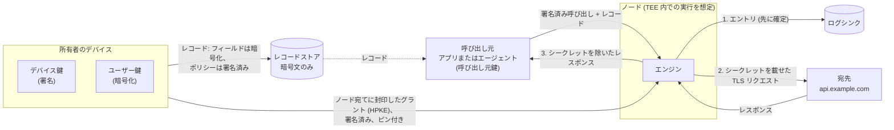
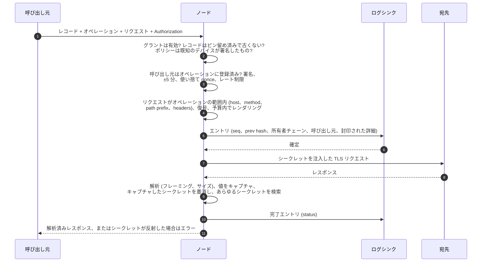
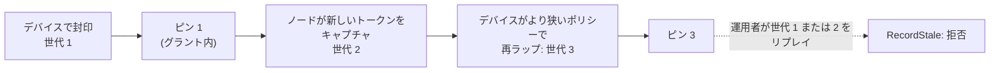
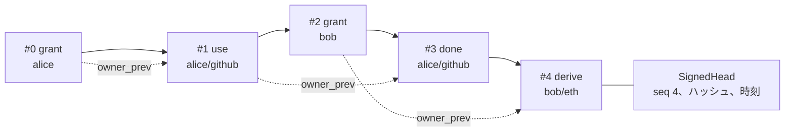

# credentials

[](https://github.com/BloubHQ/credentials/actions/workflows/ci.yml)
[](LICENSE)

[English](README.md) | [한국어](README.ko.md) | [简体中文](README.zh-CN.md) | **日本語**

アプリケーションや AI エージェントが、認証情報 (credential) を一度も**見る**ことなく**使える**
ようにするボールトエンジンです。シークレットをどこへ、どの形で送ってよいかは、所有者のデバイスが
署名付きポリシーで厳密に決めます。ノードは所有者が許可している間だけシークレットを保持し、
毎回の使用の**前に**改ざん検知可能なログエントリを書き込み、シークレットが含まれていないか
検査したレスポンスを呼び出し元に返します。

```text
caller:  "GET https://api.github.com/user"            (no token)
node:    log entry confirmed  ->  adds "Authorization: Bearer ghp_..."  ->  TLS  ->  GitHub
caller:  200 OK {"login": "octo"}                     (token removed or response dropped)
```

エンジンは認証情報の種類を一切知りません。API キー、OAuth リフレッシュ、AWS SigV4、HTTP Digest、
JWT 署名、TOTP、IMAP ログイン、mutual TLS (相互 TLS)、Ethereum 署名は、すべてコードではなく
ポリシーのデータです。

> **ステータス: 0.x、監査未実施。** エンジンはテスト済みで内部レビューも受けていますが、外部の
> セキュリティ監査は受けておらず、フォーマットは変更される可能性があります。本番のシークレットを
> 任せる前に [脅威モデル](docs/threat-model.md) を読んでください。

## 目次

- [仕組み](#仕組み)
- [クイックスタート](#クイックスタート)
- [ポリシー](#ポリシー)
- [レコード、世代、ロールバック](#レコード世代ロールバック)
- [ログ](#ログ)
- [ノードの運用](#ノードの運用)
- [保証すること](#保証すること)
- [計測結果](#計測結果)
- [しないこと](#しないこと)
- [クレート](#クレート) · [開発](#開発) · [セキュリティ](#セキュリティ) · [ライセンス](#ライセンス)

## 仕組み



登場するのは 4 つの当事者と 4 種類の鍵です。

| 当事者 | 鍵 | 役割 |
| --- | --- | --- |
| 所有者のデバイス | `DeviceKey` (Ed25519) | ポリシー、グラント、ピン、失効、他のデバイスに署名する |
| 所有者 | `UserKey` (256-bit) | レコードを暗号化する (HKDF でレコードごとに鍵を導出)。ノードはグラントの間だけこれを保持する |
| 呼び出し元 | `CallerKey` (Ed25519) | 各呼び出しに署名する。どの呼び出し元がどのオペレーションを実行できるかはポリシーに列挙される |
| ノード | `NodeKey` (Ed25519) | ログに署名する。ここから導出した X25519 鍵で封印されたグラントを開く |

1 回の呼び出しを順に示します。ログエントリより前のチェックは痕跡を残しません。確定したエントリ
なしにノードから出ていくものはありません。



## クイックスタート

```sh
git clone https://github.com/BloubHQ/credentials && cd credentials
cargo test --workspace
GITHUB_TOKEN=ghp_... cargo run -p transport --example github_user
```

[`github_user`](crates/transport/examples/github_user.rs) の例は、すべての部品を 1 つのプロセスで
動かします。デバイスがトークンをレコードに封印し、`GET https://api.github.com/user` だけを許可する
ポリシーに署名して、ノードにグラントを与えます。アプリケーションが呼び出しに署名し、ノードはログを
記録してトークンを注入し、TLS でリクエストを送ってレスポンスを返します。コードでは次のとおりです。

```rust
// 所有者のデバイス上で。
let record = Record::seal(&user_key, "github", "me", device.sign_policy(policy)?, &values)?;
let grant = device.grant(&user_key, &node.identity(), GrantTerms {
    owner: "me".into(),
    expires_ms: now + 600_000,
    issued_ms: now,
    pins: vec![RecordPin { record_id: "github".into(), generation: record.generation }],
})?;

// ノード上で。
node.grant(&grant)?;

// アプリケーション内: レコード (暗号文) と呼び出し元鍵を保持するが、トークンは決して持たない。
let auth = app.authorize("example", &node.public_key(), &record, "github",
                         &Payload::Http(Some(&request)), now)?;
let response = node.http(&record, "github", &auth, Some(&request), &mut transport).result?;
```

## ポリシー

ポリシーは、レコードの **fields** (フィールド)、それを使える **callers** (呼び出し元)、彼らが実行
できる **operations** (オペレーション) を定めます。ポリシーはデバイスが署名し、その署名とレコードの
暗号化の両方に結び付けられるため、所有者抜きで値の行き先を変えることは誰にもできません。完全な
リファレンスは [docs/policy.md](docs/policy.md) にあります。

```json
{
  "fields": [
    {"name": "client_id", "secret": false},
    {"name": "client_secret", "secret": true},
    {"name": "refresh_token", "secret": true},
    {"name": "access_token", "secret": true, "optional": true}
  ],
  "callers": [
    {"name": "billing-agent", "key": "<caller public key>",
     "operations": ["refresh", "call"], "limit": {"count": 100, "window_ms": 60000}}
  ],
  "operations": [
    {"kind": "http", "name": "refresh",
     "destinations": [{"host": "auth.example.com", "port": 443}],
     "steps": [{
       "request": {"from": "fixed", "method": "POST", "path": "/oauth/token"},
       "inject": [{"target": {"kind": "body"},
                   "template": "grant_type=refresh_token&refresh_token={{pct(refresh_token)}}&client_id={{pct(client_id)}}&client_secret={{pct(client_secret)}}"}],
       "capture": [{"source": {"from": "json", "pointer": "/access_token"},
                    "into": {"kind": "field", "name": "access_token"}}]
     }]},
    {"kind": "http", "name": "call",
     "destinations": [{"host": "*.api.example.com", "port": 443}],
     "methods": ["GET", "POST"], "paths": ["/v1/"], "caller_headers": ["Accept"],
     "steps": [{"inject": [{"target": {"kind": "header", "name": "Authorization"},
                            "template": "Bearer {{access_token}}"}]}]}
  ]
}
```

| オペレーション | 役割 |
| --- | --- |
| `http` | 1〜8 ステップ。各ステップは呼び出し元のリクエストまたはポリシーが固定したリクエストを送り、値を注入し、レスポンスから値をキャプチャしてフィールド (新しいレコード世代) または後続ステップ用の一時値に入れる。返されるのは最後のレスポンスだけ。 |
| `stream` | 1 本の TLS 接続上での send/expect スクリプト (IMAP、SMTP、行指向プロトコル)。その後、認証済みの接続上で呼び出し元のやり取りを行う。 |
| `derive` | テンプレートの出力が呼び出し元に返される: 署名、HMAC、TOTP コード、JWT。 |

値は**テンプレート**を通して入ります: `{{ hex(hmac_sha256(secret, $query)) }}`。この言語には名前、
変数、文字列リテラル、関数呼び出し、`+` があり、分岐やループはありません。ポリシーが署名される前に、
すべてのテンプレートが解析されます。

- **テイント (taint)。** シークレットを可逆な形で保持する値は *tainted* (汚染されている) です。
  エンコードはテイントを保ちます。ハッシュ、MAC、署名、`len` はテイントを除去し、暗号化は秘密鍵の
  もとでのみテイントを除去します。出力が tainted な導出は拒否されます。
- **オラクル (oracle)。** シークレットと、呼び出し元またはサーバーが選ぶ値とは、結果からシークレットが
  少しずつ明らかになる場所で出会ってはなりません: `replace`、`xor`、`json_set` のキー、デコーダー、
  数値引数や鍵引数などです。`len(replace(key, $input, ""))` は拒否されます。
- **推測可能なフィールド。** `guessable` と指定されたフィールド (PIN、パスワード) は、推測を照合できる
  導出出力 (それらのハッシュや署名) に到達してはなりません。ただし、強い秘密鍵による鍵付き MAC や
  暗号化がそれらを隠す場合は除きます。
- **予算 (budget)。** 1 つのオペレーションでレンダリングできるのは最大 128 MiB、PBKDF2 1,000,000
  ラウンド、32 署名までです。

| 認証情報 | ポリシー |
| --- | --- |
| Bearer トークン、Cookie、API キー | ヘッダーテンプレート 1 つ |
| Telegram ボット | `/bot{token}/getMe` 内の `path_param` `{{token}}` |
| 取引所の HMAC 署名 | クエリ `signature` = `{{ hex(hmac_sha256(secret, $query)) }}` |
| AWS SigV4 | ヘッダーテンプレート 2 つ (`time`、`canonical_query`、ネストした `hmac_sha256`)。テストが公式ベクターを再現する |
| HTTP Digest | ステップ 1 で `header_param` により `realm`/`nonce` をキャプチャし、ステップ 2 で `md5` により応答する。RFC 2617 のベクター |
| OAuth リフレッシュ | `fixed` POST、`json` キャプチャでフィールドへ: ノードは新しいレコードを返す |
| セッションログイン | `fixed` POST /login、`cookie` キャプチャで一時値へ、呼び出し元のリクエストに `Cookie` |
| JWT RS256 | derive `b64urlraw(header) + "." + b64urlraw($input) + "." + b64urlraw(rsa_sign_pkcs1_sha256(pem(key), …))` |
| Ethereum | derive `{{ k256_sign_recoverable(key, keccak256($input)) }}` |
| IMAP | stream: グリーティングを expect、`a1 LOGIN {{user}} {{password}}` を send、expect、中継 |
| TOTP | derive `{{ totp(b32decode(seed)) }}` |
| Mutual TLS | `"identity": {"cert": "{{cert}}", "key": "{{key}}"}` |

## レコード、世代、ロールバック

レコードとは、ユーザー鍵とレコード ID から導出した鍵のもとで ChaCha20-Poly1305 により暗号化された
フィールド群であり、ID、所有者、**世代 (generation)**、署名済みポリシーが関連データ (associated data)
に含まれます。再封印のたびに世代が 1 つ増えます。



ノードは、所有者がピン留めしていない (グラント内、または `DeviceKey::pin` で) レコードを拒否し、
自分が見た最新の世代や所有者がピン留めした世代より古い世代をすべて拒否します。グラントがピンを
運ぶため、新しいレコードを一度も見ていない新規ノードでも古いレコードを拒否します。

## ログ

各エントリはノードが署名し、二重にチェーンされます。直前のエントリへのチェーンと、同じ所有者の
前回のエントリへのチェーンです。所有者は他者のエントリなしで自分のエントリを検証でき、署名付き
チェックポイント (`SignedHead`) が先頭を固定するので、末尾が切り取られれば判明します。



エントリには、誰がどのレコードを、いつ、どの呼び出し元で、どのオペレーションに使ったかが記録されます。
値が**どこへ**行き、何が送られたか (ホスト、パス、ボディのハッシュ) は所有者のユーザー鍵宛てに封印
されます。ログストアはそれを読めませんが、所有者は読めます (`log::open_detail`、または
`verify --owner alice --user-key key.txt`)。ノードは確定したエントリなしには決して動作しません。
トランスポート関数は `Confirmed` を受け取り、これはシンクが `Ok` を返した後に `Log::commit` だけが
生成できます。シンクが失敗すると、ログは整合が取れるまで停止します。

```sh
verify log.jsonl <node-public-key>                          # the whole chain
verify log.jsonl <node-public-key> --head head.json         # must end at a signed checkpoint
verify log.jsonl <node-public-key> --owner alice            # one owner's chain
verify log.jsonl <node-public-key> --owner alice --user-key key.txt   # with the details
```

## ノードの運用

- **トランスポート。** `transport::TlsTransport` (ring プロバイダーを使う rustls、Mozilla のルート証明書、
  クライアント証明書、接続/読み取り/全体のデッドライン、サイズ制限)。接続を所有者が署名したホストに
  結び付けるのは宛先の証明書であり、DNS は信頼しません。
- **ゼロ化アロケーター。** ノードを動かすバイナリにこれをインストールしてください。エンジンが手の届か
  ない依存クレートのバッファ (TLS レコード、解析済みの RSA 鍵) が、解放時に消去されます。

  ```rust
  #[global_allocator]
  static ALLOCATOR: zeroizing_alloc::ZeroAlloc<std::alloc::System> =
      zeroizing_alloc::ZeroAlloc(std::alloc::System);
  ```

  計測結果: 署名 1 回あたり解放済みメモリに残る RSA 鍵のコピーは 1 から 0 になり、時間は 3–12%
  増えます (下の表を参照)。
- **アテステーション。** ノードは TEE (SGX、TDX、SEV-SNP、Nitro) で実行してください。
  `NodeIdentity::report_data()` (ログ鍵と封印鍵に対する SHA-512) を quote の report data に入れます。
  所有者はグラントを封印する前に、quote とその値を検証します。quote の検証はプラットフォーム固有で
  あり、このリポジトリには含まれません。
- **鍵と再起動。** `NodeKey::to_bytes()` はエンクレーブに封印して保管してください。再起動後、
  `Node::restore(key, sink, clock, entries)` がチェーンを継続し、レコードの下限世代、既知のデバイス、
  最後のグラント時刻を復元します。所有者はグラントを再度与えます。
- **並行性。** すべてのメソッドは `&self` を取るので、1 つのノードをスレッド間で共有できます。
  トランスポートの I/O はノードのロックの外で実行されます。

## 保証すること

- シークレットがエンジンから出るのは、確定したログエントリの後に、`Transport` を通じて、所有者が
  署名した宛先への 1 つのリクエストのバイト列としてのみです。
- `Secret` の値は表示・クローン・シリアライズできず、drop 時に消去されます。クレート外のコードは
  それを読めません (`compile_fail` の doc テスト)。
- オペレーションを実行できるのは、ポリシーに列挙された呼び出し元が、この呼び出しそのものに対する
  新しい使い捨て署名を持ち、レート制限の範囲内にある場合だけです。
- グラントは、封印された宛先のノード上でのみ、かつノードがその所有者について知っているデバイスから
  のみ開かれ (初回使用は信頼される)、リプレイできません。失効には既知のデバイスが必要です。
- レコードは、ピンやノードが見た世代を超えてロールバックできません。
- テンプレートは署名前に解析されます。導出は、シークレット、シークレットに対するオラクル、推測可能な
  フィールドの推測を照合する手段のいずれも返せません。
- レスポンスは厳格に解析され (フレーミング、エンコーディング、サイズ)、キャプチャされたシークレットは
  墨消しされます。既知の形でシークレットを含んだままのレスポンスは破棄されます。
- ログは追記専用で、署名され、ノード単位と所有者単位でチェーンされ、オフラインで検証できます。
- エンジンには `unsafe` も `unwrap`/`expect`/`panic`/インデックスアクセスもありません (lint で強制)。

## 計測結果

1 台のマシン上のリリースビルドです。攻撃ケースは内部レビューのプローブで、以前のコード (`79a21c1`)
と現在のコードに対して実行しました。メモリは計測用アロケーターで測ったピーク値です。

| ケース | 以前 | 現在 |
| --- | --- | --- |
| 64 KiB のキャプチャ済みトークン + 8 MiB のレスポンス (墨消しと検索) | 63.88 s | 0.08–0.10 s |
| 16 KiB のトークン + 4 MiB のレスポンス | 6.34 s | 0.07 s |
| 1 MiB 入力に対するテンプレート連結 ×401 | 受理、803 MiB | `Budget` エラー、129 MiB |
| PBKDF2 1,000,000 ラウンド ×127 | 12.70 s | 0.09 s 後に `Budget` エラー |
| 64 MiB のレスポンス | 1.81 s 後に通過 | 0.02 s 後に拒否 |
| ポインターキャプチャ付きの 16 MiB JSON 配列 | 400 MiB | 64 MiB |
| 16 MiB のヘッダー | 192 MiB | 0 MiB (64 KiB で拒否) |
| 16 個の一時値にキャプチャされた 16 MiB のボディ | 768 MiB | 32 MiB (64 KiB で拒否) |
| シークレットを保持したままの解放済みブロック (json キャプチャ、`b64decode`、`json`、`replace`、`json_set`) | 1, 8, 1, 1, 1 | 0, 0, 0, 0, 0 |
| RSA 秘密鍵を保持したままの解放済みブロック (署名 1 回あたり) | 1 | 1 (ゼロ化アロケーター使用時は 0) |
| P-384 秘密鍵を保持したままの解放済みブロック | 0 | 0 |

| スループット (計測用アロケーター使用) | システムアロケーター | ゼロ化アロケーター |
| --- | --- | --- |
| HMAC 導出 2,000 回 | 0.29–0.30 s | 0.31 s |
| RSA-2048 署名 200 回 | 0.129–0.130 s | 0.130–0.136 s |
| 64 KiB レスポンスの HTTP 呼び出し 1,000 回 | 0.329 s | 0.338–0.369 s |

ring の代替として RustCrypto `rsa` 0.10 も計測しました。署名 1 回あたり素数 `p` を保持した解放済み
ブロックが 11 個残った (鍵の解析と検査の間の一時値) ため、ring を使い続けます。

## しないこと

これらは設計上の限界であり、未実装のコードではありません。それぞれの説明は
[脅威モデル](docs/threat-model.md) にあります。

- **このリポジトリに TEE は含まれません。** ここでのノードは普通のプロセスであり、アテステーションは
  プラットフォームとの統合です ([ノードの運用](#ノードの運用) を参照)。TEE がなければ、ノードを
  動かしている者はそのメモリを読めます。
- **反射 (reflection) の検索は既知のエンコーディングしか見つけません**: 生データ、base64 (両方の
  アルファベット)、パーセントエンコーディング、JSON と hex、エスケープされた JSON 文字列です。
  エコーするシークレットを分割したり、独自に圧縮したり、暗号化したりするサーバーは検出できません。
  4〜7 バイトのシークレットフィールドは生データでのみ検索され、そのバイト列が偶然現れるとレスポンスは
  破棄されます。
- **レスポンスはバッファリングされます** (最大 16 MiB)。検索にはレスポンス全体が必要なためです。
- **サーバーがキャプチャ用に送ってくる値はサーバーのものです。** サーバーが鍵を返し、ポリシーがそれを
  鍵として使う場合、サーバーはその鍵を知っています。
- **低エントロピーのシークレット**で `guessable` と指定されていないものは、強い鍵として扱われます。
- **初回使用は信頼されます**: ノード上での所有者に対する最初のグラントが、その所有者のデバイスを
  決めます。すべてのデバイスを失った所有者は、新しい所有者名から始めることになります。
- **ストリームセッション**は呼び出しとともに終了します。SSH、データベースのワイヤプロトコル、gRPC、
  WebSocket のフレーミングは、send/expect スクリプトで扱える範囲でしか動作しません。
- **ブラウザーログイン、プッシュ型 2FA、ハードウェアキー**は人やデバイスを必要とし、委任できません。

## クレート

| クレート | |
| --- | --- |
| [`engine`](crates/engine) | シークレット、ポリシー、テンプレート、レコード、グラント、呼び出し元、ログ、レスポンス、ノード |
| [`transport`](crates/transport) | TLS トランスポート (rustls) とエンドツーエンドの例 |
| [`verify`](crates/verify) | ノードログのコマンドライン検証ツール |

## 開発

```sh
cargo fmt --all --check
cargo clippy --workspace --all-targets --locked -- -D warnings
cargo test --workspace --locked
```

最小 Rust バージョン: 1.87。CI では `cargo audit`、`cargo deny`、MSRV ビルド、再現可能ビルドの
チェックも実行します。[CONTRIBUTING.md](CONTRIBUTING.md) を参照してください。

## セキュリティ

脆弱性は [SECURITY.md](SECURITY.md) に記載の方法で、非公開で報告してください。

## ライセンス

[Apache License 2.0](LICENSE)。
