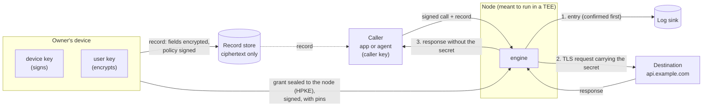
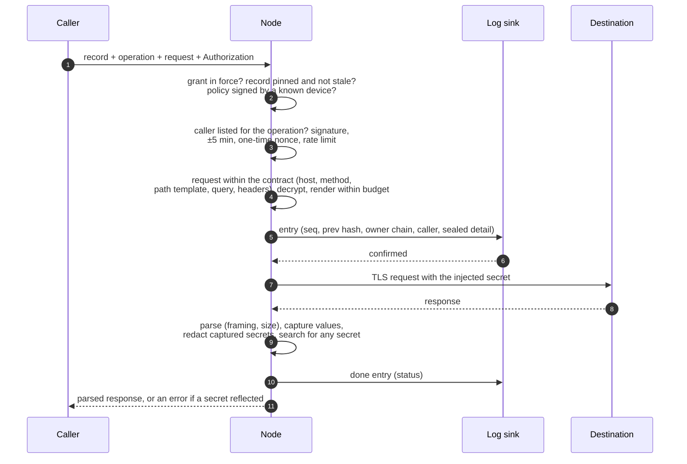
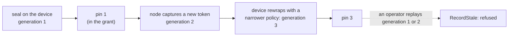
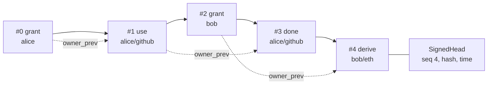
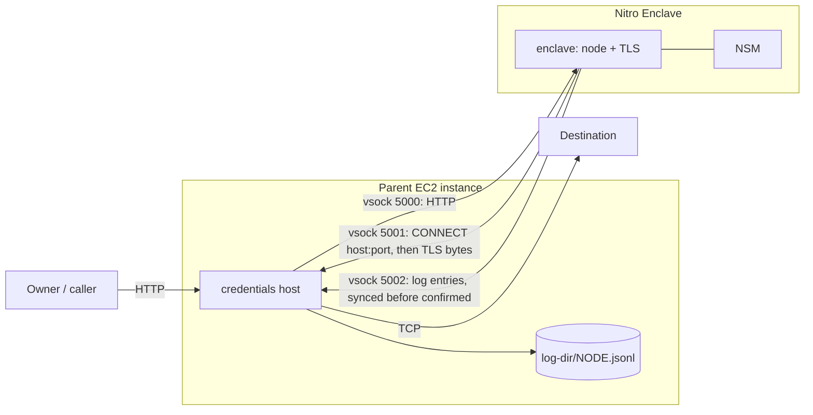

# credentials

[](https://github.com/BloubHQ/credentials/actions/workflows/ci.yml)
[](LICENSE)

**English** | [한국어](docs/i18n/README.ko.md) | [简体中文](docs/i18n/README.zh-CN.md) | [日本語](docs/i18n/README.ja.md)

A vault engine that lets applications and AI agents **use** a credential without ever
**seeing** it. The owner's device decides, in a signed policy, exactly where a secret may go
and in what form. A node holds the secret only while the owner allows it, writes a
tamper-evident log entry **before** every use, and hands the caller back a response that has
been checked for the secret.

```text
caller:  "GET https://api.github.com/user"            (no token)
node:    log entry confirmed  ->  adds "Authorization: Bearer ghp_..."  ->  TLS  ->  GitHub
caller:  200 OK {"login": "octo"}                     (token removed or response dropped)
```

The engine knows no kind of credential. API keys, OAuth refresh, AWS SigV4, HTTP Digest, JWT
signing, TOTP, IMAP logins, mutual TLS and Ethereum signatures are all policy data, not code.

> **Status: 0.x, not audited.** The engine is tested and has been reviewed internally, but it has not had
> an external security audit and its formats may change. Read the
> [threat model](docs/threat-model.md) before you trust it with production secrets.

## Contents

- [How it works](#how-it-works)
- [Quick start](#quick-start)
- [Policies](#policies)
- [Records, generations and rollback](#records-generations-and-rollback)
- [The log](#the-log)
- [Running a node](#running-a-node)
- [Running in a Nitro Enclave](#running-in-a-nitro-enclave)
- [What it guarantees](#what-it-guarantees)
- [Measurements](#measurements)
- [What it does not do](#what-it-does-not-do)
- [Crates](#crates) · [Development](#development) · [Security](#security) · [License](#license)

## How it works



There are four parties and four kinds of key:

| Party | Key | What it does |
| --- | --- | --- |
| Owner's device | `DeviceKey` (Ed25519) | Signs policies, grants, pins, revocations and other devices |
| Owner | `UserKey` (256-bit) | Encrypts records (a key per record via HKDF); a node holds it only during a grant |
| Caller | `CallerKey` (Ed25519) | Signs each call; the policy lists which caller may run which operation |
| Node | `NodeKey` (Ed25519) | Signs the log; an X25519 key derived from it opens sealed grants |

One call, in order. Every check before the log entry leaves no trace; nothing leaves the node
without a confirmed entry:



## Quick start

```sh
git clone https://github.com/BloubHQ/credentials && cd credentials
cargo test --workspace
GITHUB_TOKEN=ghp_... cargo run -p transport --example github_user
```

The [`github_user`](crates/transport/examples/github_user.rs) example runs every part in one
process: the device seals a token into a record, signs a policy that allows only
`GET https://api.github.com/user`, and grants a node; an application signs a call; the node
logs, injects the token, sends the request over TLS and returns the response. In code:

```rust
// On the owner's device.
let policy = device.sign_policy(policy)?;
let record = Record::seal(&user_key, "github", "me", policy, &values)?;
let terms = GrantTerms::new("me", Duration::from_secs(600)).pin(&record);
let grant = device.grant(&user_key, &node.identity(), terms)?;

// On the node.
node.grant(&grant)?;

// In the application: it holds the record (ciphertext) and its caller key, never the token.
let body = Body::http(request);
let call = app.sign_call("example", &node.public_key(), record, "github", body)?;

// On the node: log, inject the token, send over TLS, check the response for the token.
let outcome = node.run(&call, &mut TlsTransport::new());
```

## Policies

A policy names the **fields** of a record, the **callers** who may use it, and the
**operations** they may run. The device signs it; the signature and the encryption of the
record both bind it, so nobody can change where a value goes without the owner. The full
reference is in [docs/policy.md](docs/policy.md).

```json
{
  "fields": [
    {"name": "client_id", "secret": false},
    {"name": "client_secret", "secret": true},
    {"name": "refresh_token", "secret": true},
    {"name": "access_token", "secret": true, "optional": true}
  ],
  "callers": [
    {"name": "billing-agent", "key": "<caller public key>",
     "operations": ["refresh", "call"], "limit": {"count": 100, "window_ms": 60000}}
  ],
  "operations": [
    {"name": "refresh", "steps": [
      {"do": "open", "connection": "https",
       "destinations": [{"host": "auth.example.com", "port": 443}]},
      {"do": "send", "request": {"from": "fixed", "method": "POST", "path": "/oauth/token"},
       "inject": [{"target": {"kind": "body"},
                   "template": "grant_type=refresh_token&refresh_token={{pct(refresh_token)}}&client_id={{pct(client_id)}}&client_secret={{pct(client_secret)}}"}]},
      {"do": "receive", "capture": [{"source": {"from": "json", "pointer": "/access_token"},
                                     "into": {"kind": "field", "name": "access_token"}}]},
      {"do": "return", "response": {"body": {"json": ["/expires_in"]}}}
    ]},
    {"name": "call", "steps": [
      {"do": "open", "connection": "https",
       "destinations": [{"host": "*.api.example.com", "port": 443}]},
      {"do": "send",
       "request": {"from": "caller", "methods": ["GET", "POST"],
                   "paths": ["/v1/invoices", "/v1/invoices/*"], "headers": ["Accept"],
                   "query": [{"name": "status", "one_of": ["open", "paid"]},
                             {"name": "limit", "min": "1", "max": "100"}]},
       "inject": [{"target": {"kind": "header", "name": "Authorization"},
                   "template": "Bearer {{access_token}}"}]},
      {"do": "return", "response": {"headers": ["Content-Type"], "body": "all"}}
    ]}
  ]
}
```

An operation is a list of **steps** over one connection: `open` (HTTPS, a TLS stream, a WebSocket, a
protocol connection, UDP datagrams, a browser over CDP, or none), `send`, `receive` (with captures), `compute` (a template into a name later steps
read), `run` (the site's own code in a sandbox, below), and `return`, which says what goes
back to the caller.

| Connection | What it does |
| --- | --- |
| `https` | 1 to 8 requests. Each `send` carries the caller's request within a **contract** (methods, path templates, headers, query parameters and their values) or a request the policy fixes, with injected values; a `receive` captures from its response into a field (a new record generation) or a temporary value. `return` lets back the status and only the headers and JSON members it lists (`"body": "all"` for everything). HTTP/2 by ALPN (or pinned with `protocol`, never downgraded), unary gRPC, and bodies handed on as they arrive (`"body": "stream"`: server-sent events, chunked), searched for secrets across chunks. |
| `websocket` | A handshake request, messages the policy writes (first-message authentication), then the caller's signed frames, each checked against a closed JSON schema or pattern; the server's messages go back only if `return` says so, searched for secrets. Limits on idle time, duration and bytes; one log entry when it opens and one when it closes. |
| `tls` | A send/receive script on one TLS connection (line protocols); then the caller's exchanges whose sends match the patterns `return` relays. |
| `ssh`, `postgres`, `smtp`, `imap`, `redis` | The node signs in with the item's secret (SSH password, key or keyboard-interactive against pinned host keys; PostgreSQL SCRAM-SHA-256 over TLS; SMTP and IMAP over implicit TLS or STARTTLS with the mechanism the policy names; Redis `AUTH` over TLS), runs the commands the policy fixes, then the caller's named commands whose parameters match their patterns (bound, quoted or one argument each, never spliced), or the caller's mail within sender and recipient rules. Results are searched for secrets; an SSH shell runs on `/stream`. Only modern algorithms, no downgrade. |
| `pop3`, `ftp` | POP3 over implicit TLS or `STLS` with the mechanism the policy names (`USER`/`PASS`, `APOP` flagged weak, SASL `PLAIN`, `LOGIN`, `XOAUTH2`), message numbers only; FTP over TLS only (implicit or `AUTH TLS`, `PROT P`), typed `list`, `retrieve`, `store`, `delete`, `mkdir`, `rename`, passive data connections to the control connection's own address over resumed TLS. No credential ever goes over plain FTP or POP3. Paths and numbers cannot carry a command; replies come back with the user name and password scrubbed. SFTP also lists, stats, renames, deletes and makes or removes directories, through no link. |
| `amqp1` | AMQP 1.0 over TLS (or the AMQP TLS header) with the SASL mechanism the policy names (`PLAIN`, `EXTERNAL` with a client certificate, `SCRAM-SHA-256` that the broker must prove, `XOAUTH2`); `send` to and `receive` up to a count of messages from addresses the policy fixes, settled `settled`, `first` or `second` as the policy says and never as the broker changes it. Frames, nesting and messages are bounded; error texts come back scrubbed. SSH also forwards remotely (`tcpip-forward`): the server listens on the policy's address and port, and the one connection it forwards there is the caller's stream. |
| `udp` | One datagram per `send` and per `receive` to the destination the policy fixes (RADIUS, DNS with TSIG, STUN), resent while unanswered; then the caller's datagrams that match the patterns `return` relays. No TLS, so a datagram may carry a secret only through a one-way function (an HMAC, a signature): anything else is refused at signing. |
| `browser` | A fill of a login or card form in a browser the agent drives elsewhere: the node connects to the CDP endpoint the policy fixes (over TLS; the caller never relays CDP), finds the one tab at the policy's `https` origin, checks the origin of the top frame and of the field's frame (a cross-origin frame only when the policy names it) before and after each value, types the values itself with fixed functions in an isolated world (never `Runtime.evaluate`), submits, and blanks the fields if the page stays. With `browser.exclusive` the endpoint must answer that it handed the browser to the node alone (the agent's controller cut off), or nothing is sent; before the controller is back, the page is blanked (or loaded again, `leave: reload`) and its history cleared. Typed `login` and `card` items fill from their kind's roles (user name, password, one-time code; number, expiry, code, holder): a login only at its pinned origin, a card only after the owner approves. The caller gets the outcome and the final origin, nothing of the page, and cannot send CDP commands. |
| none | `return` renders a template for the caller: signatures, HMACs, TOTP codes, JWTs. The caller's `$input` is checked first against the operation's `input` schema (raw bytes, JSON or RLP: fixed members, allowed values, numeric bounds, times the node sets). |

Policies of the format before steps (`"kind": "http" | "stream" | "derive"`) convert with
`credentials policy upgrade`; the result narrows what the caller gets, notes it, and must be
signed again.

Values go in through **templates**: `{{ hex(hmac_sha256(secret, $query)) }}`. The language
has names, variables, string literals, function calls and `+`; no branches or loops (steps
have bounded `repeat` and `if`, testing only values no secret influences). Before a
policy is signed, every template is analysed:

- **Taint.** A value that holds a secret in reversible form is *tainted*. Encodings keep taint;
  hashes, MACs, signatures and `len` remove it, except a hash of the secret alone, which is as good as the key where the key is hashed before use (a long HMAC key, an Ed25519 seed). A key derived from a secret (HKDF, Concat KDF, SP 800-108, Kerberos DK) is a secret too, and no output length may depend on one. Encryption under a secret field hides only the
  key: a secret in its message, nonce or data stays tainted, because another operation could
  encrypt chosen bytes under the same key. A derivation whose output is tainted is refused.
- **Oracles.** A secret and a value the caller or server chooses may not meet where the result
  reveals the secret piece by piece: in `replace`, `xor`, `slice`, `between`, `add`, the key
  of `json_set`, a decoder, a number or a key argument. `len(replace(key, $input, ""))` and
  `slice(key, $input, "1")` are refused. Hash and curve names are fixed by the policy, and an
  RSA encryption key never comes from the caller.
- **Guessable fields.** A derivation may depend on a field marked `guessable` (PIN, password)
  only through `len`: a hash, signature, MAC or encryption of it would let the caller check
  guesses.
- **Steps.** A `compute` step gives its name exactly the properties of its template, so a
  value passed between steps is analysed as if it were written inline.
- **Compression and XML.** A secret is never compressed (`deflate`, `zlib_deflate`,
  `gzip_deflate`): a compressed length tells how the input repeats itself (CRIME). One
  inflation writes at most 1 MiB and the budget left; XML is read with no DTD, so no
  external entity and no entity expansion.
- **SRP and OpenPGP.** The SRP private value is the node's (`random` or a field, never chosen
  or captured), `B` and the server's proof never come from the caller, and the premaster
  secret is a secret like an `ecdh` result, computed in constant time. `pgp_mpi` never takes
  a secret: its length would tell the leading zeros.
- **Budgets.** One operation may render at most 128 MiB, 1,000,000 PBKDF2 rounds and 32
  signatures and key agreements.

| Credential | Policy |
| --- | --- |
| Bearer token, cookie, API key | one header template |
| Telegram bot | `path_param` `token` = `bot{{token}}` in the path template `/{token}/getMe` |
| Exchange HMAC signature | query `signature` = `{{ hex(hmac_sha256(secret, $query)) }}` |
| AWS SigV4 | two header templates (`time`, `canonical_query`, nested `hmac_sha256`); a test reproduces the official vector |
| HTTP Message Signatures, Hawk | `$method`, `$target_uri`, `$authority`, `$query_param("page")` and the caller's own headers (`$header("content-type")`, only those its contract lists), and what the policy injects itself (each template reads the request as it is sent: filled path, injected query, headers and body) under `ed25519_sign` or `hmac_sha256`; RFC 9421 B.2.5 and B.2.6 and the Hawk examples reproduced |
| JWE of the caller's JSON with a card number from the record | `aead_ciphertext(...)` and `aead_tag(...)` of one `aes_gcm_encrypt(cek, iv, json_set($body, "card", card_number), head)`, the key under `rsa_encrypt_oaep`; RFC 7516 A.3 reproduced |
| HTTP Digest | step 1 captures `realm`/`nonce` with `header_param`; step 2 answers with `md5`; RFC 2617 vector |
| OAuth refresh | `fixed` POST, `json` capture into a field: the node returns a new record |
| Session login | `fixed` POST /login, `cookie` capture into a temp, `Cookie` on the caller's request |
| Login form with a CSRF token | `html` capture `input[name=_csrf]` (`value`) into a temp, then `fixed` POST /login |
| Password encrypted in the browser | `ecdh("p256", server_key)` + `sha256` + `aes_cbc_encrypt` with `u8(len(…))` prefixes and `ecdh_public("p256")`; or `rsa_encrypt_oaep("sha256", key, password)` with the key captured from the server |
| JWT RS256 | no connection: `b64urlraw(header) + "." + b64urlraw($input) + "." + b64urlraw(rsa_sign_pkcs1_sha256(pem(key), …))` |
| JWT with a lifetime the policy bounds | a `json` input schema that fixes `iss`/`aud` and has the node `set` `iat`/`exp`; or `json_set_number(..., "exp", add($unix, "300"))` in the template |
| SRP-6a login | `srp_public` of a `random("32")`, then `srp_x`, `srp_premaster`, `sha256` and `srp_m1` after the salt and `B` come back, and `srp_verify` of the server's `M2` before anything is returned |
| OpenPGP detached signature | no connection: `pgp_armor("SIGNATURE", pgp_packet("2", ...))` around `rsa_sign_pkcs1("sha256", ...)` (an MPI) or `ed25519_sign` of the digest, with `pgp_subpacket` and the trailer written with `be16`, `be32` and `len`; v4 verified by GnuPG |
| SAML service provider, WS-Security | HTTP-Redirect: `b64(deflate(authn))` and `rsa_sign_pkcs1_sha256` or `p256_sign` over the query; HTTP-POST: an enveloped signature over `xml_c14n("http://www.w3.org/2001/10/xml-exc-c14n#", ...)`; each verified with `rsa` and ring |
| OAuth 1.0a (RFC 5849) | `sorted_params($query, $body, ...)` and `hmac_sha1` or `rsa_sign_pkcs1("sha1", ...)` over the base string; RFC 5849 vectors, verified with `hmac` and `rsa` |
| AWS Signature Version 4A | `kbkdf_ec_key("p256", "sha256", ...)` (SP 800-108 counter mode, FIPS 186-5 rejection sampling) and `p256_sign_der`; verified with ring under a key derived in the test |
| NTLMv2 over HTTP (MS-NLMP) | `md4` (flagged weak), `hmac_md5`, `utf16le`, `uint_le` on one `tls` connection, with the MIC, then a relay; MS-NLMP 4.2.4 vectors |
| Ethereum | no connection: `{{ k256_sign_recoverable(key, keccak256($input)) }}` with an `rlp` input schema that fixes the recipient, chain and data and bounds the value |
| IMAP | tls: receive the greeting, send `a1 LOGIN {{user}} {{password}}`, receive, relay the commands the policy lists |
| TOTP | no connection: `{{ totp(b32decode(seed)) }}` |
| Mutual TLS | `open` with `"identity": {"cert": "{{cert}}", "key": "{{key}}"}` |

**Typed items.** A policy may bind its record to a kind: `card`, `login`, `oauth`,
`identity`, `totp`, `ssh`, `database`, `ftp`, `mail`, `queue`, `vpn`, `api`, or a custom kind
the owner's device signs. A kind says which fields are secret, masked or public, checks the
values (Luhn, expiry by the node's clock, code length per card brand, exact origins, SSH host
keys, TLS unless signed off) and bounds what its policies may do; the node refuses a typed
policy wider than its kind, even a signed one. A caller may `describe` a typed record and gets
the public fields and masks such as `visa ••••4242`, never a secret field.

**Site code.** When a login encrypts or packages the password in the site's own
WebAssembly and the steps cannot be written as templates, a `run` step fetches the module
from the destination's own origin (its URL and, ideally, its SHA-256 are in the signed
policy) or takes a reviewed library compiled into the node, and runs it in a sandbox
(wasmi, an interpreter: no I/O, no clock, no randomness, fuel and memory limits). Its output
may go only into a request the policy fixes to that same origin: never back to the caller,
to another destination or into the log; the signing check refuses every other use. An
unpinned module is flagged. A site's JavaScript runs the same way on a reviewed engine
module (boa compiled to WebAssembly): the step names the script's URL on the destination's
origin and its SHA-256, which is required; the script finds no clock, randomness or I/O, and
the policy may lower its fuel, memory and time. Measurements, and the comparison with
QuickJS that chose the engine, are in [docs/sandbox.md](docs/sandbox.md).

**Before signing.** `summarize` lists, per secret, where it can go and in what form, what
comes back, and risk flags (a destination outside the item's origin, wildcards, plain HTTP,
any-bytes inputs, reversible outputs, relays, and everything a new version widens over the
last). The format has a JSON Schema, `crates/engine/policy.schema.json`. Details in
[docs/policy.md](docs/policy.md).

**Operations that wait for the owner.** An `await` step parks an operation in the node's
memory (five minutes at most, never logged, dropped on restart) until the owner's device
answers: a one-time code signed and sealed to the node (`answer_challenge`), never typed by
the caller, or an approval in another app that the node polls the site for. Every use of a
card, an operation the owner marks, and a payment above the owner's spending limits (per
item, merchant, day and 30 days, signed by the device) wait for an approval of a summary the
node builds from what it checked: merchant, amount, currency and the masked card. An amount
in the caller's body is read under a body contract (JSON or form): the node writes the body
again and reads the amount from the bytes it sends, so the amount counted is the amount
sent. A TLS operation waits only before it connects. Sessions
the node obtains carry an expiry and are renewed by a login operation of the policy, or by the
owner. The caller resumes with the id it was given, and only that caller can.

**Delegation, emergency access and vending.** A device of the owner can let another owner's
callers use one record under a narrower policy it signs (no wider operation, no capture into
the record), with the record key sealed to the node, never to the delegate; with a waiting
period, it is emergency access: the delegate's first call starts the wait, logged under both
owners, and a device of the owner can cancel it or revoke the delegation before it opens. An
operation can vend a credential minted from the secret (a short-lived token, a signed URL): the
node refuses one that expires later than the policy's lifetime (at most 12 hours) and returns
nothing of it.

## Records, generations and rollback

A record is the fields, encrypted with ChaCha20-Poly1305 under a key derived from the user
key and the record id, with the id, owner, **generation** and signed policy in the associated
data. Every re-seal adds one to the generation.



A node refuses a record unless the owner pinned it (in a grant or with `DeviceKey::pin`), and
refuses any generation older than the newest it saw or the owner pinned. Because the grant
carries the pins, even a fresh node that never saw the newer record refuses the old one.

## The log

Each entry is signed by the node and chained twice: to the entry before it, and to the
previous entry of the same owner. An owner can check its own entries without anyone else's,
and a signed checkpoint (`SignedHead`) fixes the head so a cut tail shows.



Entries show who used which record, when, by which caller and for which operation. **Where**
the value went and what was sent (host, path, body hash) is sealed to the owner's user key:
the log store cannot read it, the owner can (`log::open_detail`, or
`credentials verify --owner alice --user-key key.txt`). A node never acts without a confirmed entry: the
transport functions take a `Confirmed` that only `Log::commit` can make, after the sink
returned `Ok`. If the sink fails, the log halts until it is reconciled.

```sh
credentials verify log.jsonl <node-public-key>                   # the whole chain
credentials verify log.jsonl <node-public-key> --head head.json  # must end at a signed checkpoint
credentials verify log.jsonl <node-public-key> --owner alice     # one owner's chain
credentials verify log.jsonl <node-public-key> --owner alice --user-key key.txt   # with the details
credentials verify old.jsonl <old-node-key> --next new.jsonl     # one chain across a hand-over
```

## Running a node

- **Transport.** `transport::TlsTransport` (rustls with the ring provider, Mozilla roots,
  client certificates, connect/read/total deadlines, size limits). The certificate of the
  destination is what binds a connection to the host the owner signed; DNS is not trusted.
- **Zeroizing allocator.** Install one in the binary that runs a node, so the buffers of
  dependencies the engine cannot reach (TLS records, parsed RSA keys) are erased when freed:

  ```rust
  #[global_allocator]
  static ALLOCATOR: zeroizing_alloc::ZeroAlloc<std::alloc::System> =
      zeroizing_alloc::ZeroAlloc(std::alloc::System);
  ```

  Measured: RSA key copies left in freed memory per signature go from 1 to 0, for 3–12% more
  time (table below).
- **Attestation.** Run the node in a TEE (SGX, TDX, SEV-SNP, Nitro). Put
  `NodeIdentity::report_data()` (SHA-512 over the log key and the seal key) into the quote's
  report data; owners check the quote and that value before they seal a grant. AWS Nitro
  Enclaves are integrated: see [Running in a Nitro Enclave](#running-in-a-nitro-enclave);
  the [`attest`](crates/attest) crate and `credentials attest` do the owner's check.
- **Keys and restarts.** Keep `NodeKey::to_bytes()` sealed to the enclave. After a restart,
  `Node::restore(key, sink, clock, entries)` continues the chain and brings back record
  floors, known devices and the last grant times; owners grant again, and nothing granted or
  signed before the restart is accepted. Keep `Node::checkpoint()` where the operator cannot
  roll it back (sealed storage, a monotonic counter) and restart with `Node::restore_anchored`,
  which refuses a cut log.
- **Command line and server.** [`credentials`](crates/cli) makes keys, signs policies, seals
  records, makes grants and signed calls, and `credentials serve` runs a node over HTTP with a
  durable JSONL log. `POST /answer`, `/approve` and `/limits` take what the owner's device
  signs for operations that wait, `/delegate` and `/delegation/change` its delegations;
  operations waiting when the node restarts are gone.
  `POST /stream` runs a WebSocket, a streamed response or an SSH shell as framed messages
  both ways (`server::stream`), one thread per open connection.
  A browser fill is a plain `POST /call` and answers `{"kind": "fill", ...}`.
- **Concurrency.** Every method takes `&self`; share one node between threads. Transport I/O
  runs outside the node's lock.

## Running in a Nitro Enclave

The [`enclave`](crates/enclave) program runs a node inside an AWS Nitro Enclave, and
`credentials host` runs next to it on the parent instance. The enclave has no network and no
disk; vsock to the parent is its only link.



- **Boot.** The program refuses to start unless the kernel draws randomness from the NSM
  (`nsm-hwrng`), then generates a fresh node key. There is no sealed storage on Nitro: **a
  restarted enclave is a new node** with a new identity and a new log file, and owners grant
  to it again (grants are sealed to one node's key and never survive a restart anyway),
  unless the old node handed over to it (below).
- **API.** The HTTP API of `credentials serve` (the same server code, from the
  [`server`](crates/server) crate) on vsock port 5000, plus `GET /attestation?nonce=<base64url>`,
  which answers `{"identity": <NodeIdentity>, "document": <base64url>}`. The document is a
  COSE-signed NSM attestation whose `user_data` is `NodeIdentity::report_data()` and whose
  `nonce` is the caller's (1 to 512 bytes).
- **Before granting**, an owner checks the document: its certificate chain to the AWS Nitro
  root, PCR0, PCR1 and PCR2 against `measurements.json` of a release (all-zero PCRs mean a
  debug-mode enclave, whose memory the parent can read), the nonce it sent, and that
  `user_data` equals `report_data()` of the identity it is about to grant to.
- **Egress.** TLS stays inside the enclave (`TlsTransport` over a vsock `Connector`). For each
  connection the node, after checking the destination against the signed policy, sends
  `CONNECT host:port` to the host, which connects over TCP (only to `--allow` entries, when
  given) and then carries ciphertext both ways. The host resolves DNS; the certificate check
  of the destination is what binds the connection, as without an enclave.
- **Log.** Entries go to the host, which appends each to `<log-dir>/<node log key>.jsonl` and
  `sync_data`s it before it confirms; the node treats an entry as stored only after that
  confirmation, halts otherwise, and reconciles with what the host reports. Checkpoints go to
  `<node log key>.jsonl.head.json`. Check the log with `credentials verify` as usual.
- **Clock.** The node uses the system clock of the enclave, which comes from the host
  hypervisor (see the [threat model](docs/threat-model.md)).

### Verify the node before a grant

A node in an AWS Nitro Enclave puts `NodeIdentity::report_data()` into the `user_data` of its
attestation document. Before the owner seals a grant, it sends the node a fresh random nonce
(32 bytes), gets the document back, and checks it against the `measurements.json` of the
releases it accepts (`{"release": ..., "git_commit": ..., "pcr0": ..., "pcr1": ..., "pcr2":
...}`, one object or an array; PCRs in hex):

```sh
credentials attest --document doc.cbor --nonce <base64url> --measurements measurements.json \
    --identity identity.json
credentials grant ... --node identity.json \
    --attestation doc.cbor --nonce <base64url> --measurements measurements.json
```

`attest::verify` (and both commands) refuse the document unless:

- it is a COSE_Sign1 signed with ES384 (protected header exactly `{1: -35}`) whose payload is
  the map of the Nitro Secure Module, with `digest` `SHA384`;
- its certificate chains through the `cabundle` intermediates to the pinned AWS Nitro Enclaves
  Root-G1 (SHA-256 `641a0321...79bb5b`), valid at the time the document states; the copy of the
  root inside the document is not trusted;
- the signature verifies under the P-384 key of that certificate;
- its nonce is the one the owner sent, so an old document cannot be replayed;
- PCR0, PCR1 and PCR2 are not all zero (a debug enclave, whose memory the host can read) and
  equal one accepted release, so an old or unknown build is refused once its measurements leave
  the list;
- with `--identity` (and always with `grant --attestation`), its `user_data` equals
  `report_data()` of the node identity, so the seal key the grant goes to belongs to the
  attested enclave.

`credentials grant` without `--attestation` still works and prints a warning: nothing then
shows what code holds the seal key.

### Build the enclave image file

```sh
build/reproduce.sh --release dev --out out   # needs git and Docker with buildx
```

`build/build.sh` builds the commit `HEAD` (not the work tree): `build/Dockerfile.enclave`
compiles `enclave` statically for `x86_64-unknown-linux-musl` in a Rust 1.97.1 image pinned by
digest, with `--locked`, `SOURCE_DATE_EPOCH` set to the commit time and paths remapped; then
`nitro-cli build-enclave`, from an Amazon Linux 2023 image pinned by digest with
`aws-nitro-enclaves-cli` pinned by version, makes `enclave.eif`. `measurements.json` holds the
release, the commit, PCR0, PCR1, PCR2 and the SHA-256 of every input (images, files of the
commit, the kernel and init that nitro-cli adds, the program). `build/reproduce.sh` builds
twice, the second time without any cache, and fails unless the measurements are the same; CI
runs it on every change to the enclave or its build, and each release attaches `enclave.eif`,
`measurements.json` and the SBOM of the program, `enclave-<tag>.cdx.json` (in `SHA256SUMS` and
the build provenance attestation; the `credentials` binaries have theirs,
`credentials-<tag>.cdx.json`), and prints the measurements in its notes. The EIF file itself differs between builds (its metadata holds the
build time); its PCRs do not.

### Run it

On a Nitro-enabled instance with `aws-nitro-enclaves-cli` and the allocator configured:

```sh
nitro-cli run-enclave --eif-path enclave.eif --cpu-count 2 --memory 1024 --enclave-cid 16
credentials host --enclave-cid 16 --log-dir /var/lib/credentials \
  --listen 127.0.0.1:8700 --allow api.github.com:443
curl -s "http://127.0.0.1:8700/attestation?nonce=$(head -c 32 /dev/urandom | basenc --base64url | tr -d '=')"
```

Start `credentials host` first or right after: the node connects to its log writer at boot and
stops if it cannot. `credentials host` is described in [crates/host](crates/host).

### Hand over to a new release

A restarted enclave is a new node, but a node does not have to lose its owners when a new
release comes out: it hands its state to a node of the newer release (`docs/design.md`,
section 10).

```sh
nitro-cli run-enclave --eif-path enclave-v1.1.0.eif --cpu-count 2 --memory 1024 --enclave-cid 17
credentials hand-over --from-cid 16 --to-cid 17 \
  --statement successor.json --bundle successor.sigstore.json
credentials verify old.jsonl <old node key> --next new.jsonl --head new.jsonl.head.json
```

- **Successor statement.** Each release publishes `successor.json` ("release X may hand over
  to these measurements of release Y") and `successor.sigstore.json`, signed by the release
  workflow with Sigstore keyless signing and logged in Rekor. Both nodes verify it offline
  (`crates/continuity`): the Fulcio certificate chain to a pinned root, the signer (the
  release workflow of this repository at the tag of Y, on a GitHub-hosted runner), the Rekor
  signed entry timestamp and inclusion proof. Y must be newer than X.
- **Mutual attestation.** The old node hands over only to an enclave whose PCRs are Y's in
  the statement, the new node takes over only from an enclave whose PCRs are X's; each checks
  the other's NSM document over its own nonce and its binding to the node identity.
- **What moves.** Devices, retired devices, record floors and spending limits of every owner,
  and the user keys of grants that allow a successor (the default; `credentials grant
  --no-successor` or `client::grant_without_successor` keep a grant on its node). The state
  is sealed (HPKE) to the new node's key; the host carries ciphertext over vsock port 5003.
- **One log.** The old node's last entry is the hand-over, the new node's first entry names
  its hash; `credentials verify --next` checks one chain across both, and the old node refuses
  every act after it.
- **If the old node is gone**, apps re-grant: `client::verify_successor` checks the new node
  against the statement of the release the owner had granted to, and `client::regrant`
  grants under the owner's policy.
- **Trust root.** The Sigstore trust root compiled into the nodes
  (`crates/continuity/trust/trusted_root.json`) is the public instance's, as Sigstore's TUF
  repository served it on 2026-11-26 (the release workflow checks it against TUF again). Only
  its Rekor v1 log (ECDSA P-256) is read, so releases sign with Rekor v1. The hand-over is tested with test roots only (no Nitro hardware,
  no Sigstore service in the tests).

## What it guarantees

- A secret leaves the engine only as bytes of one request to a destination the owner signed,
  through the `Transport`, after a confirmed log entry.
- `Secret` values cannot be printed, cloned or serialized, and are erased on drop. Code
  outside the crate cannot read them (`compile_fail` doc tests).
- Only a caller the policy lists, with a fresh one-time signature over this exact call, within
  its rate limit, can run an operation.
- Grants open only on the node they were sealed to, only from a device the node knows for the
  owner (first use is trusted), and cannot be replayed. Revocations need a known device.
- Records cannot be rolled back past a pin or a generation the node saw.
- A challenge is answered and an approval given only by a known device of the owner, over
  exactly what the node built; a waiting operation resumes only for the caller that started
  it, and its values never leave the node. Payments within the owner's limits are counted
  before anything is sent; above them, the owner approves.
- Templates are analysed before signing; derivations cannot hand back a secret, an oracle on
  a secret, or a check for guesses of a guessable field.
- Responses are parsed strictly (framing, encodings, sizes); captured secrets are redacted;
  a response that still holds any secret in a known form is dropped.
- The log is append-only, signed, chained per node and per owner, and checkable offline.
- No `unsafe`, no `unwrap`/`expect`/`panic`/indexing in the engine (enforced by lints).

## Measurements

Release builds on one machine. The attack cases are the probes of the internal review, run
against the earlier code (`79a21c1`) and the current code; memory is the peak measured by an
instrumented allocator.

| Case | Before | Now |
| --- | --- | --- |
| 64 KiB captured token + 8 MiB response (redaction and search) | 63.88 s | 0.08–0.10 s |
| 16 KiB token + 4 MiB response | 6.34 s | 0.07 s |
| Template concatenation ×401 on 1 MiB input | accepted, 803 MiB | `Budget` error, 129 MiB |
| PBKDF2 1,000,000 rounds ×127 | 12.70 s | `Budget` error after 0.09 s |
| 64 MiB response | passed through after 1.81 s | refused after 0.02 s |
| 16 MiB JSON array with a pointer capture | 400 MiB | 64 MiB |
| 16 MiB of headers | 192 MiB | 0 MiB (refused at 64 KiB) |
| 16 MiB body captured into 16 temps | 768 MiB | 32 MiB (refused at 64 KiB) |
| Freed blocks still holding a secret (json capture, `b64decode`, `json`, `replace`, `json_set`) | 1, 8, 1, 1, 1 | 0, 0, 0, 0, 0 |
| Freed blocks still holding an RSA private key, per signature | 1 | 1 (0 with the zeroizing allocator) |
| Freed blocks still holding a P-384 private key | 0 | 0 |

| Throughput (with the instrumented allocator) | System allocator | Zeroizing allocator |
| --- | --- | --- |
| 2,000 HMAC derivations | 0.29–0.30 s | 0.31 s |
| 200 RSA-2048 signatures | 0.129–0.130 s | 0.130–0.136 s |
| 1,000 HTTP calls with 64 KiB responses | 0.329 s | 0.338–0.369 s |

RustCrypto `rsa` 0.10 was also measured as a replacement for ring: it left 11 freed blocks
holding the prime `p` per signature (temporaries while it parses and checks the key), so ring
stays. ring cannot sign PKCS#1 v1.5 with SHA-1, so `rsa_sign_pkcs1("sha1", …)` alone goes
through RustCrypto `rsa` and has that cost (not measured again); RSA encryption uses only
public keys.

## What it does not do

These are limits of the design, not missing code. The [threat model](docs/threat-model.md)
explains each.

- **One TEE only.** AWS Nitro Enclaves are integrated ([Running in a Nitro
  Enclave](#running-in-a-nitro-enclave)); elsewhere the node is an ordinary process and
  whoever runs it can read its memory. A Nitro node has no sealed storage: a restart is a new
  node, and owners grant again.
- **Reflection search finds known encodings only**: raw, base64 (both alphabets, also inside
  a longer base64 value), percent (either case, `+` for spaces), JSON, hex (any case), and
  escaped JSON strings. A server that splits, compresses in its own way or
  encrypts a secret it echoes is not caught. Secret fields of 4 to 7 bytes are searched raw
  only, and their bytes appearing by chance drop the response.
- **TLS reads take time to decide.** A caller's delimiter never ends a read inside an echoed
  secret, but deciding takes longer next to one, and the caller sees the time of its call
  ([threat model](docs/threat-model.md)).
- **Responses are buffered** (16 MiB at most), because the search needs the whole response.
- **A value the server sends for capture is the server's.** If a server hands back a key and
  the policy uses it as a key, the server knows that key.
- **Low-entropy secrets** not marked `guessable` are treated as strong keys.
- **Cuts shorter than 4 bytes** (`slice`, `u8` of a secret) are below what the reflection
  search looks for; the policy fixes where they come from, never the caller.
- **First use is trusted**: the first grant for an owner on a node decides its devices. An
  owner who loses every device starts a new owner name.
- **Open connections** (a WebSocket, a streamed response, a protocol connection) end with
  their limits (at most an hour) and hold a thread each. SSH, PostgreSQL, SMTP, IMAP and Redis
  have clients of their own; MySQL, MQTT and AMQP work only as far as a TLS send/expect script
  can go. gRPC is unary only (no client, server or bidirectional streams).
- **UDP datagrams are not encrypted.** What a `udp` operation sends and receives is
  readable on the path and by the host of an enclave; the policy keeps secrets out of it
  except through one-way functions. DTLS is not offered.
- **Site code is trusted as the site.** A `run` module computes on the secret; it can fail
  or take time depending on it, and an unpinned module is whatever the origin serves.
- **Browser fills trust the browser.** The node cannot see the page's TLS through CDP; a
  browser that lies, or whoever runs it, can show any page at any origin and read what is
  typed. The page reads the values (as it would from a person) and its scripts can keep
  them. Over CDP the node cannot see a second client on the page it fills: without the
  endpoint's exclusive grant (flagged `browser_shared`) the agent's controller can read the
  values as they are typed, and with it the node relies on the endpoint's word. Flagged
  `browser_fill`. Tested against a fake CDP endpoint only, never a real browser or endpoint.
- **Hardware keys and logins that need a person** (a captcha, a passkey) cannot be delegated.
  One-time codes and approvals in another app come from the owner (an `await` step), not from
  the node or the caller.
- **A web page is weaker than an app.** The [`client`](crates/client) package runs in a page
  as in an app, but the server of the page can send other code at any load; grant from an
  app where you can. Its keys are not hardware keys either (the Secure Enclave and StrongBox
  hold P-256 only).

## Crates

| Crate | |
| --- | --- |
| [`engine`](crates/engine) | Secrets, policies, templates, records, grants, callers, the log, responses, the node |
| [`transport`](crates/transport) | TLS transport (rustls) over TCP or any `Connector`, and an end-to-end example |
| [`server`](crates/server) | The HTTP server of a node, and its log kept in a JSONL file |
| [`relay`](crates/relay) | The vsock wire between an enclave and its host: ports, the egress `CONNECT` tunnel, the log protocol |
| [`enclave`](crates/enclave) | The node program inside an AWS Nitro Enclave (NSM attestation) |
| [`host`](crates/host) | The program on the parent instance of an enclave, run as `credentials host` |
| [`verify`](crates/verify) | Verifier of node logs, run as `credentials verify` |
| [`attest`](crates/attest) | Verifier of AWS Nitro Enclaves attestation documents, run as `credentials attest` |
| [`client`](crates/client) | The app side for iOS, Android and the web: keys, node attestation, grants, records and calls, re-grants to a successor node, key backup and 6-digit device transfer, bound to Swift and Kotlin (UniFFI) and JavaScript (wasm-bindgen) |
| [`continuity`](crates/continuity) | Node continuity: successor statements signed with Sigstore keyless signing and verified offline, and the attested hand-over between two nodes |
| [`sandbox`](crates/sandbox) | The WebAssembly sandbox of the `run` step (wasmi): fuel, memory and time limits, inputs in and one output out, reviewed library modules, the JavaScript engine module (`crates/sandbox/js`) |
| [`cli`](crates/cli) | The `credentials` tool: keys, policies, records, grants, calls, a node server, and `credentials host` |

## Development

```sh
cargo fmt --all --check
cargo clippy --workspace --all-targets --locked -- -D warnings
cargo test --workspace --locked
```

Minimum Rust: 1.88 (the `enclave` crate: 1.92, for `aws-nitro-enclaves-nsm-api`). CI also runs `cargo audit`, `cargo deny`, tests on the MSRV, a
reproducible-build check and fuzzing per target (10 seconds on a pull request, 60 on main, 300 in a daily run). See [CONTRIBUTING.md](.github/CONTRIBUTING.md); changes are listed in
[docs/CHANGELOG.md](docs/CHANGELOG.md).

## Security

Please report vulnerabilities privately, as described in [SECURITY.md](.github/SECURITY.md).

## License

[Apache License 2.0](LICENSE).
