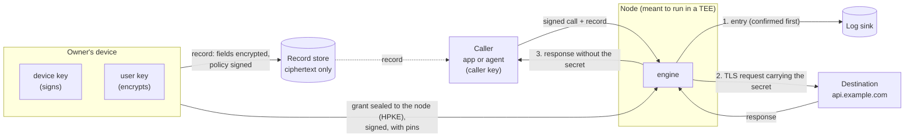
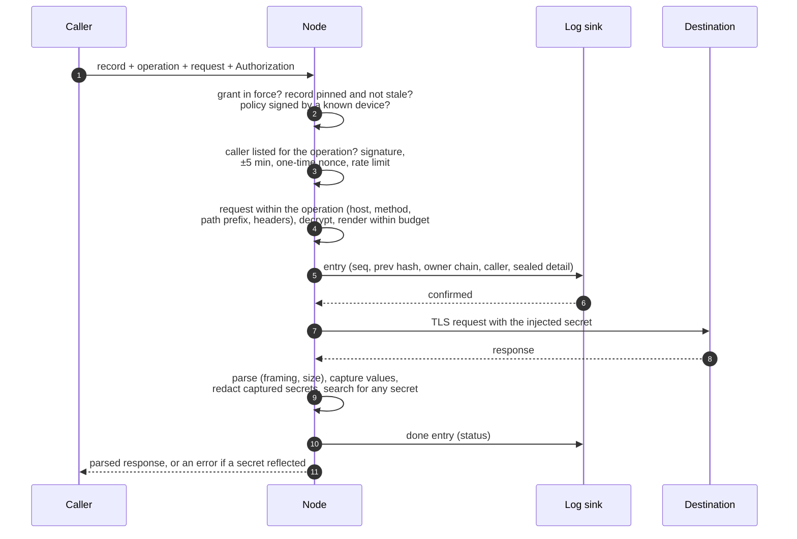
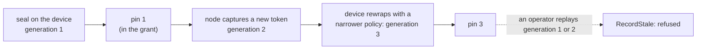
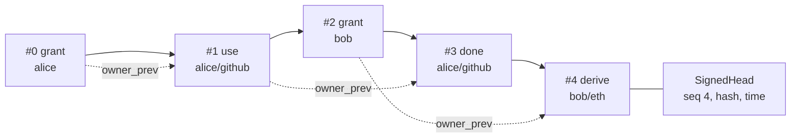
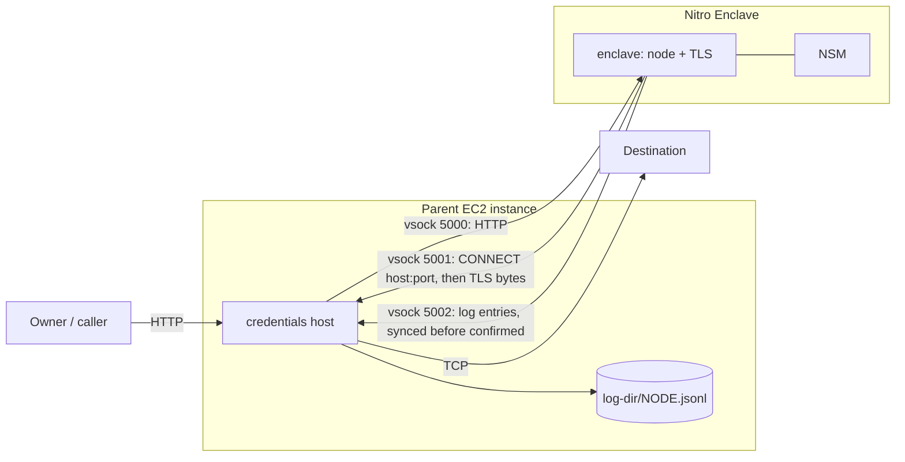

# credentials

[](https://github.com/BloubHQ/credentials/actions/workflows/ci.yml)
[](LICENSE)

**English** | [한국어](docs/i18n/README.ko.md) | [简体中文](docs/i18n/README.zh-CN.md) | [日本語](docs/i18n/README.ja.md)

A vault engine that lets applications and AI agents **use** a credential without ever
**seeing** it. The owner's device decides, in a signed policy, exactly where a secret may go
and in what form. A node holds the secret only while the owner allows it, writes a
tamper-evident log entry **before** every use, and hands the caller back a response that has
been checked for the secret.

```text
caller:  "GET https://api.github.com/user"            (no token)
node:    log entry confirmed  ->  adds "Authorization: Bearer ghp_..."  ->  TLS  ->  GitHub
caller:  200 OK {"login": "octo"}                     (token removed or response dropped)
```

The engine knows no kind of credential. API keys, OAuth refresh, AWS SigV4, HTTP Digest, JWT
signing, TOTP, IMAP logins, mutual TLS and Ethereum signatures are all policy data, not code.

> **Status: 0.x, not audited.** The engine is tested and has been reviewed internally, but it has not had
> an external security audit and its formats may change. Read the
> [threat model](docs/threat-model.md) before you trust it with production secrets.

## Contents

- [How it works](#how-it-works)
- [Quick start](#quick-start)
- [Policies](#policies)
- [Records, generations and rollback](#records-generations-and-rollback)
- [The log](#the-log)
- [Running a node](#running-a-node)
- [Running in a Nitro Enclave](#running-in-a-nitro-enclave)
- [What it guarantees](#what-it-guarantees)
- [Measurements](#measurements)
- [What it does not do](#what-it-does-not-do)
- [Crates](#crates) · [Development](#development) · [Security](#security) · [License](#license)

## How it works



There are four parties and four kinds of key:

| Party | Key | What it does |
| --- | --- | --- |
| Owner's device | `DeviceKey` (Ed25519) | Signs policies, grants, pins, revocations and other devices |
| Owner | `UserKey` (256-bit) | Encrypts records (a key per record via HKDF); a node holds it only during a grant |
| Caller | `CallerKey` (Ed25519) | Signs each call; the policy lists which caller may run which operation |
| Node | `NodeKey` (Ed25519) | Signs the log; an X25519 key derived from it opens sealed grants |

One call, in order. Every check before the log entry leaves no trace; nothing leaves the node
without a confirmed entry:



## Quick start

```sh
git clone https://github.com/BloubHQ/credentials && cd credentials
cargo test --workspace
GITHUB_TOKEN=ghp_... cargo run -p transport --example github_user
```

The [`github_user`](crates/transport/examples/github_user.rs) example runs every part in one
process: the device seals a token into a record, signs a policy that allows only
`GET https://api.github.com/user`, and grants a node; an application signs a call; the node
logs, injects the token, sends the request over TLS and returns the response. In code:

```rust
// On the owner's device.
let policy = device.sign_policy(policy)?;
let record = Record::seal(&user_key, "github", "me", policy, &values)?;
let terms = GrantTerms::new("me", Duration::from_secs(600)).pin(&record);
let grant = device.grant(&user_key, &node.identity(), terms)?;

// On the node.
node.grant(&grant)?;

// In the application: it holds the record (ciphertext) and its caller key, never the token.
let body = Body::http(request);
let call = app.sign_call("example", &node.public_key(), record, "github", body)?;

// On the node: log, inject the token, send over TLS, check the response for the token.
let outcome = node.run(&call, &mut TlsTransport::new());
```

## Policies

A policy names the **fields** of a record, the **callers** who may use it, and the
**operations** they may run. The device signs it; the signature and the encryption of the
record both bind it, so nobody can change where a value goes without the owner. The full
reference is in [docs/policy.md](docs/policy.md).

```json
{
  "fields": [
    {"name": "client_id", "secret": false},
    {"name": "client_secret", "secret": true},
    {"name": "refresh_token", "secret": true},
    {"name": "access_token", "secret": true, "optional": true}
  ],
  "callers": [
    {"name": "billing-agent", "key": "<caller public key>",
     "operations": ["refresh", "call"], "limit": {"count": 100, "window_ms": 60000}}
  ],
  "operations": [
    {"kind": "http", "name": "refresh",
     "destinations": [{"host": "auth.example.com", "port": 443}],
     "steps": [{
       "request": {"from": "fixed", "method": "POST", "path": "/oauth/token"},
       "inject": [{"target": {"kind": "body"},
                   "template": "grant_type=refresh_token&refresh_token={{pct(refresh_token)}}&client_id={{pct(client_id)}}&client_secret={{pct(client_secret)}}"}],
       "capture": [{"source": {"from": "json", "pointer": "/access_token"},
                    "into": {"kind": "field", "name": "access_token"}}]
     }]},
    {"kind": "http", "name": "call",
     "destinations": [{"host": "*.api.example.com", "port": 443}],
     "methods": ["GET", "POST"], "paths": ["/v1/"], "caller_headers": ["Accept"],
     "steps": [{"inject": [{"target": {"kind": "header", "name": "Authorization"},
                            "template": "Bearer {{access_token}}"}]}]}
  ]
}
```

| Operation | What it does |
| --- | --- |
| `http` | 1 to 8 steps. Each sends the caller's request or a request the policy fixes, injects values, and captures values from the response into a field (a new record generation) or a temporary value for later steps. Only the last response goes back. |
| `stream` | A send/expect script on one TLS connection (IMAP, SMTP, line protocols), then the caller's exchanges on the authenticated connection. |
| `derive` | A template's output goes back to the caller: signatures, HMACs, TOTP codes, JWTs. |

Values go in through **templates**: `{{ hex(hmac_sha256(secret, $query)) }}`. The language
has names, variables, string literals, function calls and `+`; no branches or loops. Before a
policy is signed, every template is analysed:

- **Taint.** A value that holds a secret in reversible form is *tainted*. Encodings keep taint;
  hashes, MACs, signatures and `len` remove it, except a hash of the secret alone, which is as good as the key where the key is hashed before use (a long HMAC key, an Ed25519 seed). Encryption under a secret field hides only the
  key: a secret in its message, nonce or data stays tainted, because another operation could
  encrypt chosen bytes under the same key. A derivation whose output is tainted is refused.
- **Oracles.** A secret and a value the caller or server chooses may not meet where the result
  reveals the secret piece by piece: in `replace`, `xor`, the key of `json_set`, a decoder,
  a number or a key argument. `len(replace(key, $input, ""))` is refused.
- **Guessable fields.** A derivation may depend on a field marked `guessable` (PIN, password)
  only through `len`: a hash, signature, MAC or encryption of it would let the caller check
  guesses.
- **Budgets.** One operation may render at most 128 MiB, 1,000,000 PBKDF2 rounds and 32
  signatures.

| Credential | Policy |
| --- | --- |
| Bearer token, cookie, API key | one header template |
| Telegram bot | `path_param` `{{token}}` in `/bot{token}/getMe` |
| Exchange HMAC signature | query `signature` = `{{ hex(hmac_sha256(secret, $query)) }}` |
| AWS SigV4 | two header templates (`time`, `canonical_query`, nested `hmac_sha256`); a test reproduces the official vector |
| HTTP Digest | step 1 captures `realm`/`nonce` with `header_param`; step 2 answers with `md5`; RFC 2617 vector |
| OAuth refresh | `fixed` POST, `json` capture into a field: the node returns a new record |
| Session login | `fixed` POST /login, `cookie` capture into a temp, `Cookie` on the caller's request |
| JWT RS256 | derive `b64urlraw(header) + "." + b64urlraw($input) + "." + b64urlraw(rsa_sign_pkcs1_sha256(pem(key), …))` |
| Ethereum | derive `{{ k256_sign_recoverable(key, keccak256($input)) }}` |
| IMAP | stream: expect greeting, send `a1 LOGIN {{user}} {{password}}`, expect, relay |
| TOTP | derive `{{ totp(b32decode(seed)) }}` |
| Mutual TLS | `"identity": {"cert": "{{cert}}", "key": "{{key}}"}` |

## Records, generations and rollback

A record is the fields, encrypted with ChaCha20-Poly1305 under a key derived from the user
key and the record id, with the id, owner, **generation** and signed policy in the associated
data. Every re-seal adds one to the generation.



A node refuses a record unless the owner pinned it (in a grant or with `DeviceKey::pin`), and
refuses any generation older than the newest it saw or the owner pinned. Because the grant
carries the pins, even a fresh node that never saw the newer record refuses the old one.

## The log

Each entry is signed by the node and chained twice: to the entry before it, and to the
previous entry of the same owner. An owner can check its own entries without anyone else's,
and a signed checkpoint (`SignedHead`) fixes the head so a cut tail shows.



Entries show who used which record, when, by which caller and for which operation. **Where**
the value went and what was sent (host, path, body hash) is sealed to the owner's user key:
the log store cannot read it, the owner can (`log::open_detail`, or
`credentials verify --owner alice --user-key key.txt`). A node never acts without a confirmed entry: the
transport functions take a `Confirmed` that only `Log::commit` can make, after the sink
returned `Ok`. If the sink fails, the log halts until it is reconciled.

```sh
credentials verify log.jsonl <node-public-key>                   # the whole chain
credentials verify log.jsonl <node-public-key> --head head.json  # must end at a signed checkpoint
credentials verify log.jsonl <node-public-key> --owner alice     # one owner's chain
credentials verify log.jsonl <node-public-key> --owner alice --user-key key.txt   # with the details
```

## Running a node

- **Transport.** `transport::TlsTransport` (rustls with the ring provider, Mozilla roots,
  client certificates, connect/read/total deadlines, size limits). The certificate of the
  destination is what binds a connection to the host the owner signed; DNS is not trusted.
- **Zeroizing allocator.** Install one in the binary that runs a node, so the buffers of
  dependencies the engine cannot reach (TLS records, parsed RSA keys) are erased when freed:

  ```rust
  #[global_allocator]
  static ALLOCATOR: zeroizing_alloc::ZeroAlloc<std::alloc::System> =
      zeroizing_alloc::ZeroAlloc(std::alloc::System);
  ```

  Measured: RSA key copies left in freed memory per signature go from 1 to 0, for 3–12% more
  time (table below).
- **Attestation.** Run the node in a TEE (SGX, TDX, SEV-SNP, Nitro). Put
  `NodeIdentity::report_data()` (SHA-512 over the log key and the seal key) into the quote's
  report data; owners check the quote and that value before they seal a grant. AWS Nitro
  Enclaves are integrated: see [Running in a Nitro Enclave](#running-in-a-nitro-enclave);
  the [`attest`](crates/attest) crate and `credentials attest` do the owner's check.
- **Keys and restarts.** Keep `NodeKey::to_bytes()` sealed to the enclave. After a restart,
  `Node::restore(key, sink, clock, entries)` continues the chain and brings back record
  floors, known devices and the last grant times; owners grant again, and nothing granted or
  signed before the restart is accepted. Keep `Node::checkpoint()` where the operator cannot
  roll it back (sealed storage, a monotonic counter) and restart with `Node::restore_anchored`,
  which refuses a cut log.
- **Command line and server.** [`credentials`](crates/cli) makes keys, signs policies, seals
  records, makes grants and signed calls, and `credentials serve` runs a node over HTTP with a
  durable JSONL log.
- **Concurrency.** Every method takes `&self`; share one node between threads. Transport I/O
  runs outside the node's lock.

## Running in a Nitro Enclave

The [`enclave`](crates/enclave) program runs a node inside an AWS Nitro Enclave, and
`credentials host` runs next to it on the parent instance. The enclave has no network and no
disk; vsock to the parent is its only link.



- **Boot.** The program refuses to start unless the kernel draws randomness from the NSM
  (`nsm-hwrng`), then generates a fresh node key. There is no sealed storage on Nitro: **a
  restarted enclave is a new node** with a new identity and a new log file, and owners grant
  to it again (grants are sealed to one node's key and never survive a restart anyway).
- **API.** The HTTP API of `credentials serve` (the same server code, from the
  [`server`](crates/server) crate) on vsock port 5000, plus `GET /attestation?nonce=<base64url>`,
  which answers `{"identity": <NodeIdentity>, "document": <base64url>}`. The document is a
  COSE-signed NSM attestation whose `user_data` is `NodeIdentity::report_data()` and whose
  `nonce` is the caller's (1 to 512 bytes).
- **Before granting**, an owner checks the document: its certificate chain to the AWS Nitro
  root, PCR0, PCR1 and PCR2 against `measurements.json` of a release (all-zero PCRs mean a
  debug-mode enclave, whose memory the parent can read), the nonce it sent, and that
  `user_data` equals `report_data()` of the identity it is about to grant to.
- **Egress.** TLS stays inside the enclave (`TlsTransport` over a vsock `Connector`). For each
  connection the node, after checking the destination against the signed policy, sends
  `CONNECT host:port` to the host, which connects over TCP (only to `--allow` entries, when
  given) and then carries ciphertext both ways. The host resolves DNS; the certificate check
  of the destination is what binds the connection, as without an enclave.
- **Log.** Entries go to the host, which appends each to `<log-dir>/<node log key>.jsonl` and
  `sync_data`s it before it confirms; the node treats an entry as stored only after that
  confirmation, halts otherwise, and reconciles with what the host reports. Checkpoints go to
  `<node log key>.jsonl.head.json`. Check the log with `credentials verify` as usual.
- **Clock.** The node uses the system clock of the enclave, which comes from the host
  hypervisor (see the [threat model](docs/threat-model.md)).

### Verify the node before a grant

A node in an AWS Nitro Enclave puts `NodeIdentity::report_data()` into the `user_data` of its
attestation document. Before the owner seals a grant, it sends the node a fresh random nonce
(32 bytes), gets the document back, and checks it against the `measurements.json` of the
releases it accepts (`{"release": ..., "git_commit": ..., "pcr0": ..., "pcr1": ..., "pcr2":
...}`, one object or an array; PCRs in hex):

```sh
credentials attest --document doc.cbor --nonce <base64url> --measurements measurements.json \
    --identity identity.json
credentials grant ... --node identity.json \
    --attestation doc.cbor --nonce <base64url> --measurements measurements.json
```

`attest::verify` (and both commands) refuse the document unless:

- it is a COSE_Sign1 signed with ES384 (protected header exactly `{1: -35}`) whose payload is
  the map of the Nitro Secure Module, with `digest` `SHA384`;
- its certificate chains through the `cabundle` intermediates to the pinned AWS Nitro Enclaves
  Root-G1 (SHA-256 `641a0321...79bb5b`), valid at the time the document states; the copy of the
  root inside the document is not trusted;
- the signature verifies under the P-384 key of that certificate;
- its nonce is the one the owner sent, so an old document cannot be replayed;
- PCR0, PCR1 and PCR2 are not all zero (a debug enclave, whose memory the host can read) and
  equal one accepted release, so an old or unknown build is refused once its measurements leave
  the list;
- with `--identity` (and always with `grant --attestation`), its `user_data` equals
  `report_data()` of the node identity, so the seal key the grant goes to belongs to the
  attested enclave.

`credentials grant` without `--attestation` still works and prints a warning: nothing then
shows what code holds the seal key.

### Build the enclave image file

```sh
build/reproduce.sh --release dev --out out   # needs git and Docker with buildx
```

`build/build.sh` builds the commit `HEAD` (not the work tree): `build/Dockerfile.enclave`
compiles `enclave` statically for `x86_64-unknown-linux-musl` in a Rust 1.97.1 image pinned by
digest, with `--locked`, `SOURCE_DATE_EPOCH` set to the commit time and paths remapped; then
`nitro-cli build-enclave`, from an Amazon Linux 2023 image pinned by digest with
`aws-nitro-enclaves-cli` pinned by version, makes `enclave.eif`. `measurements.json` holds the
release, the commit, PCR0, PCR1, PCR2 and the SHA-256 of every input (images, files of the
commit, the kernel and init that nitro-cli adds, the program). `build/reproduce.sh` builds
twice, the second time without any cache, and fails unless the measurements are the same; CI
runs it on every change to the enclave or its build, and each release attaches `enclave.eif`
and `measurements.json` (in `SHA256SUMS` and the build provenance attestation) and prints the
measurements in its notes. The EIF file itself differs between builds (its metadata holds the
build time); its PCRs do not.

### Run it

On a Nitro-enabled instance with `aws-nitro-enclaves-cli` and the allocator configured:

```sh
nitro-cli run-enclave --eif-path enclave.eif --cpu-count 2 --memory 1024 --enclave-cid 16
credentials host --enclave-cid 16 --log-dir /var/lib/credentials \
  --listen 127.0.0.1:8700 --allow api.github.com:443
curl -s "http://127.0.0.1:8700/attestation?nonce=$(head -c 32 /dev/urandom | basenc --base64url | tr -d '=')"
```

Start `credentials host` first or right after: the node connects to its log writer at boot and
stops if it cannot. `credentials host` is described in [crates/cli](crates/cli#the-host-nitro-enclaves).

## What it guarantees

- A secret leaves the engine only as bytes of one request to a destination the owner signed,
  through the `Transport`, after a confirmed log entry.
- `Secret` values cannot be printed, cloned or serialized, and are erased on drop. Code
  outside the crate cannot read them (`compile_fail` doc tests).
- Only a caller the policy lists, with a fresh one-time signature over this exact call, within
  its rate limit, can run an operation.
- Grants open only on the node they were sealed to, only from a device the node knows for the
  owner (first use is trusted), and cannot be replayed. Revocations need a known device.
- Records cannot be rolled back past a pin or a generation the node saw.
- Templates are analysed before signing; derivations cannot hand back a secret, an oracle on
  a secret, or a check for guesses of a guessable field.
- Responses are parsed strictly (framing, encodings, sizes); captured secrets are redacted;
  a response that still holds any secret in a known form is dropped.
- The log is append-only, signed, chained per node and per owner, and checkable offline.
- No `unsafe`, no `unwrap`/`expect`/`panic`/indexing in the engine (enforced by lints).

## Measurements

Release builds on one machine. The attack cases are the probes of the internal review, run
against the earlier code (`79a21c1`) and the current code; memory is the peak measured by an
instrumented allocator.

| Case | Before | Now |
| --- | --- | --- |
| 64 KiB captured token + 8 MiB response (redaction and search) | 63.88 s | 0.08–0.10 s |
| 16 KiB token + 4 MiB response | 6.34 s | 0.07 s |
| Template concatenation ×401 on 1 MiB input | accepted, 803 MiB | `Budget` error, 129 MiB |
| PBKDF2 1,000,000 rounds ×127 | 12.70 s | `Budget` error after 0.09 s |
| 64 MiB response | passed through after 1.81 s | refused after 0.02 s |
| 16 MiB JSON array with a pointer capture | 400 MiB | 64 MiB |
| 16 MiB of headers | 192 MiB | 0 MiB (refused at 64 KiB) |
| 16 MiB body captured into 16 temps | 768 MiB | 32 MiB (refused at 64 KiB) |
| Freed blocks still holding a secret (json capture, `b64decode`, `json`, `replace`, `json_set`) | 1, 8, 1, 1, 1 | 0, 0, 0, 0, 0 |
| Freed blocks still holding an RSA private key, per signature | 1 | 1 (0 with the zeroizing allocator) |
| Freed blocks still holding a P-384 private key | 0 | 0 |

| Throughput (with the instrumented allocator) | System allocator | Zeroizing allocator |
| --- | --- | --- |
| 2,000 HMAC derivations | 0.29–0.30 s | 0.31 s |
| 200 RSA-2048 signatures | 0.129–0.130 s | 0.130–0.136 s |
| 1,000 HTTP calls with 64 KiB responses | 0.329 s | 0.338–0.369 s |

RustCrypto `rsa` 0.10 was also measured as a replacement for ring: it left 11 freed blocks
holding the prime `p` per signature (temporaries while it parses and checks the key), so ring
stays.

## What it does not do

These are limits of the design, not missing code. The [threat model](docs/threat-model.md)
explains each.

- **One TEE only.** AWS Nitro Enclaves are integrated ([Running in a Nitro
  Enclave](#running-in-a-nitro-enclave)); elsewhere the node is an ordinary process and
  whoever runs it can read its memory. A Nitro node has no sealed storage: a restart is a new
  node, and owners grant again.
- **Reflection search finds known encodings only**: raw, base64 (both alphabets), percent,
  JSON and hex, and escaped JSON strings. A server that splits, compresses in its own way or
  encrypts a secret it echoes is not caught. Secret fields of 4 to 7 bytes are searched raw
  only, and their bytes appearing by chance drop the response.
- **Responses are buffered** (16 MiB at most), because the search needs the whole response.
- **A value the server sends for capture is the server's.** If a server hands back a key and
  the policy uses it as a key, the server knows that key.
- **Low-entropy secrets** not marked `guessable` are treated as strong keys.
- **First use is trusted**: the first grant for an owner on a node decides its devices. An
  owner who loses every device starts a new owner name.
- **Stream sessions** end with the call. SSH, database wire protocols, gRPC and WebSocket
  framing work only as far as a send/expect script can go.
- **Browser logins, push 2FA and hardware keys** need a person or a device and cannot be
  delegated.

## Crates

| Crate | |
| --- | --- |
| [`engine`](crates/engine) | Secrets, policies, templates, records, grants, callers, the log, responses, the node |
| [`transport`](crates/transport) | TLS transport (rustls) over TCP or any `Connector`, and an end-to-end example |
| [`server`](crates/server) | The HTTP server of a node, and the vsock relay protocol between an enclave and its host |
| [`enclave`](crates/enclave) | The node program inside an AWS Nitro Enclave (NSM attestation) |
| [`verify`](crates/verify) | Verifier of node logs, run as `credentials verify` |
| [`attest`](crates/attest) | Verifier of AWS Nitro Enclaves attestation documents, run as `credentials attest` |
| [`cli`](crates/cli) | The `credentials` tool: keys, policies, records, grants, calls, a node server, and the host of an enclave |

## Development

```sh
cargo fmt --all --check
cargo clippy --workspace --all-targets --locked -- -D warnings
cargo test --workspace --locked
```

Minimum Rust: 1.87 (the `enclave` crate: 1.92, for `aws-nitro-enclaves-nsm-api`). CI also runs `cargo audit`, `cargo deny`, tests on the MSRV, a
reproducible-build check and 60 seconds of fuzzing per target. See [CONTRIBUTING.md](.github/CONTRIBUTING.md).

## Security

Please report vulnerabilities privately, as described in [SECURITY.md](.github/SECURITY.md).

## License

[Apache License 2.0](LICENSE).
