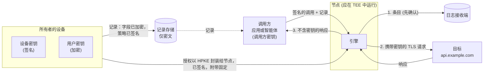
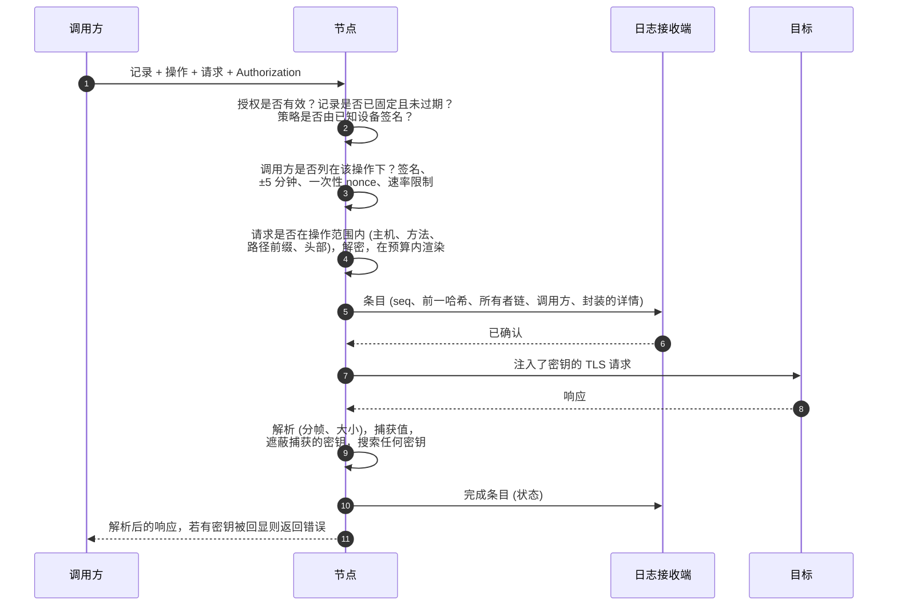
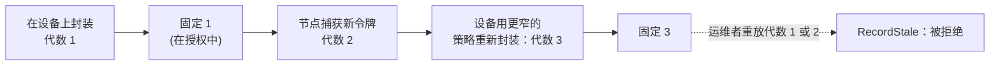
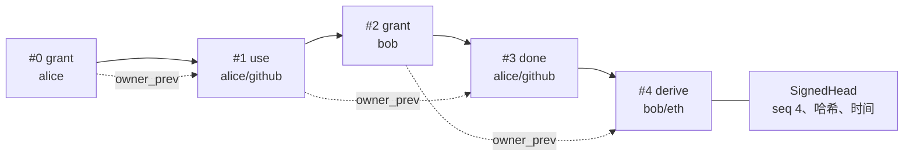

# credentials

[](https://github.com/BloubHQ/credentials/actions/workflows/ci.yml)
[](LICENSE)

[English](README.md) | [한국어](README.ko.md) | **简体中文** | [日本語](README.ja.md)

一个保险库（vault）引擎，让应用和 AI 智能体能够**使用**凭据，却永远**看不到**它。
由所有者的设备通过一份签名的策略（policy）精确决定密钥可以去往何处、以何种形式出现。
节点只在所有者允许的期间持有密钥，在每次使用**之前**写入一条防篡改（tamper-evident）
日志条目，并把经过密钥检查的响应交还给调用方。

```text
caller:  "GET https://api.github.com/user"            (no token)
node:    log entry confirmed  ->  adds "Authorization: Bearer ghp_..."  ->  TLS  ->  GitHub
caller:  200 OK {"login": "octo"}                     (token removed or response dropped)
```

引擎本身不认识任何一种凭据。API 密钥、OAuth 刷新、AWS SigV4、HTTP Digest、JWT 签名、
TOTP、IMAP 登录、双向 TLS（mutual TLS）和以太坊签名，全都是策略数据，而不是代码。

> **状态：0.x，未经审计。** 引擎已经过测试和内部评审，但尚未经过外部安全审计，其格式也可能变化。
> 在用它保管生产环境的密钥之前，请先阅读
> [威胁模型](docs/threat-model.md)。

## 目录

- [工作原理](#工作原理)
- [快速开始](#快速开始)
- [策略](#策略)
- [记录、代数与回滚](#记录代数与回滚)
- [日志](#日志)
- [运行节点](#运行节点)
- [它保证什么](#它保证什么)
- [实测数据](#实测数据)
- [它不做什么](#它不做什么)
- [Crates](#crates) · [开发](#开发) · [安全](#安全) · [许可证](#许可证)

## 工作原理



共有四方和四种密钥：

| 参与方 | 密钥 | 作用 |
| --- | --- | --- |
| 所有者的设备 | `DeviceKey` (Ed25519) | 签署策略、授权（grant）、固定（pin）、撤销以及其他设备 |
| 所有者 | `UserKey` (256-bit) | 加密记录（通过 HKDF 为每条记录派生一个密钥）；节点仅在授权期间持有它 |
| 调用方 | `CallerKey` (Ed25519) | 签署每次调用；策略列出哪个调用方可以运行哪个操作 |
| 节点 | `NodeKey` (Ed25519) | 签署日志；由它派生的 X25519 密钥用于打开封装的授权 |

一次调用的顺序如下。日志条目之前的每项检查都不留痕迹；没有已确认的条目，任何东西都不会离开节点：



## 快速开始

```sh
git clone https://github.com/BloubHQ/credentials && cd credentials
cargo test --workspace
GITHUB_TOKEN=ghp_... cargo run -p transport --example github_user
```

[`github_user`](crates/transport/examples/github_user.rs) 示例在一个进程中运行所有部分：
设备把令牌封装进一条记录，签署一份只允许 `GET https://api.github.com/user` 的策略，
并向节点授权；应用签署一次调用；节点写日志、注入令牌、通过 TLS 发送请求并返回响应。
用代码表示：

```rust
// 在所有者的设备上。
let record = Record::seal(&user_key, "github", "me", device.sign_policy(policy)?, &values)?;
let grant = device.grant(&user_key, &node.identity(), GrantTerms {
    owner: "me".into(),
    expires_ms: now + 600_000,
    issued_ms: now,
    pins: vec![RecordPin { record_id: "github".into(), generation: record.generation }],
})?;

// 在节点上。
node.grant(&grant)?;

// 在应用中：它持有记录（密文）和自己的调用方密钥，从不持有令牌。
let auth = app.authorize("example", &node.public_key(), &record, "github",
                         &Payload::Http(Some(&request)), now)?;
let response = node.http(&record, "github", &auth, Some(&request), &mut transport).result?;
```

## 策略

策略列出一条记录的**字段**（fields）、可以使用它的**调用方**（callers），以及他们可以运行的
**操作**（operations）。策略由设备签名；签名和记录的加密都绑定了它，因此没有所有者的参与，
谁也无法改变一个值的去向。完整参考见 [docs/policy.md](docs/policy.md)。

```json
{
  "fields": [
    {"name": "client_id", "secret": false},
    {"name": "client_secret", "secret": true},
    {"name": "refresh_token", "secret": true},
    {"name": "access_token", "secret": true, "optional": true}
  ],
  "callers": [
    {"name": "billing-agent", "key": "<caller public key>",
     "operations": ["refresh", "call"], "limit": {"count": 100, "window_ms": 60000}}
  ],
  "operations": [
    {"kind": "http", "name": "refresh",
     "destinations": [{"host": "auth.example.com", "port": 443}],
     "steps": [{
       "request": {"from": "fixed", "method": "POST", "path": "/oauth/token"},
       "inject": [{"target": {"kind": "body"},
                   "template": "grant_type=refresh_token&refresh_token={{pct(refresh_token)}}&client_id={{pct(client_id)}}&client_secret={{pct(client_secret)}}"}],
       "capture": [{"source": {"from": "json", "pointer": "/access_token"},
                    "into": {"kind": "field", "name": "access_token"}}]
     }]},
    {"kind": "http", "name": "call",
     "destinations": [{"host": "*.api.example.com", "port": 443}],
     "methods": ["GET", "POST"], "paths": ["/v1/"], "caller_headers": ["Accept"],
     "steps": [{"inject": [{"target": {"kind": "header", "name": "Authorization"},
                            "template": "Bearer {{access_token}}"}]}]}
  ]
}
```

| 操作 | 作用 |
| --- | --- |
| `http` | 1 到 8 个步骤。每一步发送调用方的请求或策略固定的请求，注入值，并把响应中的值捕获到一个字段（产生新的记录代数）或供后续步骤使用的临时值中。只有最后一个响应会返回。 |
| `stream` | 在一条 TLS 连接上运行 send/expect 脚本（IMAP、SMTP、行协议），之后调用方在已认证的连接上进行交互。 |
| `derive` | 模板的输出返回给调用方：签名、HMAC、TOTP 码、JWT。 |

值通过**模板**（templates）注入：`{{ hex(hmac_sha256(secret, $query)) }}`。该语言支持
名称、变量、字符串字面量、函数调用和 `+`；没有分支或循环。在策略签名之前，每个模板都会被分析：

- **污点（taint）。** 以可逆形式持有密钥的值是*被污染的*（tainted）。编码保留污点；
  哈希、MAC、签名和 `len` 消除污点；加密只有在使用秘密密钥时才消除污点。
  输出被污染的派生会被拒绝。
- **预言机（oracle）。** 密钥与调用方或服务器选择的值不得在结果会逐段泄露密钥的位置相遇：
  `replace`、`xor`、`json_set` 的键、解码器、数字参数或密钥参数中。
  `len(replace(key, $input, ""))` 会被拒绝。
- **可猜测字段。** 标记为 `guessable` 的字段（PIN、密码）不得进入可用于验证猜测的派生输出
  （它们的哈希或签名），除非有带密钥的 MAC 或使用强秘密密钥的加密将其隐藏。
- **预算。** 一个操作最多可渲染 128 MiB、1,000,000 轮 PBKDF2 和 32 个签名。

| 凭据 | 策略 |
| --- | --- |
| Bearer 令牌、Cookie、API 密钥 | 一个头部模板 |
| Telegram 机器人 | `/bot{token}/getMe` 中的 `path_param` `{{token}}` |
| 交易所 HMAC 签名 | 查询参数 `signature` = `{{ hex(hmac_sha256(secret, $query)) }}` |
| AWS SigV4 | 两个头部模板（`time`、`canonical_query`、嵌套的 `hmac_sha256`）；有测试复现官方向量 |
| HTTP Digest | 第 1 步用 `header_param` 捕获 `realm`/`nonce`；第 2 步用 `md5` 应答；RFC 2617 向量 |
| OAuth 刷新 | `fixed` POST，`json` 捕获到字段：节点返回一条新记录 |
| 会话登录 | `fixed` POST /login，`cookie` 捕获到临时值，在调用方的请求上加 `Cookie` |
| JWT RS256 | derive `b64urlraw(header) + "." + b64urlraw($input) + "." + b64urlraw(rsa_sign_pkcs1_sha256(pem(key), …))` |
| 以太坊 | derive `{{ k256_sign_recoverable(key, keccak256($input)) }}` |
| IMAP | stream：expect 问候，send `a1 LOGIN {{user}} {{password}}`，expect，转发 |
| TOTP | derive `{{ totp(b32decode(seed)) }}` |
| 双向 TLS | `"identity": {"cert": "{{cert}}", "key": "{{key}}"}` |

## 记录、代数与回滚

记录就是那些字段，用 ChaCha20-Poly1305 加密，密钥由用户密钥和记录 id 派生，
关联数据中包含 id、所有者、**代数**（generation）和签名的策略。每次重新封装都会使代数加一。



除非所有者固定了某条记录（在授权中或通过 `DeviceKey::pin`），节点会拒绝它；
节点也会拒绝任何比它见过的或所有者固定的最新代数更旧的代数。由于授权携带了固定信息，
即使是从未见过较新记录的全新节点，也会拒绝旧记录。

## 日志

每个条目都由节点签名，并被双重链接：链接到它之前的条目，以及同一所有者的上一个条目。
所有者无需其他人的条目即可检查自己的条目，而签名的检查点（`SignedHead`）固定了链头，
因此截断的尾部会暴露出来。



条目显示了谁在何时、通过哪个调用方、为哪个操作使用了哪条记录。值**去往何处**以及发送了什么
（主机、路径、正文哈希）则被封装给所有者的用户密钥：日志存储无法读取，所有者可以读取
（`log::open_detail`，或 `verify --owner alice --user-key key.txt`）。没有已确认的条目，
节点绝不会行动：传输函数接受一个 `Confirmed`，而它只能由 `Log::commit` 在接收端返回 `Ok`
之后生成。如果接收端失败，日志会停止，直到完成核对。

```sh
verify log.jsonl <node-public-key>                          # the whole chain
verify log.jsonl <node-public-key> --head head.json         # must end at a signed checkpoint
verify log.jsonl <node-public-key> --owner alice            # one owner's chain
verify log.jsonl <node-public-key> --owner alice --user-key key.txt   # with the details
```

## 运行节点

- **传输。** `transport::TlsTransport`（使用 ring provider 的 rustls、Mozilla 根证书、
  客户端证书、连接/读取/总计截止时间、大小限制）。将连接绑定到所有者所签名主机的，
  是目标的证书；DNS 不被信任。
- **清零分配器。** 在运行节点的二进制程序中安装一个，使引擎无法触及的依赖缓冲区
  （TLS 记录、已解析的 RSA 密钥）在释放时被擦除：

  ```rust
  #[global_allocator]
  static ALLOCATOR: zeroizing_alloc::ZeroAlloc<std::alloc::System> =
      zeroizing_alloc::ZeroAlloc(std::alloc::System);
  ```

  实测：每次签名后残留在已释放内存中的 RSA 密钥副本从 1 降为 0，代价是多花 3–12% 的时间
  （见下表）。
- **远程证明（attestation）。** 在 TEE（可信执行环境：SGX、TDX、SEV-SNP、Nitro）中运行节点。把
  `NodeIdentity::report_data()`（对日志密钥和封装密钥计算的 SHA-512）放入 quote 的
  report data；所有者在封装授权之前检查 quote 和该值。quote 的验证与平台相关，不在本仓库中。
- **密钥与重启。** 将 `NodeKey::to_bytes()` 封装（seal）到 enclave 中保存。重启后，
  `Node::restore(key, sink, clock, entries)` 会延续链，并恢复记录下限、已知设备和最近的授权时间；
  所有者需要重新授权。
- **并发。** 每个方法都接受 `&self`；可在线程之间共享一个节点。传输 I/O 在节点的锁之外运行。

## 它保证什么

- 密钥只会以一个请求的字节形式离开引擎，发往所有者签名的目标，经由 `Transport`，
  并且在日志条目确认之后。
- `Secret` 值无法被打印、克隆或序列化，并在 drop 时被擦除。crate 之外的代码无法读取它们
  （`compile_fail` 文档测试）。
- 只有策略列出的调用方，凭借对这次调用本身的新鲜一次性签名，并在其速率限制之内，才能运行操作。
- 授权只能在其被封装给的节点上打开，只接受该节点已知属于该所有者的设备（首次使用即信任），
  且无法被重放。撤销需要已知设备。
- 记录无法被回滚到固定或节点见过的代数之前。
- 模板在签名之前被分析；派生无法交还密钥、针对密钥的预言机，或对可猜测字段的猜测验证手段。
- 响应被严格解析（分帧、编码、大小）；捕获的密钥会被遮蔽；仍以已知形式包含任何密钥的响应会被丢弃。
- 日志只追加、已签名、按节点和按所有者链接，并可离线检查。
- 引擎中没有 `unsafe`，没有 `unwrap`/`expect`/`panic`/索引访问（由 lint 强制）。

## 实测数据

在同一台机器上的 release 构建。攻击用例是内部评审中的探测，分别针对早先的代码（`79a21c1`）
和当前代码运行；内存是由插桩分配器测得的峰值。

| 用例 | 之前 | 现在 |
| --- | --- | --- |
| 64 KiB 捕获令牌 + 8 MiB 响应（遮蔽与搜索） | 63.88 s | 0.08–0.10 s |
| 16 KiB 令牌 + 4 MiB 响应 | 6.34 s | 0.07 s |
| 对 1 MiB 输入进行 ×401 模板拼接 | 被接受，803 MiB | `Budget` 错误，129 MiB |
| PBKDF2 1,000,000 轮 ×127 | 12.70 s | 0.09 s 后 `Budget` 错误 |
| 64 MiB 响应 | 1.81 s 后被放行 | 0.02 s 后被拒绝 |
| 16 MiB JSON 数组加指针捕获 | 400 MiB | 64 MiB |
| 16 MiB 的头部 | 192 MiB | 0 MiB（在 64 KiB 处拒绝） |
| 16 MiB 正文捕获到 16 个临时值 | 768 MiB | 32 MiB（在 64 KiB 处拒绝） |
| 仍含密钥的已释放内存块（json 捕获、`b64decode`、`json`、`replace`、`json_set`） | 1, 8, 1, 1, 1 | 0, 0, 0, 0, 0 |
| 每次签名后仍含 RSA 私钥的已释放内存块 | 1 | 1（使用清零分配器时为 0） |
| 仍含 P-384 私钥的已释放内存块 | 0 | 0 |

| 吞吐量（使用插桩分配器） | 系统分配器 | 清零分配器 |
| --- | --- | --- |
| 2,000 次 HMAC 派生 | 0.29–0.30 s | 0.31 s |
| 200 次 RSA-2048 签名 | 0.129–0.130 s | 0.130–0.136 s |
| 1,000 次 HTTP 调用，响应 64 KiB | 0.329 s | 0.338–0.369 s |

还测量了用 RustCrypto `rsa` 0.10 替换 ring：每次签名会留下 11 个持有素数 `p` 的已释放内存块
（解析和检查密钥时的临时值），因此保留 ring。

## 它不做什么

这些是设计上的限制，而不是缺失的代码。[威胁模型](docs/threat-model.md)对每一项都有说明。

- **本仓库中没有 TEE。** 这里的节点是一个普通进程；远程证明属于平台集成
  （见[运行节点](#运行节点)）。没有 TEE，运行节点的人就能读取其内存。
- **回显搜索只能发现已知编码**：原始、base64（两种字母表）、百分号编码、JSON 和十六进制，
  以及转义的 JSON 字符串。服务器若对回显的密钥进行拆分、以自有方式压缩或加密，则无法被发现。
  4 到 7 字节的秘密字段只按原始形式搜索，其字节偶然出现时也会丢弃响应。
- **响应会被缓冲**（最多 16 MiB），因为搜索需要完整的响应。
- **服务器为捕获而发送的值属于服务器。** 如果服务器交回一个密钥而策略把它用作密钥，
  服务器就知道这个密钥。
- **低熵密钥**若未标记为 `guessable`，会被当作强密钥对待。
- **首次使用即信任**：某个所有者在节点上的第一次授权决定了其设备。丢失所有设备的所有者
  需要使用新的所有者名称重新开始。
- **流会话**随调用结束。SSH、数据库线协议、gRPC 和 WebSocket 分帧只能在 send/expect
  脚本所能达到的范围内工作。
- **浏览器登录、推送式 2FA 和硬件密钥**需要人或设备参与，无法委托。

## Crates

| Crate | |
| --- | --- |
| [`engine`](crates/engine) | 密钥、策略、模板、记录、授权、调用方、日志、响应、节点 |
| [`transport`](crates/transport) | TLS 传输（rustls），以及一个端到端示例 |
| [`verify`](crates/verify) | 节点日志的命令行验证器 |

## 开发

```sh
cargo fmt --all --check
cargo clippy --workspace --all-targets --locked -- -D warnings
cargo test --workspace --locked
```

最低 Rust 版本：1.87。CI 还会运行 `cargo audit`、`cargo deny`、MSRV 构建和可复现构建检查。
参见 [CONTRIBUTING.md](CONTRIBUTING.md)。

## 安全

请按照 [SECURITY.md](SECURITY.md) 中的说明私下报告漏洞。

## 许可证

[Apache License 2.0](LICENSE)。
