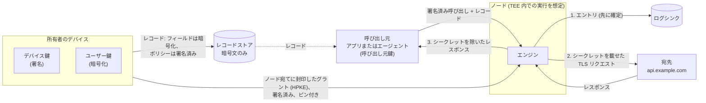
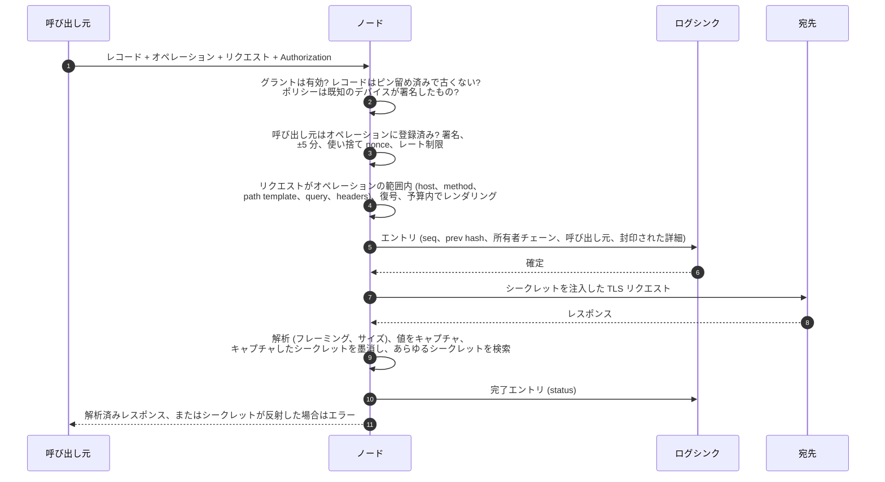
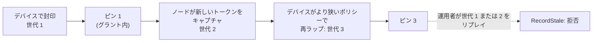
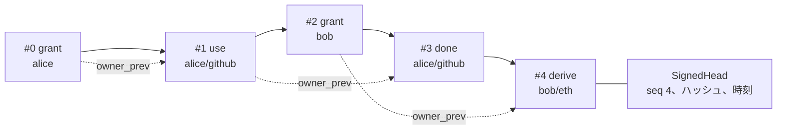
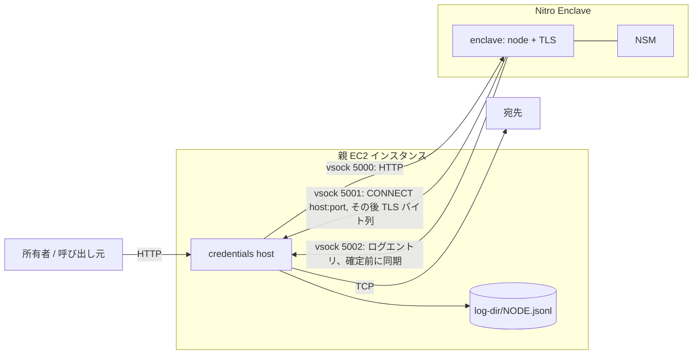

# credentials

[](https://github.com/BloubHQ/credentials/actions/workflows/ci.yml)
[](../../LICENSE)

[English](../../README.md) | [한국어](README.ko.md) | [简体中文](README.zh-CN.md) | **日本語**

アプリケーションや AI エージェントが、認証情報 (credential) を一度も**見る**ことなく**使える**
ようにするボールトエンジンです。シークレットをどこへ、どの形で送ってよいかは、所有者のデバイスが
署名付きポリシーで厳密に決めます。ノードは所有者が許可している間だけシークレットを保持し、
毎回の使用の**前に**改ざん検知可能なログエントリを書き込み、シークレットが含まれていないか
検査したレスポンスを呼び出し元に返します。

```text
caller:  "GET https://api.github.com/user"            (no token)
node:    log entry confirmed  ->  adds "Authorization: Bearer ghp_..."  ->  TLS  ->  GitHub
caller:  200 OK {"login": "octo"}                     (token removed or response dropped)
```

エンジンは認証情報の種類を一切知りません。API キー、OAuth リフレッシュ、AWS SigV4、HTTP Digest、
JWT 署名、TOTP、IMAP ログイン、mutual TLS (相互 TLS)、Ethereum 署名は、すべてコードではなく
ポリシーのデータです。

> **ステータス: 0.x、監査未実施。** エンジンはテスト済みで内部レビューも受けていますが、外部の
> セキュリティ監査は受けておらず、フォーマットは変更される可能性があります。本番のシークレットを
> 任せる前に [脅威モデル](../threat-model.md) を読んでください。

## 目次

- [仕組み](#仕組み)
- [クイックスタート](#クイックスタート)
- [ポリシー](#ポリシー)
- [レコード、世代、ロールバック](#レコード世代ロールバック)
- [ログ](#ログ)
- [ノードの運用](#ノードの運用)
- [Nitro Enclave での実行](#nitro-enclave-での実行)
- [保証すること](#保証すること)
- [計測結果](#計測結果)
- [しないこと](#しないこと)
- [クレート](#クレート) · [開発](#開発) · [セキュリティ](#セキュリティ) · [ライセンス](#ライセンス)

## 仕組み



登場するのは 4 つの当事者と 4 種類の鍵です。

| 当事者 | 鍵 | 役割 |
| --- | --- | --- |
| 所有者のデバイス | `DeviceKey` (Ed25519) | ポリシー、グラント、ピン、失効、他のデバイスに署名する |
| 所有者 | `UserKey` (256-bit) | レコードを暗号化する (HKDF でレコードごとに鍵を導出)。ノードはグラントの間だけこれを保持する |
| 呼び出し元 | `CallerKey` (Ed25519) | 各呼び出しに署名する。どの呼び出し元がどのオペレーションを実行できるかはポリシーに列挙される |
| ノード | `NodeKey` (Ed25519) | ログに署名する。ここから導出した X25519 鍵で封印されたグラントを開く |

1 回の呼び出しを順に示します。ログエントリより前のチェックは痕跡を残しません。確定したエントリ
なしにノードから出ていくものはありません。



## クイックスタート

```sh
git clone https://github.com/BloubHQ/credentials && cd credentials
cargo test --workspace
GITHUB_TOKEN=ghp_... cargo run -p transport --example github_user
```

[`github_user`](../../crates/transport/examples/github_user.rs) の例は、すべての部品を 1 つのプロセスで
動かします。デバイスがトークンをレコードに封印し、`GET https://api.github.com/user` だけを許可する
ポリシーに署名して、ノードにグラントを与えます。アプリケーションが呼び出しに署名し、ノードはログを
記録してトークンを注入し、TLS でリクエストを送ってレスポンスを返します。コードでは次のとおりです。

```rust
// 所有者のデバイス上で。
let policy = device.sign_policy(policy)?;
let record = Record::seal(&user_key, "github", "me", policy, &values)?;
let terms = GrantTerms::new("me", Duration::from_secs(600)).pin(&record);
let grant = device.grant(&user_key, &node.identity(), terms)?;

// ノード上で。
node.grant(&grant)?;

// アプリケーション内: レコード (暗号文) と呼び出し元鍵を保持するが、トークンは決して持たない。
let body = Body::http(request);
let call = app.sign_call("example", &node.public_key(), record, "github", body)?;

// ノード上で: ログを書き、トークンを注入して TLS で送り、応答にトークンがないか確認する。
let outcome = node.run(&call, &mut TlsTransport::new());
```

## ポリシー

ポリシーは、レコードの **fields** (フィールド)、それを使える **callers** (呼び出し元)、彼らが実行
できる **operations** (オペレーション) を定めます。ポリシーはデバイスが署名し、その署名とレコードの
暗号化の両方に結び付けられるため、所有者抜きで値の行き先を変えることは誰にもできません。完全な
リファレンスは [docs/policy.md](../policy.md) にあります。

```json
{
  "fields": [
    {"name": "client_id", "secret": false},
    {"name": "client_secret", "secret": true},
    {"name": "refresh_token", "secret": true},
    {"name": "access_token", "secret": true, "optional": true}
  ],
  "callers": [
    {"name": "billing-agent", "key": "<caller public key>",
     "operations": ["refresh", "call"], "limit": {"count": 100, "window_ms": 60000}}
  ],
  "operations": [
    {"name": "refresh", "steps": [
      {"do": "open", "connection": "https",
       "destinations": [{"host": "auth.example.com", "port": 443}]},
      {"do": "send", "request": {"from": "fixed", "method": "POST", "path": "/oauth/token"},
       "inject": [{"target": {"kind": "body"},
                   "template": "grant_type=refresh_token&refresh_token={{pct(refresh_token)}}&client_id={{pct(client_id)}}&client_secret={{pct(client_secret)}}"}]},
      {"do": "receive", "capture": [{"source": {"from": "json", "pointer": "/access_token"},
                                     "into": {"kind": "field", "name": "access_token"}}]},
      {"do": "return", "response": {"body": {"json": ["/expires_in"]}}}
    ]},
    {"name": "call", "steps": [
      {"do": "open", "connection": "https",
       "destinations": [{"host": "*.api.example.com", "port": 443}]},
      {"do": "send",
       "request": {"from": "caller", "methods": ["GET", "POST"],
                   "paths": ["/v1/invoices", "/v1/invoices/*"], "headers": ["Accept"],
                   "query": [{"name": "status", "one_of": ["open", "paid"]},
                             {"name": "limit", "min": "1", "max": "100"}]},
       "inject": [{"target": {"kind": "header", "name": "Authorization"},
                   "template": "Bearer {{access_token}}"}]},
      {"do": "return", "response": {"headers": ["Content-Type"], "body": "all"}}
    ]}
  ]
}
```

オペレーションは 1 本の接続上の **ステップ** の列です: `open` (HTTPS、TLS ストリーム、または接続なし)、
`send`、`receive` (キャプチャ付き)、`compute` (テンプレートを後続ステップが読む名前に入れる)、そして
呼び出し元に何を返すかを決める `return`。

| 接続 | 役割 |
| --- | --- |
| `https` | 1〜8 リクエスト。各 `send` は **契約** (method、パステンプレート、ヘッダー、クエリパラメータとその値) の範囲内の呼び出し元のリクエスト、またはポリシーが固定したリクエストを、値を注入して送る。`receive` はそのレスポンスから値をキャプチャしてフィールド (新しいレコード世代) または一時値に入れる。`return` はステータスと、列挙したヘッダーと JSON メンバーだけを返す (すべては `"body": "all"`)。 |
| `tls` | 1 本の TLS 接続上での send/receive スクリプト (IMAP、SMTP、行指向プロトコル)。その後、`return` が中継するパターンに send が一致する呼び出し元のやり取りだけを行う。 |
| なし | `return` がテンプレートをレンダリングして呼び出し元に返す: 署名、HMAC、TOTP コード、JWT。呼び出し元の `$input` は先にオペレーションの `input` スキーマ (raw バイト、JSON、RLP: 固定メンバー、許可値、数値範囲、ノードが入れる時刻) で検査される。 |

ステップ以前の形式 (`"kind": "http" | "stream" | "derive"`) のポリシーは `credentials policy upgrade`
で変換する。結果は呼び出し元が受け取るものを狭め、その内容を知らせる。再署名が必要。

値は**テンプレート**を通して入ります: `{{ hex(hmac_sha256(secret, $query)) }}`。この言語には名前、
変数、文字列リテラル、関数呼び出し、`+` があり、分岐やループはありません。ポリシーが署名される前に、
すべてのテンプレートが解析されます。

- **テイント (taint)。** シークレットを可逆な形で保持する値は *tainted* (汚染されている) です。
  エンコードはテイントを保ちます。ハッシュ、MAC、署名、`len` はテイントを除去します。ただし、シークレットだけのハッシュは例外です。鍵を先にハッシュして使う場所 (長い HMAC 鍵、Ed25519 シード) では鍵と同じだからです。シークレットから導出した鍵 (HKDF、Concat KDF、SP 800-108、Kerberos DK) もシークレットであり、出力の長さがシークレットに依存してはなりません。シークレット
  フィールドを鍵とする暗号化が隠すのは鍵だけです。メッセージ、nonce、データに含まれるシークレットは
  tainted のままです。別のオペレーションが同じ鍵で選んだバイトを暗号化できるからです。出力が tainted な
  導出は拒否されます。
- **オラクル (oracle)。** シークレットと、呼び出し元またはサーバーが選ぶ値とは、結果からシークレットが
  少しずつ明らかになる場所で出会ってはなりません: `replace`、`xor`、`slice`、`between`、`add`、
  `json_set` のキー、デコーダー、数値引数や鍵引数などです。`len(replace(key, $input, ""))` と
  `slice(key, $input, "1")` は拒否されます。ハッシュ名と曲線名はポリシーが決め、RSA 暗号化の鍵は
  呼び出し元から来ません。
- **推測可能なフィールド。** 導出が `guessable` と指定されたフィールド (PIN、パスワード) に依存できるのは
  `len` を通してだけです。そのハッシュ、署名、MAC、暗号文はどれも呼び出し元に推測を照合させてしまいます。
- **ステップ。** `compute` ステップの名前はそのテンプレートとまったく同じ性質を持つので、ステップ間で
  渡す値もインラインで書いたのと同じように解析される。
- **予算 (budget)。** 1 つのオペレーションでレンダリングできるのは最大 128 MiB、PBKDF2 1,000,000
  ラウンド、署名と鍵合意あわせて 32 回までです。

| 認証情報 | ポリシー |
| --- | --- |
| Bearer トークン、Cookie、API キー | ヘッダーテンプレート 1 つ |
| Telegram ボット | パステンプレート `/{token}/getMe` で `path_param` `token` = `bot{{token}}` |
| 取引所の HMAC 署名 | クエリ `signature` = `{{ hex(hmac_sha256(secret, $query)) }}` |
| AWS SigV4 | ヘッダーテンプレート 2 つ (`time`、`canonical_query`、ネストした `hmac_sha256`)。テストが公式ベクターを再現する |
| HTTP Digest | ステップ 1 で `header_param` により `realm`/`nonce` をキャプチャし、ステップ 2 で `md5` により応答する。RFC 2617 のベクター |
| OAuth リフレッシュ | `fixed` POST、`json` キャプチャでフィールドへ: ノードは新しいレコードを返す |
| セッションログイン | `fixed` POST /login、`cookie` キャプチャで一時値へ、呼び出し元のリクエストに `Cookie` |
| CSRF トークン付きのログインフォーム | `html` キャプチャ `input[name=_csrf]` (`value`) を一時値へ、続けて `fixed` POST /login |
| ブラウザーで暗号化するパスワード | `ecdh("p256", server_key)` + `sha256` + `aes_cbc_encrypt`、`u8(len(…))` の長さ接頭辞と `ecdh_public("p256")`。またはサーバーからキャプチャした鍵で `rsa_encrypt_oaep("sha256", key, password)` |
| JWT RS256 | 接続なし: `b64urlraw(header) + "." + b64urlraw($input) + "." + b64urlraw(rsa_sign_pkcs1_sha256(pem(key), …))` |
| ポリシーが有効期間を決める JWT | `iss`/`aud` を固定し `iat`/`exp` をノードが `set` する `json` input スキーマ、またはテンプレートの `json_set_number(..., "exp", add($unix, "300"))` |
| Ethereum | 接続なし: `{{ k256_sign_recoverable(key, keccak256($input)) }}` と、宛先・チェーン・data を固定し金額を制限する `rlp` input スキーマ |
| IMAP | tls: グリーティングを receive、`a1 LOGIN {{user}} {{password}}` を send、receive、ポリシーが列挙したコマンドだけ中継 |
| TOTP | 接続なし: `{{ totp(b32decode(seed)) }}` |
| Mutual TLS | `open` の `"identity": {"cert": "{{cert}}", "key": "{{key}}"}` |

**型付きアイテム。** ポリシーはレコードを種類 (kind) に結び付けられます: `card`、`login`、
`oauth`、`identity`、`totp`、`ssh`、`database`、`ftp`、`mail`、`queue`、`vpn`、`api`、
または所有者のデバイスが署名した独自の種類。種類は各フィールドが secret・masked・public の
どれかを定め、値を検査し (Luhn、ノードの時計による有効期限、カードブランドごとのセキュリティ
コード長、正確なオリジン、SSH ホスト鍵、署名された例外がなければ TLS 必須)、ポリシーにできる
ことを制限します。ノードは種類より広い型付きポリシーを、署名済みであっても拒否します。呼び出し
側は型付きレコードを `describe` して公開フィールドと `visa ••••4242` のようなマスク値を
得るだけで、secret フィールドは決して得られません。

**サイトのコード。** ログインがサイト自身の WebAssembly でパスワードを暗号化・梱包し、その手順を
テンプレートで書けないとき、`run` ステップは宛先自身のオリジンからモジュールを取得する (URL と、
できれば SHA-256 を署名済みポリシーに置く) か、ノードにコンパイルされたレビュー済みライブラリを使い、
サンドボックスで実行します (インタプリタ wasmi: I/O・時計・乱数なし、燃料とメモリの上限)。出力は
ポリシーが同じオリジンに固定したリクエストにしか入れられず、呼び出し元にも、ほかの宛先にも、ログにも
行きません。それ以外の使い方は署名時にすべて拒否されます。ハッシュを固定しないモジュールはフラグが
付きます。測定結果と JavaScript の計画は [docs/sandbox.md](../sandbox.md) にあります。

**署名の前に。** `summarize` は secret ごとに送り先と形式、返るもの、リスクフラグ (アイテムの
オリジン外の宛先、ワイルドカード、平文 HTTP、任意バイトの入力、可逆な出力、リレー、新しい
バージョンが前より広げたものすべて) を示します。形式には JSON Schema
`crates/engine/policy.schema.json` があります。詳細は [docs/policy.md](../policy.md)。

**所有者を待つ操作。** `await` ステップは、所有者のデバイスが答えるまで操作をノードのメモリに保持します
(最長 5 分、ログに残さず、再起動で消える)。答えは、ノードに封印され署名されたワンタイムコード
(`answer_challenge`、呼び出し元は入力しない)、またはノードがサイトにポーリングして確かめる別アプリでの
承認です。カードのすべての利用、所有者が指定した操作、所有者の支出上限 (アイテム、加盟店、1 日、30 日
ごと、デバイスが署名) を超える支払いは、ノードが確かめた値 (加盟店、金額、通貨、マスクしたカード) から
作った要約への承認を待ちます。ノードが得たセッションには有効期限があり、ポリシーのログイン操作か所有者が
更新します。呼び出し元は受け取った id で操作を再開し、その呼び出し元だけが再開できます。

## レコード、世代、ロールバック

レコードとは、ユーザー鍵とレコード ID から導出した鍵のもとで ChaCha20-Poly1305 により暗号化された
フィールド群であり、ID、所有者、**世代 (generation)**、署名済みポリシーが関連データ (associated data)
に含まれます。再封印のたびに世代が 1 つ増えます。



ノードは、所有者がピン留めしていない (グラント内、または `DeviceKey::pin` で) レコードを拒否し、
自分が見た最新の世代や所有者がピン留めした世代より古い世代をすべて拒否します。グラントがピンを
運ぶため、新しいレコードを一度も見ていない新規ノードでも古いレコードを拒否します。

## ログ

各エントリはノードが署名し、二重にチェーンされます。直前のエントリへのチェーンと、同じ所有者の
前回のエントリへのチェーンです。所有者は他者のエントリなしで自分のエントリを検証でき、署名付き
チェックポイント (`SignedHead`) が先頭を固定するので、末尾が切り取られれば判明します。



エントリには、誰がどのレコードを、いつ、どの呼び出し元で、どのオペレーションに使ったかが記録されます。
値が**どこへ**行き、何が送られたか (ホスト、パス、ボディのハッシュ) は所有者のユーザー鍵宛てに封印
されます。ログストアはそれを読めませんが、所有者は読めます (`log::open_detail`、または
`credentials verify --owner alice --user-key key.txt`)。ノードは確定したエントリなしには決して動作しません。
トランスポート関数は `Confirmed` を受け取り、これはシンクが `Ok` を返した後に `Log::commit` だけが
生成できます。シンクが失敗すると、ログは整合が取れるまで停止します。

```sh
credentials verify log.jsonl <node-public-key>                   # the whole chain
credentials verify log.jsonl <node-public-key> --head head.json  # must end at a signed checkpoint
credentials verify log.jsonl <node-public-key> --owner alice     # one owner's chain
credentials verify log.jsonl <node-public-key> --owner alice --user-key key.txt   # with the details
```

## ノードの運用

- **トランスポート。** `transport::TlsTransport` (ring プロバイダーを使う rustls、Mozilla のルート証明書、
  クライアント証明書、接続/読み取り/全体のデッドライン、サイズ制限)。接続を所有者が署名したホストに
  結び付けるのは宛先の証明書であり、DNS は信頼しません。
- **ゼロ化アロケーター。** ノードを動かすバイナリにこれをインストールしてください。エンジンが手の届か
  ない依存クレートのバッファ (TLS レコード、解析済みの RSA 鍵) が、解放時に消去されます。

  ```rust
  #[global_allocator]
  static ALLOCATOR: zeroizing_alloc::ZeroAlloc<std::alloc::System> =
      zeroizing_alloc::ZeroAlloc(std::alloc::System);
  ```

  計測結果: 署名 1 回あたり解放済みメモリに残る RSA 鍵のコピーは 1 から 0 になり、時間は 3–12%
  増えます (下の表を参照)。
- **アテステーション。** ノードは TEE (SGX、TDX、SEV-SNP、Nitro) で実行してください。
  `NodeIdentity::report_data()` (ログ鍵と封印鍵に対する SHA-512) を quote の report data に入れます。
  所有者はグラントを封印する前に、quote とその値を検証します。AWS Nitro Enclaves は統合済みです。
  [Nitro Enclave での実行](#nitro-enclave-での実行) を参照してください。所有者の検証は
  [`attest`](../../crates/attest) クレートと `credentials attest` が行います。
- **鍵と再起動。** `NodeKey::to_bytes()` はエンクレーブに封印して保管してください。再起動後、
  `Node::restore(key, sink, clock, entries)` がチェーンを継続し、レコードの下限世代、既知のデバイス、
  最後のグラント時刻を復元します。所有者はグラントを再度与え、再起動前に発行・署名されたものは受け付けられません。
  `Node::checkpoint()` は運用者が巻き戻せない場所 (封印ストレージ、単調カウンター) に保存し、
  `Node::restore_anchored` で再起動してください。切り詰められたログを拒否します。
- **コマンドラインとサーバー。** [`credentials`](../../crates/cli) で鍵の生成、ポリシーの署名、レコードの封印、
  グラントと署名付き呼び出しの作成ができ、`credentials serve` は永続的な JSONL ログとともに HTTP でノードを
  実行します。
- **並行性。** すべてのメソッドは `&self` を取るので、1 つのノードをスレッド間で共有できます。
  トランスポートの I/O はノードのロックの外で実行されます。

## Nitro Enclave での実行

[`enclave`](../../crates/enclave) プログラムは AWS Nitro Enclave の中でノードを実行し、`credentials host`
は親インスタンス上でその隣で動きます。エンクレーブにはネットワークもディスクもなく、親への vsock が
唯一の経路です。



- **起動。** カーネルが NSM (`nsm-hwrng`) から乱数を得ていなければプログラムは起動を拒否し、その後
  新しいノード鍵を生成します。Nitro には封印ストレージがありません。**再起動したエンクレーブは新しい
  ノード**であり、新しいアイデンティティと新しいログファイルを持ちます。所有者はそのノードにグラントを
  与え直します (グラントは 1 つのノードの鍵に封印されるので、もともと再起動を越えて残りません)。
- **API。** vsock ポート 5000 で `credentials serve` の HTTP API ([`server`](../../crates/server)
  クレートの同じサーバーコード) を提供し、加えて `GET /attestation?nonce=<base64url>` があります。
  応答は `{"identity": <NodeIdentity>, "document": <base64url>}` です。document は COSE で署名された NSM
  のアテステーションドキュメントで、`user_data` は `NodeIdentity::report_data()`、`nonce` は呼び出し側が
  渡したもの (1〜512 バイト) です。
- **グラントの前に**、所有者はドキュメントを検証します。AWS Nitro のルートまでの証明書チェーン、リリースの
  `measurements.json` と照合した PCR0、PCR1、PCR2 (PCR がすべてゼロならデバッグモードのエンクレーブで、
  親がそのメモリを読めます)、自分が送った nonce、そして `user_data` がこれからグラントを与えるアイデン
  ティティの `report_data()` と等しいことです。
- **外向き通信 (egress)。** TLS はエンクレーブ内にとどまります (vsock の `Connector` 上の `TlsTransport`)。
  接続ごとに、ノードは署名済みポリシーと宛先を照合した後、ホストに `CONNECT host:port` を送ります。ホストは
  TCP で接続し (`--allow` が指定されていればその項目にのみ)、その後は暗号文を双方向に運びます。DNS は
  ホストが解決します。接続を結び付けるのは、エンクレーブがない場合と同じく宛先の証明書の検証です。
- **ログ。** エントリはホストに送られ、ホストは各エントリを `<log-dir>/<node log key>.jsonl` に追記し、
  `sync_data` してから確定を返します。ノードはその確定を受けて初めてエントリが保存されたとみなし、そう
  でなければ停止し、ホストが報告する内容と整合を取ります。チェックポイントは
  `<node log key>.jsonl.head.json` に書かれます。ログはいつもどおり `credentials verify` で検証してください。
- **時計。** ノードはエンクレーブのシステム時計を使い、これはホストのハイパーバイザーから来ます
  ([脅威モデル](../threat-model.md) を参照)。

### グラント前のノード検証

AWS Nitro Enclave 内のノードは、アテステーションドキュメントの `user_data` に
`NodeIdentity::report_data()` を入れます。所有者はグラントを封印する前に、新しいランダムな nonce
(32 バイト) をノードに送ってドキュメントを受け取り、受け入れるリリースの `measurements.json`
(`{"release": ..., "git_commit": ..., "pcr0": ..., "pcr1": ..., "pcr2":
...}`、オブジェクト 1 つまたは配列。PCR は hex) と照合します。

```sh
credentials attest --document doc.cbor --nonce <base64url> --measurements measurements.json \
    --identity identity.json
credentials grant ... --node identity.json \
    --attestation doc.cbor --nonce <base64url> --measurements measurements.json
```

`attest::verify` (と両方のコマンド) は、次をすべて満たさない限りドキュメントを拒否します。

- ES384 で署名された COSE_Sign1 で (protected header はちょうど `{1: -35}`)、ペイロードが Nitro Secure
  Module のマップであり、`digest` が `SHA384` であること。
- 証明書が `cabundle` の中間証明書を経て、ピン留めされた AWS Nitro Enclaves Root-G1 (SHA-256
  `641a0321...79bb5b`) までチェーンし、ドキュメントが示す時刻に有効であること。ドキュメント内のルートの
  コピーは信頼しません。
- 署名がその証明書の P-384 鍵で検証できること。
- nonce が所有者の送ったものであること。これにより古いドキュメントはリプレイできません。
- PCR0、PCR1、PCR2 がすべてゼロではなく (すべてゼロならホストがメモリを読めるデバッグエンクレーブ)、
  受け入れるリリースのいずれかと一致すること。これにより古いビルドや未知のビルドは、その計測値がリスト
  から外れた時点で拒否されます。
- `--identity` を指定した場合 (`grant --attestation` では常に)、`user_data` がノードのアイデンティティの
  `report_data()` と等しいこと。これにより、グラントの宛先となる封印鍵はアテストされたエンクレーブの
  ものになります。

`--attestation` なしの `credentials grant` も引き続き動作しますが、警告を表示します。その場合、どの
コードが封印鍵を持っているかを示すものが何もないためです。

### エンクレーブイメージファイルのビルド

```sh
build/reproduce.sh --release dev --out out   # needs git and Docker with buildx
```

`build/build.sh` はワークツリーではなくコミット `HEAD` をビルドします。`build/Dockerfile.enclave` が、
digest で固定した Rust 1.97.1 イメージの中で、`--locked`、コミット時刻に設定した `SOURCE_DATE_EPOCH`、
リマップしたパスを使って `enclave` を `x86_64-unknown-linux-musl` 向けに静的コンパイルします。次に、
digest で固定し `aws-nitro-enclaves-cli` をバージョンで固定した Amazon Linux 2023 イメージで、
`nitro-cli build-enclave` が `enclave.eif` を作ります。`measurements.json` には、リリース、コミット、
PCR0、PCR1、PCR2、そしてすべての入力 (イメージ、コミットのファイル、nitro-cli が加えるカーネルと init、
プログラム) の SHA-256 が入ります。`build/reproduce.sh` は 2 回ビルドし、2 回目はキャッシュを一切使わず、
計測値が一致しなければ失敗します。CI はエンクレーブやそのビルドが変わるたびにこれを実行し、各リリースは
`enclave.eif`、`measurements.json`、プログラムの SBOM `enclave-<tag>.cdx.json` を添付し (`SHA256SUMS`
とビルドの来歴 (provenance) アテステーションに含まれる。`credentials` バイナリの SBOM は
`credentials-<tag>.cdx.json`)、リリースノートに計測値を載せます。EIF ファイル自体はビルドごとに異なります (メタデータに
ビルド時刻が入る) が、PCR は変わりません。

### 実行する

`aws-nitro-enclaves-cli` とアロケーターを設定した Nitro 対応インスタンス上で:

```sh
nitro-cli run-enclave --eif-path enclave.eif --cpu-count 2 --memory 1024 --enclave-cid 16
credentials host --enclave-cid 16 --log-dir /var/lib/credentials \
  --listen 127.0.0.1:8700 --allow api.github.com:443
curl -s "http://127.0.0.1:8700/attestation?nonce=$(head -c 32 /dev/urandom | basenc --base64url | tr -d '=')"
```

`credentials host` は先に、または直後に起動してください。ノードは起動時にログライターへ接続し、接続
できなければ停止します。`credentials host` については [crates/host](../../crates/host)
で説明しています。

### 新しいリリースへの引き継ぎ

再起動したエンクレーブは新しいノードですが、新しいリリースが出たからといってノードが所有者を
失う必要はありません。ノードは状態を新しいリリースのノードへ引き継ぎます（`docs/design.md`
10 節）。

```sh
nitro-cli run-enclave --eif-path enclave-v1.1.0.eif --cpu-count 2 --memory 1024 --enclave-cid 17
credentials hand-over --from-cid 16 --to-cid 17 \
  --statement successor.json --bundle successor.sigstore.json
credentials verify old.jsonl <旧ノードの鍵> --next new.jsonl --head new.jsonl.head.json
```

- **後継ステートメント。** 各リリースは `successor.json`（「リリース X はリリース Y のこの
  計測値へ引き継げる」）と `successor.sigstore.json` を公開します。リリースワークフローが
  Sigstore のキーレス署名で署名し、Rekor に記録します。両ノードはオフラインで検証します
  （`crates/continuity`）：固定ルートまでの Fulcio 証明書チェーン、署名者（GitHub ホストの
  ランナーで Y のタグに対して実行されたこのリポジトリのリリースワークフロー）、Rekor の署名付き
  エントリタイムスタンプと包含証明。Y は X より新しくなければなりません。
- **相互アテステーション。** 旧ノードは PCR がステートメントの Y の値であるエンクレーブにだけ
  引き継ぎ、新ノードは PCR が X の値であるエンクレーブからだけ引き継ぎます。それぞれ自分の
  nonce に対する相手の NSM ドキュメントとノード ID への結び付けを確認します。
- **移るもの。** すべての所有者のデバイス、廃止済みデバイス、レコードの下限、支出上限、
  そして後継を許可したグラントのユーザー鍵（既定。`credentials grant --no-successor` または
  `client::grant_without_successor` でグラントをそのノードに留められます）。状態は新ノードの
  鍵へ封印（HPKE）され、ホストは vsock 5003 番ポートで暗号文だけを運びます。
- **一つのログ。** 旧ノードの最後のエントリが引き継ぎで、新ノードの最初のエントリがその
  ハッシュを指します。`credentials verify --next` が両ノードにまたがる一本のチェーンを検査し、
  旧ノードは引き継ぎ後のすべての操作を拒否します。
- **旧ノードが失われた場合**はアプリが再グラントします。`client::verify_successor` が所有者が
  グラントしたリリースのステートメントで新ノードを確認し、`client::regrant` が所有者の
  ポリシーに従ってグラントします。
- **まだ無効。** ノードに組み込まれる Sigstore トラストルート
  （`crates/continuity/trust/trusted_root.json`）はコミットされるまで空で、それまでは
  すべてのステートメントが拒否されます。引き継ぎはテスト用ルートでのみ試験しています
  （テストに Nitro ハードウェアや Sigstore サービスは使いません）。

## 保証すること

- シークレットがエンジンから出るのは、確定したログエントリの後に、`Transport` を通じて、所有者が
  署名した宛先への 1 つのリクエストのバイト列としてのみです。
- `Secret` の値は表示・クローン・シリアライズできず、drop 時に消去されます。クレート外のコードは
  それを読めません (`compile_fail` の doc テスト)。
- オペレーションを実行できるのは、ポリシーに列挙された呼び出し元が、この呼び出しそのものに対する
  新しい使い捨て署名を持ち、レート制限の範囲内にある場合だけです。
- グラントは、封印された宛先のノード上でのみ、かつノードがその所有者について知っているデバイスから
  のみ開かれ (初回使用は信頼される)、リプレイできません。失効には既知のデバイスが必要です。
- レコードは、ピンやノードが見た世代を超えてロールバックできません。
- テンプレートは署名前に解析されます。導出は、シークレット、シークレットに対するオラクル、推測可能な
  フィールドの推測を照合する手段のいずれも返せません。
- レスポンスは厳格に解析され (フレーミング、エンコーディング、サイズ)、キャプチャされたシークレットは
  墨消しされます。既知の形でシークレットを含んだままのレスポンスは破棄されます。
- ログは追記専用で、署名され、ノード単位と所有者単位でチェーンされ、オフラインで検証できます。
- エンジンには `unsafe` も `unwrap`/`expect`/`panic`/インデックスアクセスもありません (lint で強制)。

## 計測結果

1 台のマシン上のリリースビルドです。攻撃ケースは内部レビューのプローブで、以前のコード (`79a21c1`)
と現在のコードに対して実行しました。メモリは計測用アロケーターで測ったピーク値です。

| ケース | 以前 | 現在 |
| --- | --- | --- |
| 64 KiB のキャプチャ済みトークン + 8 MiB のレスポンス (墨消しと検索) | 63.88 s | 0.08–0.10 s |
| 16 KiB のトークン + 4 MiB のレスポンス | 6.34 s | 0.07 s |
| 1 MiB 入力に対するテンプレート連結 ×401 | 受理、803 MiB | `Budget` エラー、129 MiB |
| PBKDF2 1,000,000 ラウンド ×127 | 12.70 s | 0.09 s 後に `Budget` エラー |
| 64 MiB のレスポンス | 1.81 s 後に通過 | 0.02 s 後に拒否 |
| ポインターキャプチャ付きの 16 MiB JSON 配列 | 400 MiB | 64 MiB |
| 16 MiB のヘッダー | 192 MiB | 0 MiB (64 KiB で拒否) |
| 16 個の一時値にキャプチャされた 16 MiB のボディ | 768 MiB | 32 MiB (64 KiB で拒否) |
| シークレットを保持したままの解放済みブロック (json キャプチャ、`b64decode`、`json`、`replace`、`json_set`) | 1, 8, 1, 1, 1 | 0, 0, 0, 0, 0 |
| RSA 秘密鍵を保持したままの解放済みブロック (署名 1 回あたり) | 1 | 1 (ゼロ化アロケーター使用時は 0) |
| P-384 秘密鍵を保持したままの解放済みブロック | 0 | 0 |

| スループット (計測用アロケーター使用) | システムアロケーター | ゼロ化アロケーター |
| --- | --- | --- |
| HMAC 導出 2,000 回 | 0.29–0.30 s | 0.31 s |
| RSA-2048 署名 200 回 | 0.129–0.130 s | 0.130–0.136 s |
| 64 KiB レスポンスの HTTP 呼び出し 1,000 回 | 0.329 s | 0.338–0.369 s |

ring の代替として RustCrypto `rsa` 0.10 も計測しました。署名 1 回あたり素数 `p` を保持した解放済み
ブロックが 11 個残った (鍵の解析と検査の間の一時値) ため、ring を使い続けます。ring は SHA-1 の
PKCS#1 v1.5 署名ができないので、`rsa_sign_pkcs1("sha1", …)` だけが RustCrypto `rsa` を通り、その
コストを負います (再計測していません)。RSA 暗号化は公開鍵しか使いません。

## しないこと

これらは設計上の限界であり、未実装のコードではありません。それぞれの説明は
[脅威モデル](../threat-model.md) にあります。

- **TEE は 1 つだけです。** AWS Nitro Enclaves は統合済みです ([Nitro Enclave
  での実行](#nitro-enclave-での実行))。それ以外の環境ではノードは普通のプロセスであり、ノードを動かして
  いる者はそのメモリを読めます。Nitro のノードには封印ストレージがないため、再起動すると新しいノードに
  なり、所有者はグラントを与え直します。
- **反射 (reflection) の検索は既知のエンコーディングしか見つけません**: 生データ、base64 (両方の
  アルファベット)、パーセントエンコーディング、JSON と hex、エスケープされた JSON 文字列です。
  エコーするシークレットを分割したり、独自に圧縮したり、暗号化したりするサーバーは検出できません。
  4〜7 バイトのシークレットフィールドは生データでのみ検索され、そのバイト列が偶然現れるとレスポンスは
  破棄されます。
- **レスポンスはバッファリングされます** (最大 16 MiB)。検索にはレスポンス全体が必要なためです。
- **サーバーがキャプチャ用に送ってくる値はサーバーのものです。** サーバーが鍵を返し、ポリシーがそれを
  鍵として使う場合、サーバーはその鍵を知っています。
- **低エントロピーのシークレット**で `guessable` と指定されていないものは、強い鍵として扱われます。
- **4 バイトより短い切り出し** (`slice`、シークレットの `u8`) は反射検索が探す長さに届きません。
  どこから切り出すかはポリシーが決め、呼び出し元は決められません。
- **初回使用は信頼されます**: ノード上での所有者に対する最初のグラントが、その所有者のデバイスを
  決めます。すべてのデバイスを失った所有者は、新しい所有者名から始めることになります。
- **ストリームセッション**は呼び出しとともに終了します。SSH、データベースのワイヤプロトコル、gRPC、
  WebSocket のフレーミングは、send/expect スクリプトで扱える範囲でしか動作しません。
- **ブラウザーログイン、ハードウェアキー**は人やデバイスを必要とし、委任できません。ワンタイムコードと
  別アプリでの承認は、ノードや呼び出し元ではなく所有者から届きます (`await` ステップ)。
- **Web ページはアプリより弱い。** [`client`](../../crates/client) パッケージはページでもアプリと同じ検証を行いますが、
  ページのサーバーは読み込みのたびに別のコードを送れます。グラントはできるだけアプリから行ってください。
  鍵もハードウェア鍵ではありません (Secure Enclave と StrongBox が保持できるのは P-256 だけです)。

## クレート

| クレート | |
| --- | --- |
| [`engine`](../../crates/engine) | シークレット、ポリシー、テンプレート、レコード、グラント、呼び出し元、ログ、レスポンス、ノード |
| [`transport`](../../crates/transport) | TCP または任意の `Connector` 上の TLS トランスポート (rustls) とエンドツーエンドの例 |
| [`server`](../../crates/server) | ノードの HTTP サーバーと、JSONL ファイルに置くそのログ |
| [`relay`](../../crates/relay) | エンクレーブとそのホストの間の vsock 接続: ポート、送信用 `CONNECT` トンネル、ログプロトコル |
| [`enclave`](../../crates/enclave) | AWS Nitro Enclave 内で動くノードプログラム (NSM アテステーション) |
| [`host`](../../crates/host) | エンクレーブの親インスタンスで動くプログラム。`credentials host` として実行 |
| [`verify`](../../crates/verify) | ノードログの検証ツール。`credentials verify` として実行 |
| [`attest`](../../crates/attest) | AWS Nitro Enclaves のアテステーションドキュメントの検証ツール。`credentials attest` として実行 |
| [`client`](../../crates/client) | iOS・Android・Web のアプリ側ライブラリ: 鍵、ノードのアテステーション検証、グラント、レコード、呼び出し。Swift と Kotlin (UniFFI)、JavaScript (wasm-bindgen) のバインディング |
| [`sandbox`](../../crates/sandbox) | `run` ステップの WebAssembly サンドボックス (wasmi): 燃料とメモリの上限、入力を受け取り出力を 1 つ返す、レビュー済みライブラリモジュール |
| [`cli`](../../crates/cli) | `credentials` ツール: 鍵、ポリシー、レコード、グラント、呼び出し、ノードサーバー、`credentials host` |

## 開発

```sh
cargo fmt --all --check
cargo clippy --workspace --all-targets --locked -- -D warnings
cargo test --workspace --locked
```

最小 Rust バージョン: 1.88 (`enclave` クレートは `aws-nitro-enclaves-nsm-api` のため 1.92)。CI では `cargo audit`、`cargo deny`、MSRV テスト、ターゲットごとに 60 秒のファジング、再現可能ビルドの
チェックも実行します。[CONTRIBUTING.md](../../.github/CONTRIBUTING.md) を参照してください。変更履歴は [CHANGELOG](../CHANGELOG.md) にあります。

## セキュリティ

脆弱性は [SECURITY.md](../../.github/SECURITY.md) に記載の方法で、非公開で報告してください。

## ライセンス

[Apache License 2.0](../../LICENSE)。
