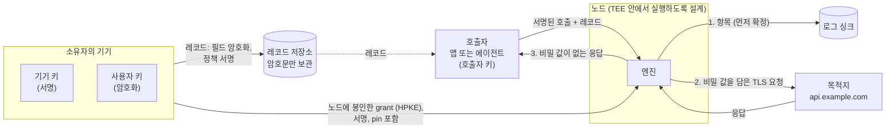
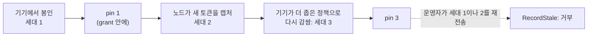
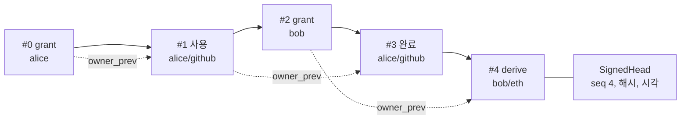
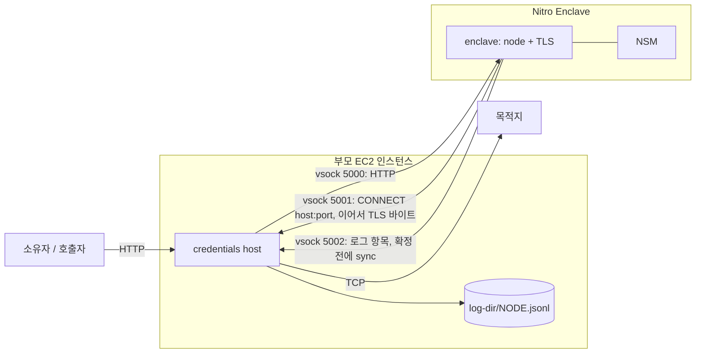

# credentials

[](https://github.com/BloubHQ/credentials/actions/workflows/ci.yml)
[](../../LICENSE)

[English](../../README.md) | **한국어** | [简体中文](README.zh-CN.md) | [日本語](README.ja.md)

애플리케이션과 AI 에이전트가 자격 증명(credential)을 **보지** 않고도 **사용**할 수 있게 해 주는
볼트 엔진입니다. 비밀 값이 정확히 어디로, 어떤 형태로 갈 수 있는지는 소유자의 기기가 서명한 정책으로
정합니다. 노드는 소유자가 허용하는 동안에만 비밀 값을 보관하고, 사용할 때마다 **그 전에**
변조 탐지가 가능한(tamper-evident) 로그 항목을 기록하며, 비밀 값이 들어 있는지 검사를 거친 응답을
호출자에게 돌려줍니다.

```text
caller:  "GET https://api.github.com/user"            (no token)
node:    log entry confirmed  ->  adds "Authorization: Bearer ghp_..."  ->  TLS  ->  GitHub
caller:  200 OK {"login": "octo"}                     (token removed or response dropped)
```

엔진은 자격 증명의 종류를 전혀 알지 못합니다. API 키, OAuth 갱신(refresh), AWS SigV4, HTTP Digest,
JWT 서명, TOTP, IMAP 로그인, 상호 TLS(mutual TLS), Ethereum 서명은 모두 코드가 아니라 정책 데이터입니다.

> **상태: 0.x, 감사받지 않음.** 엔진은 테스트를 거쳤고 내부 검토도 받았지만, 외부 보안 감사는
> 받지 않았으며 형식이 바뀔 수 있습니다. 프로덕션 비밀 값을 맡기기 전에
> [위협 모델](../threat-model.md)을 읽어 보세요.

## 목차

- [동작 방식](#동작-방식)
- [빠른 시작](#빠른-시작)
- [정책](#정책)
- [레코드, 세대, 롤백](#레코드-세대-롤백)
- [로그](#로그)
- [노드 운영](#노드-운영)
- [Nitro Enclave에서 실행](#nitro-enclave에서-실행)
- [보장하는 것](#보장하는-것)
- [측정 결과](#측정-결과)
- [하지 않는 것](#하지-않는-것)
- [크레이트](#크레이트) · [개발](#개발) · [보안](#보안) · [라이선스](#라이선스)

## 동작 방식



참여자는 넷이고 키도 네 종류입니다.

| 참여자 | 키 | 하는 일 |
| --- | --- | --- |
| 소유자의 기기 | `DeviceKey` (Ed25519) | 정책, grant(권한 부여), pin, 폐기(revocation), 다른 기기에 서명 |
| 소유자 | `UserKey` (256-bit) | 레코드를 암호화(HKDF로 레코드마다 키 생성). 노드는 grant 기간에만 이 키를 가짐 |
| 호출자 | `CallerKey` (Ed25519) | 호출마다 서명. 어느 호출자가 어느 operation을 실행할 수 있는지는 정책에 명시 |
| 노드 | `NodeKey` (Ed25519) | 로그에 서명. 여기서 파생한 X25519 키로 봉인된 grant를 엶 |

호출 하나가 처리되는 순서입니다. 로그 항목 전의 검사는 아무 흔적도 남기지 않으며, 확정된 항목 없이는
어떤 것도 노드를 떠나지 않습니다.


## 빠른 시작

```sh
git clone https://github.com/BloubHQ/credentials && cd credentials
cargo test --workspace
GITHUB_TOKEN=ghp_... cargo run -p transport --example github_user
```

[`github_user`](../../crates/transport/examples/github_user.rs) 예제는 모든 구성 요소를 한 프로세스에서
실행합니다. 기기가 토큰을 레코드에 봉인하고, `GET https://api.github.com/user`만 허용하는 정책에
서명한 뒤 노드에 grant를 줍니다. 애플리케이션이 호출에 서명하면, 노드는 로그를 남기고 토큰을 주입해
TLS로 요청을 보낸 뒤 응답을 돌려줍니다. 코드로 보면 다음과 같습니다.

```rust
// 소유자의 기기에서.
let policy = device.sign_policy(policy)?;
let record = Record::seal(&user_key, "github", "me", policy, &values)?;
let terms = GrantTerms::new("me", Duration::from_secs(600)).pin(&record);
let grant = device.grant(&user_key, &node.identity(), terms)?;

// 노드에서.
node.grant(&grant)?;

// 애플리케이션에서: 레코드(암호문)와 자신의 호출자 키만 가지며, 토큰은 절대 갖지 않는다.
let body = Body::http(request);
let call = app.sign_call("example", &node.public_key(), record, "github", body)?;

// 노드에서: 로그를 쓰고, 토큰을 넣어 TLS로 보내고, 응답에 토큰이 없는지 검사한다.
let outcome = node.run(&call, &mut TlsTransport::new());
```

## 정책

정책은 레코드의 **필드(fields)**, 그 레코드를 쓸 수 있는 **호출자(callers)**, 그리고 호출자가 실행할 수
있는 **operation(operations)** 을 정의합니다. 정책은 기기가 서명하며, 서명과 레코드 암호화가 모두
정책에 묶여 있으므로 소유자 없이는 누구도 값이 가는 곳을 바꿀 수 없습니다. 전체 레퍼런스는
[docs/policy.md](../policy.md)에 있습니다.

```json
{
  "fields": [
    {"name": "client_id", "secret": false},
    {"name": "client_secret", "secret": true},
    {"name": "refresh_token", "secret": true},
    {"name": "access_token", "secret": true, "optional": true}
  ],
  "callers": [
    {"name": "billing-agent", "key": "<caller public key>",
     "operations": ["refresh", "call"], "limit": {"count": 100, "window_ms": 60000}}
  ],
  "operations": [
    {"name": "refresh", "steps": [
      {"do": "open", "connection": "https",
       "destinations": [{"host": "auth.example.com", "port": 443}]},
      {"do": "send", "request": {"from": "fixed", "method": "POST", "path": "/oauth/token"},
       "inject": [{"target": {"kind": "body"},
                   "template": "grant_type=refresh_token&refresh_token={{pct(refresh_token)}}&client_id={{pct(client_id)}}&client_secret={{pct(client_secret)}}"}]},
      {"do": "receive", "capture": [{"source": {"from": "json", "pointer": "/access_token"},
                                     "into": {"kind": "field", "name": "access_token"}}]},
      {"do": "return", "response": {"body": {"json": ["/expires_in"]}}}
    ]},
    {"name": "call", "steps": [
      {"do": "open", "connection": "https",
       "destinations": [{"host": "*.api.example.com", "port": 443}]},
      {"do": "send",
       "request": {"from": "caller", "methods": ["GET", "POST"],
                   "paths": ["/v1/invoices", "/v1/invoices/*"], "headers": ["Accept"],
                   "query": [{"name": "status", "one_of": ["open", "paid"]},
                             {"name": "limit", "min": "1", "max": "100"}]},
       "inject": [{"target": {"kind": "header", "name": "Authorization"},
                   "template": "Bearer {{access_token}}"}]},
      {"do": "return", "response": {"headers": ["Content-Type"], "body": "all"}}
    ]}
  ]
}
```

operation은 연결 하나 위의 **step** 목록입니다: `open`(HTTPS, TLS 스트림, WebSocket, 프로토콜 연결, UDP 데이터그램, CDP로 조작하는 브라우저, 또는 연결 없음),
`send`, `receive`(캡처 포함), `compute`(템플릿을 이후 step이 읽는 이름에 담음), 그리고 호출자에게
무엇이 돌아가는지 정하는 `return`.

| 연결 | 하는 일 |
| --- | --- |
| `https` | 요청 1~8개. 각 `send`는 **계약**(method, path 템플릿, 헤더, 쿼리 파라미터와 그 값) 안의 호출자 요청이나 정책이 고정한 요청을 값을 주입해 보내고, `receive`는 그 응답에서 값을 캡처해 필드(새 레코드 세대) 또는 임시 값에 넣습니다. `return`은 상태 코드와, 나열한 헤더와 JSON 멤버만 돌려줍니다(전부는 `"body": "all"`). HTTP/2는 ALPN으로 고르며(`protocol`로 고정하면 다운그레이드하지 않음), 단항 gRPC, 도착하는 대로 넘기는 본문(`"body": "stream"`: server-sent events, chunked)을 지원하고 청크 경계를 넘어 비밀 값을 검색합니다. |
| `websocket` | 핸드셰이크 요청, 정책이 쓰는 메시지(첫 메시지 인증), 그다음 호출자가 서명한 프레임. 프레임마다 닫힌 JSON 스키마나 패턴으로 검사합니다. 서버 메시지는 `return`이 허용할 때만 비밀 값 검색을 거쳐 돌려줍니다. 유휴 시간, 지속 시간, 바이트 한도가 있고, 열릴 때와 닫힐 때 로그 항목을 하나씩 남깁니다. |
| `tls` | TLS 연결 하나 위의 send/receive 스크립트(라인 기반 프로토콜). 그다음 `return`이 중계하는 패턴에 send가 맞는 호출자의 교환만 이어 갑니다. |
| `ssh`, `postgres`, `smtp`, `imap`, `redis` | 노드가 항목의 비밀 값으로 로그인합니다(SSH는 고정한 호스트 키에 대해 비밀번호, 키, keyboard-interactive; PostgreSQL은 TLS 위 SCRAM-SHA-256; SMTP와 IMAP은 암묵적 TLS나 STARTTLS 위에서 정책이 지정한 메커니즘; Redis는 TLS 위 `AUTH`). 정책이 고정한 명령을 실행한 뒤, 이름이 붙은 호출자 명령을 실행합니다. 매개변수는 패턴에 맞아야 하고 바인딩, 인용, 인자 하나로만 들어가며 명령문에 이어 붙지 않습니다. SMTP는 발신자·수신자 규칙 안의 호출자 메일을 보냅니다. 결과는 비밀 값 검색을 거치고, SSH 셸은 `/stream`에서 돌아갑니다. 최신 알고리즘만 쓰고 다운그레이드하지 않습니다. |
| `pop3`, `ftp` | POP3는 암묵적 TLS나 `STLS` 위에서 정책이 지정한 메커니즘(`USER`/`PASS`, 약하다고 표시되는 `APOP`, SASL `PLAIN`, `LOGIN`, `XOAUTH2`)으로 로그인하고 메시지 번호만 받습니다. FTP는 TLS 위에서만(암묵적 또는 `AUTH TLS`, `PROT P`) 타입이 있는 `list`, `retrieve`, `store`, `delete`, `mkdir`, `rename`을 실행하고, 데이터 연결은 패시브로만 제어 연결과 같은 주소에 재개한 TLS로 엽니다. 평문 FTP나 POP3로는 어떤 자격 증명도 보내지 않습니다. 경로와 번호에는 명령을 실을 수 없고, 응답은 사용자 이름과 비밀번호를 지운 뒤 돌려줍니다. SFTP도 목록, stat, 이름 바꾸기, 삭제, 디렉터리 만들기·지우기를 하며 링크를 따라가지 않습니다. |
| `udp` | 정책이 고정한 목적지와 `send`마다 데이터그램 하나, `receive`마다 데이터그램 하나를 주고받습니다(RADIUS, TSIG를 쓰는 DNS, STUN). 응답이 없으면 다시 보냅니다. 그다음 `return`이 중계하는 패턴에 맞는 호출자의 데이터그램이 이어집니다. TLS가 없으므로 비밀 값은 일방향 함수(HMAC, 서명)를 거쳐서만 데이터그램에 들어갈 수 있고, 그 밖의 경우는 서명할 때 거부됩니다. |
| `browser` | 에이전트가 다른 곳에서 조작하는 브라우저의 로그인·카드 폼 채우기. 노드가 정책이 고정한 CDP 엔드포인트에 TLS로 직접 연결하고(호출자는 CDP를 중계하지 않음), 정책의 `https` origin에 있는 탭 하나를 고르며, 값마다 그 전후로 최상위 프레임과 필드가 있는 프레임의 origin을 확인합니다(교차 origin 프레임은 정책이 그 origin을 적었을 때만). 값은 노드가 격리된 world에서 고정 함수로 직접 넣고(`Runtime.evaluate`는 쓰지 않음), 제출한 뒤 페이지가 그대로면 필드를 비웁니다. 호출자는 결과와 마지막 origin만 받고 페이지 내용은 받지 않으며, CDP 명령을 보낼 수 없습니다. |
| 없음 | `return`이 템플릿을 렌더링해 호출자에게 돌려줍니다: 서명, HMAC, TOTP 코드, JWT. 호출자의 `$input`은 먼저 operation의 `input` 스키마(raw 바이트, JSON, RLP: 고정 멤버, 허용 값, 숫자 범위, 노드가 넣는 시각)로 검사합니다. |

step 이전 형식(`"kind": "http" | "stream" | "derive"`)의 정책은 `credentials policy upgrade`로
변환합니다. 결과는 호출자가 받는 것을 좁히고 그 내용을 알려 주며, 다시 서명해야 합니다.

값은 **템플릿**을 통해 들어갑니다: `{{ hex(hmac_sha256(secret, $query)) }}`. 템플릿 언어에는 이름,
변수, 문자열 리터럴, 함수 호출, `+`가 있고 분기나 반복은 없습니다(단계에는 횟수가 정해진 `repeat`와 `if`가 있고, 비밀이 영향을 주지 않는 값만 검사합니다). 정책에 서명하기 전에 모든 템플릿을
분석합니다.

- **오염(taint).** 비밀 값을 되돌릴 수 있는 형태로 담은 값은 *오염(tainted)* 된 것입니다. 인코딩은
  오염을 유지하고, 해시, MAC, 서명, `len`은 오염을 제거합니다. 단, 비밀 값만 해시한 값은 예외입니다. 키를 먼저 해시해서 쓰는 곳(긴 HMAC 키, Ed25519 시드)에서는 키와 같기 때문입니다. 비밀 값에서 유도한 키(HKDF, Concat KDF, SP 800-108, Kerberos DK)도 비밀 값이며, 출력 길이는 비밀 값에 의존할 수 없습니다. 비밀 필드를 키로 한 암호화는 키만
  가립니다. 메시지, nonce, 데이터에 든 비밀 값은 오염된 채로 남습니다. 다른 operation이 같은 키로
  고른 바이트를 암호화할 수 있기 때문입니다. 출력이 오염된 derivation은 거부합니다.
- **오라클.** 비밀 값과, 호출자나 서버가 고르는 값은 결과가 비밀 값을 조금씩 드러내는 곳에서 만날 수
  없습니다: `replace`, `xor`, `slice`, `between`, `add`, `json_set`의 키, 디코더, 숫자나 키 인자.
  `len(replace(key, $input, ""))`와 `slice(key, $input, "1")`는 거부합니다. 해시와 곡선 이름은 정책이
  정하고, RSA 암호화 키는 호출자에게서 오지 않습니다.
- **추측 가능한 필드.** derivation은 `guessable`로 표시한 필드(PIN, 비밀번호)에 `len`을 통해서만
  의존할 수 있습니다. 그 필드의 해시, 서명, MAC, 암호문은 모두 호출자가 추측을 대조하는 데 쓸 수
  있습니다.
- **step.** `compute` step의 이름은 그 템플릿과 정확히 같은 성질을 가지므로, step 사이로 넘기는 값도
  인라인으로 쓴 것과 똑같이 분석합니다.
- **압축과 XML.** 비밀 값은 압축하지 않습니다(`deflate`, `zlib_deflate`, `gzip_deflate`). 압축된
  길이가 입력이 어떻게 반복되는지 알려 주기 때문입니다(CRIME). 압축 해제 한 번은 최대 1 MiB와
  남은 예산까지만 쓰고, XML은 DTD 없이 읽으므로 외부 엔티티도 엔티티 확장도 없습니다.
- **예산(budget).** operation 하나가 렌더링할 수 있는 양은 최대 128 MiB, PBKDF2 1,000,000 라운드,
  서명과 키 합의 합쳐 32개입니다.

| 자격 증명 | 정책 |
| --- | --- |
| Bearer 토큰, 쿠키, API 키 | 헤더 템플릿 하나 |
| Telegram 봇 | path 템플릿 `/{token}/getMe`에서 `path_param` `token` = `bot{{token}}` |
| 거래소 HMAC 서명 | 쿼리 `signature` = `{{ hex(hmac_sha256(secret, $query)) }}` |
| AWS SigV4 | 헤더 템플릿 두 개(`time`, `canonical_query`, 중첩 `hmac_sha256`). 공식 벡터를 재현하는 테스트 있음 |
| HTTP Message Signatures, Hawk | `$method`, `$target_uri`, `$authority`, `$query_param("page")`와 호출자가 보낸 헤더(`$header("content-type")`, 계약에 적힌 것만)를 `ed25519_sign`이나 `hmac_sha256`으로 서명. RFC 9421 B.2.5·B.2.6과 Hawk 예제 재현 |
| 레코드의 카드 번호를 넣은 호출자 JSON의 JWE | `aes_gcm_encrypt(cek, iv, json_set($body, "card", card_number), head)` 하나의 `aead_ciphertext(...)`와 `aead_tag(...)`, 키는 `rsa_encrypt_oaep`로. RFC 7516 A.3 재현 |
| HTTP Digest | step 1에서 `header_param`으로 `realm`/`nonce`를 캡처, step 2에서 `md5`로 응답. RFC 2617 벡터 |
| OAuth 갱신 | `fixed` POST, `json` 캡처를 필드로: 노드가 새 레코드를 돌려줌 |
| 세션 로그인 | `fixed` POST /login, `cookie` 캡처를 임시 값으로, 호출자 요청에 `Cookie` |
| CSRF 토큰이 있는 로그인 폼 | `html` 캡처 `input[name=_csrf]`(`value`)를 임시 값으로, 이어서 `fixed` POST /login |
| 브라우저에서 암호화하는 비밀번호 | `ecdh("p256", server_key)` + `sha256` + `aes_cbc_encrypt`, `u8(len(…))` 길이 접두사와 `ecdh_public("p256")`; 또는 서버에서 캡처한 키로 `rsa_encrypt_oaep("sha256", key, password)` |
| JWT RS256 | 연결 없음: `b64urlraw(header) + "." + b64urlraw($input) + "." + b64urlraw(rsa_sign_pkcs1_sha256(pem(key), …))` |
| 정책이 수명을 정하는 JWT | `iss`/`aud`를 고정하고 `iat`/`exp`를 노드가 `set`하는 `json` input 스키마, 또는 템플릿의 `json_set_number(..., "exp", add($unix, "300"))` |
| SAML 서비스 제공자, WS-Security | HTTP-Redirect: `b64(deflate(authn))`와 쿼리에 대한 `rsa_sign_pkcs1_sha256` 또는 `p256_sign`. HTTP-POST: `xml_c14n("http://www.w3.org/2001/10/xml-exc-c14n#", ...)` 위의 enveloped 서명. 모두 `rsa`와 ring으로 검증 |
| OAuth 1.0a (RFC 5849) | base string 위의 `sorted_params($query, $body, ...)`와 `hmac_sha1` 또는 `rsa_sign_pkcs1("sha1", ...)`. RFC 5849 벡터, `hmac`과 `rsa`로 검증 |
| AWS Signature Version 4A | `kbkdf_ec_key("p256", "sha256", ...)`(SP 800-108 카운터 모드, FIPS 186-5 rejection sampling)와 `p256_sign_der`. 테스트에서 따로 도출한 키로 ring이 검증 |
| HTTP 위의 NTLMv2 (MS-NLMP) | 하나의 `tls` 연결에서 `md4`(약함 표시), `hmac_md5`, `utf16le`, `uint_le`, MIC 포함, 이후 relay. MS-NLMP 4.2.4 벡터 |
| Ethereum | 연결 없음: `{{ k256_sign_recoverable(key, keccak256($input)) }}`와, 받는 주소·체인·data를 고정하고 금액을 제한하는 `rlp` input 스키마 |
| IMAP | tls: 인사말 receive, `a1 LOGIN {{user}} {{password}}` send, receive, 정책이 나열한 명령만 중계 |
| TOTP | 연결 없음: `{{ totp(b32decode(seed)) }}` |
| 상호 TLS | `open`의 `"identity": {"cert": "{{cert}}", "key": "{{key}}"}` |

**타입 항목.** 정책은 레코드를 종류(kind)에 묶을 수 있습니다: `card`, `login`, `oauth`,
`identity`, `totp`, `ssh`, `database`, `ftp`, `mail`, `queue`, `vpn`, `api`, 또는 소유자의
기기가 서명한 사용자 정의 종류. 종류는 각 필드가 비밀(secret)·마스킹(masked)·공개(public) 중
무엇인지 정하고, 값을 검사하며(Luhn, 노드 시계 기준 만료일, 카드 브랜드별 보안 코드 길이,
정확한 origin, SSH 호스트 키, 서명된 예외가 없으면 TLS 필수), 정책이 할 수 있는 범위를
제한합니다. 노드는 종류보다 넓은 타입 정책을 서명되어 있어도 거부합니다. 호출자는 타입 레코드를
`describe`해 공개 필드와 `visa ••••4242` 같은 마스킹 값을 받을 뿐, 비밀 필드는 절대 받지
못합니다.

**사이트 코드.** 로그인이 사이트 자신의 WebAssembly로 비밀번호를 암호화하거나 포장하고 그 과정을
템플릿으로 쓸 수 없을 때, `run` step이 목적지 자신의 출처(origin)에서 모듈을 받아 오거나(URL과,
가능하면 SHA-256을 서명된 정책에 둠) 노드에 컴파일된 검토된 라이브러리를 골라 샌드박스에서 실행합니다
(인터프리터 wasmi: I/O, 시계, 난수 없음, 연료와 메모리 한도). 그 출력은 정책이 같은 출처로 고정한
요청에만 들어갈 수 있고, 호출자에게도, 다른 목적지에도, 로그에도 가지 않습니다. 다른 쓰임은 서명할 때
모두 거부됩니다. 해시를 고정하지 않은 모듈은 표시됩니다. 측정 결과와 JavaScript 계획은
[docs/sandbox.md](../sandbox.md)에 있습니다.

**서명 전에.** `summarize`는 비밀마다 갈 수 있는 곳과 형태, 돌아오는 것, 위험 플래그(항목의
origin 밖 목적지, 와일드카드, 평문 HTTP, 아무 바이트나 받는 입력, 되돌릴 수 있는 출력, 릴레이,
새 버전이 이전보다 넓힌 모든 것)를 보여 줍니다. 형식에는 JSON Schema
`crates/engine/policy.schema.json`이 있습니다. 자세한 내용은
[docs/policy.md](../policy.md)에 있습니다.

**소유자를 기다리는 작업.** `await` 단계는 소유자의 기기가 답할 때까지 작업을 노드 메모리에
보관합니다(최대 5분, 로그에 남기지 않고 재시작하면 사라짐). 답은 노드에 봉인되고 서명된 일회용
코드(`answer_challenge`, 호출자가 입력하지 않음)이거나, 노드가 사이트에 폴링해 확인하는 다른 앱에서의
승인입니다. 카드의 모든 사용, 소유자가 표시한 작업, 소유자의 지출 한도(항목, 가맹점, 하루, 30일 단위로
기기가 서명)를 넘는 결제는 노드가 확인한 값(가맹점, 금액, 통화, 가린 카드)으로 만든 요약에 대한 승인을
기다립니다. 노드가 얻은 세션에는 만료가 있고, 정책의 로그인 작업이나 소유자가 갱신합니다. 호출자는
받은 id로 작업을 이어 가며, 그 호출자만 그럴 수 있습니다.

**위임, 긴급 접근, 발급.** 소유자의 기기는 다른 소유자의 호출자가 레코드 하나를, 기기가 서명한 더 좁은
정책(더 넓은 작업 없음, 레코드로 캡처 없음)으로 쓰게 할 수 있습니다. 레코드 키는 위임받는 쪽이 아니라
노드에만 봉인됩니다. 대기 기간을 두면 긴급 접근이 됩니다. 위임받은 쪽의 첫 호출이 대기를 시작하고 양쪽
소유자 로그에 남으며, 열리기 전에 소유자의 기기가 취소하거나 위임을 철회할 수 있습니다. 작업은 비밀로
만든 자격 증명(짧은 수명 토큰, 서명된 URL)을 발급할 수 있고, 노드는 정책의 수명(최대 12시간)보다 늦게
만료되는 것을 거부하며 아무것도 돌려주지 않습니다.

## 레코드, 세대, 롤백

레코드는 필드들을 사용자 키와 레코드 id에서 파생한 키로 ChaCha20-Poly1305 암호화한 것이며, id, 소유자,
**세대(generation)**, 서명된 정책을 연관 데이터(associated data)에 넣습니다. 다시 봉인할 때마다
세대가 1씩 늘어납니다.



노드는 소유자가 pin하지 않은 레코드(grant 안에서 또는 `DeviceKey::pin`으로)를 거부하고, 자신이 본
가장 새로운 세대나 소유자가 pin한 세대보다 오래된 세대도 거부합니다. grant가 pin을 담고 있으므로, 더
새로운 레코드를 본 적 없는 새 노드라도 옛 레코드를 거부합니다.

## 로그

각 항목은 노드가 서명하며 두 겹으로 체인됩니다. 바로 앞 항목에, 그리고 같은 소유자의 이전 항목에
연결됩니다. 소유자는 다른 소유자의 항목 없이 자신의 항목만 검증할 수 있고, 서명된 체크포인트
(`SignedHead`)가 head를 고정하므로 꼬리가 잘리면 드러납니다.



항목에는 누가 어떤 레코드를 언제, 어떤 호출자로, 어떤 operation에 썼는지가 나타납니다. 값이 **어디로**
갔고 무엇이 전송되었는지(host, path, body 해시)는 소유자의 사용자 키로 봉인됩니다. 로그 저장소는 이를
읽을 수 없고 소유자는 읽을 수 있습니다(`log::open_detail`, 또는
`credentials verify --owner alice --user-key key.txt`). 노드는 확정된 항목 없이는 절대 동작하지 않습니다. transport
함수들은 `Confirmed`를 인자로 받는데, 이 값은 싱크가 `Ok`를 반환한 뒤 `Log::commit`만 만들 수 있습니다.
싱크가 실패하면 로그는 조정(reconcile)될 때까지 멈춥니다.

```sh
credentials verify log.jsonl <node-public-key>                   # the whole chain
credentials verify log.jsonl <node-public-key> --head head.json  # must end at a signed checkpoint
credentials verify log.jsonl <node-public-key> --owner alice     # one owner's chain
credentials verify log.jsonl <node-public-key> --owner alice --user-key key.txt   # with the details
```

## 노드 운영

- **Transport.** `transport::TlsTransport` (ring provider를 쓰는 rustls, Mozilla 루트 인증서,
  클라이언트 인증서, connect/read/total 기한, 크기 제한). 연결을 소유자가 서명한 host에 묶는 것은
  목적지의 인증서이며, DNS는 신뢰하지 않습니다.
- **Zeroizing 할당자.** 노드를 실행하는 바이너리에 설치해서, 엔진이 손댈 수 없는 의존성의 버퍼(TLS
  레코드, 파싱된 RSA 키)가 해제될 때 지워지게 하세요.

  ```rust
  #[global_allocator]
  static ALLOCATOR: zeroizing_alloc::ZeroAlloc<std::alloc::System> =
      zeroizing_alloc::ZeroAlloc(std::alloc::System);
  ```

  측정 결과: 서명 하나당 해제된 메모리에 남는 RSA 키 사본이 1개에서 0개로 줄고, 시간은 3–12% 더
  걸립니다(아래 표).
- **증명(attestation).** 노드를 TEE(신뢰 실행 환경: SGX, TDX, SEV-SNP, Nitro) 안에서 실행하세요.
  `NodeIdentity::report_data()`(로그 키와 봉인 키에 대한 SHA-512)를 quote의 report data에 넣으면,
  소유자는 grant를 봉인하기 전에 quote와 그 값을 확인합니다. AWS Nitro Enclaves는 통합되어
  있습니다. [Nitro Enclave에서 실행](#nitro-enclave에서-실행)을 참고하세요. 소유자의 확인은
  [`attest`](../../crates/attest) 크레이트와 `credentials attest`가 합니다.
- **키와 재시작.** `NodeKey::to_bytes()`는 enclave에 봉인해 보관하세요. 재시작 후
  `Node::restore(key, sink, clock, entries)`가 체인을 이어 가고 레코드 하한(floor), 알려진 기기, 마지막
  grant 시각을 복원합니다. 소유자는 grant를 다시 주며, 재시작 전에 발급되거나 서명된 것은 받지
  않습니다. `Node::checkpoint()`는 운영자가 되돌릴 수 없는 곳(봉인 저장소, 단조 카운터)에 두고
  `Node::restore_anchored`로 재시작하세요. 잘린 로그를 거부합니다.
- **명령줄과 서버.** [`credentials`](../../crates/cli)로 키 생성, 정책 서명, 레코드 봉인, grant와 서명된
  호출 생성을 할 수 있고, `credentials serve`는 내구성 있는 JSONL 로그와 함께 HTTP로 노드를
  실행합니다.
- **동시성.** 모든 메서드가 `&self`를 받으므로 노드 하나를 여러 스레드가 공유하면 됩니다. Transport
  I/O는 노드의 락 밖에서 실행됩니다.

## Nitro Enclave에서 실행

[`enclave`](../../crates/enclave) 프로그램은 AWS Nitro Enclave 안에서 노드를 실행하고,
`credentials host`는 부모 인스턴스에서 그 옆에 붙어 실행됩니다. enclave에는 네트워크도 디스크도 없으며,
부모로 가는 vsock이 유일한 연결입니다.



- **부팅.** 프로그램은 커널이 NSM(`nsm-hwrng`)에서 난수를 얻지 않으면 시작을 거부하고, 그다음 새 노드
  키를 생성합니다. Nitro에는 봉인 저장소가 없으므로 **재시작한 enclave는 새 노드**이며 새 신원(identity)과
  새 로그 파일을 갖고, 소유자는 그 노드에 grant를 다시 줍니다(grant는 한 노드의 키에 봉인되므로 어차피
  재시작 후에는 남지 않습니다).
- **API.** vsock 포트 5000에서 `credentials serve`의 HTTP API([`server`](../../crates/server) 크레이트의 같은
  서버 코드)를 제공하고, 여기에 `GET /attestation?nonce=<base64url>`이 더해집니다. 이 요청은
  `{"identity": <NodeIdentity>, "document": <base64url>}`로 답합니다. document는 COSE로 서명된 NSM 증명
  문서로, `user_data`는 `NodeIdentity::report_data()`이고 `nonce`는 호출한 쪽이 보낸 값(1~512바이트)입니다.
- **grant 전에** 소유자는 문서를 확인합니다. AWS Nitro 루트까지 이어지는 인증서 체인, 릴리스의
  `measurements.json`과 비교한 PCR0, PCR1, PCR2(PCR이 모두 0이면 부모가 메모리를 읽을 수 있는 디버그 모드
  enclave), 자신이 보낸 nonce, 그리고 `user_data`가 지금 grant를 주려는 신원의 `report_data()`와 같은지를
  봅니다.
- **외부 연결(egress).** TLS는 enclave 안에 머뭅니다(vsock `Connector` 위의 `TlsTransport`). 연결마다 노드는
  서명된 정책과 목적지를 대조한 뒤 host에 `CONNECT host:port`를 보내고, host는 TCP로 연결해(`--allow`가
  주어지면 그 항목에만) 양방향으로 암호문을 나릅니다. DNS는 host가 해석하며, 연결을 묶는 것은 enclave가
  없을 때와 마찬가지로 목적지의 인증서 확인입니다.
- **로그.** 항목은 host로 가고, host는 각 항목을 `<log-dir>/<node log key>.jsonl`에 추가하고 `sync_data`한
  뒤에 확정합니다. 노드는 그 확정을 받은 뒤에만 항목이 저장된 것으로 보고, 그렇지 않으면 멈추며, host가
  알려 주는 상태와 조정(reconcile)합니다. 체크포인트는 `<node log key>.jsonl.head.json`에 저장됩니다.
  로그는 평소처럼 `credentials verify`로 검증하세요.
- **시계.** 노드는 enclave의 시스템 시계를 쓰며, 이 시계는 host 하이퍼바이저에서 옵니다
  ([위협 모델](../threat-model.md) 참고).

### grant 전에 노드 검증

AWS Nitro Enclave 안의 노드는 증명 문서의 `user_data`에 `NodeIdentity::report_data()`를 넣습니다. 소유자는
grant를 봉인하기 전에 노드에 새 무작위 nonce(32바이트)를 보내 문서를 돌려받고, 자신이 받아들이는
릴리스들의 `measurements.json`(`{"release": ..., "git_commit": ..., "pcr0": ..., "pcr1": ..., "pcr2":
...}`, 객체 하나 또는 배열, PCR은 hex)과 대조해 확인합니다.

```sh
credentials attest --document doc.cbor --nonce <base64url> --measurements measurements.json \
    --identity identity.json
credentials grant ... --node identity.json \
    --attestation doc.cbor --nonce <base64url> --measurements measurements.json
```

`attest::verify`(와 두 명령 모두)는 다음을 모두 만족하지 않으면 문서를 거부합니다.

- ES384로 서명된 COSE_Sign1이고(protected header는 정확히 `{1: -35}`), payload는 Nitro Secure Module의
  맵이며 `digest`가 `SHA384`일 것.
- 인증서가 `cabundle` 중간 인증서를 거쳐 고정된(pinned) AWS Nitro Enclaves Root-G1(SHA-256
  `641a0321...79bb5b`)까지 체인되고, 문서가 밝힌 시각에 유효할 것. 문서 안에 든 루트 사본은 신뢰하지
  않습니다.
- 서명이 그 인증서의 P-384 키로 검증될 것.
- nonce가 소유자가 보낸 값일 것. 따라서 옛 문서를 재전송할 수 없습니다.
- PCR0, PCR1, PCR2가 모두 0은 아니고(모두 0이면 호스트가 메모리를 읽을 수 있는 디버그 enclave), 받아들이는
  릴리스 하나와 같을 것. 따라서 옛 빌드나 알 수 없는 빌드는 그 측정값이 목록에서 빠지면 거부됩니다.
- `--identity`가 있으면(그리고 `grant --attestation`에서는 항상), `user_data`가 노드 신원의
  `report_data()`와 같을 것. 따라서 grant가 가는 봉인 키는 증명된 enclave의 것입니다.

`--attestation` 없는 `credentials grant`도 여전히 동작하지만 경고를 출력합니다. 그 경우 봉인 키를 어떤
코드가 갖고 있는지 보여 주는 것이 없기 때문입니다.

### enclave 이미지 파일 빌드

```sh
build/reproduce.sh --release dev --out out   # needs git and Docker with buildx
```

`build/build.sh`는 작업 트리가 아니라 커밋 `HEAD`를 빌드합니다. `build/Dockerfile.enclave`가 digest로
고정한 Rust 1.97.1 이미지에서 `--locked`, 커밋 시각으로 설정한 `SOURCE_DATE_EPOCH`, 다시 매핑한 경로로
`enclave`를 `x86_64-unknown-linux-musl`용으로 정적 컴파일합니다. 그다음 digest로 고정하고
`aws-nitro-enclaves-cli`를 버전으로 고정한 Amazon Linux 2023 이미지에서 `nitro-cli build-enclave`가
`enclave.eif`를 만듭니다. `measurements.json`에는 릴리스, 커밋, PCR0, PCR1, PCR2, 그리고 모든 입력(이미지,
커밋의 파일, nitro-cli가 추가하는 커널과 init, 프로그램)의 SHA-256이 담깁니다. `build/reproduce.sh`는 두 번
빌드하며 두 번째는 캐시 없이 빌드하고, 측정값이 같지 않으면 실패합니다. CI는 enclave나 그 빌드가 바뀔
때마다 이를 실행하고, 각 릴리스는 `enclave.eif`, `measurements.json`, 프로그램의 SBOM
`enclave-<tag>.cdx.json`을 첨부하며(`SHA256SUMS`와 빌드 출처(provenance) 증명에 포함, `credentials`
바이너리의 SBOM은 `credentials-<tag>.cdx.json`) 릴리스 노트에 측정값을 싣습니다. EIF 파일 자체는 빌드마다 다르지만(메타데이터에
빌드 시각이 들어감), PCR은 같습니다.

### 실행

`aws-nitro-enclaves-cli`와 할당자(allocator)가 설정된 Nitro 지원 인스턴스에서:

```sh
nitro-cli run-enclave --eif-path enclave.eif --cpu-count 2 --memory 1024 --enclave-cid 16
credentials host --enclave-cid 16 --log-dir /var/lib/credentials \
  --listen 127.0.0.1:8700 --allow api.github.com:443
curl -s "http://127.0.0.1:8700/attestation?nonce=$(head -c 32 /dev/urandom | basenc --base64url | tr -d '=')"
```

`credentials host`를 먼저 시작하거나 바로 이어서 시작하세요. 노드는 부팅할 때 로그 작성기에 연결하며,
연결하지 못하면 멈춥니다. `credentials host`는 [crates/host](../../crates/host)에
설명되어 있습니다.

### 새 릴리스로 넘겨주기

재시작한 enclave는 새 노드이지만, 새 릴리스가 나왔다고 노드가 소유자를 잃을 필요는 없습니다.
노드는 상태를 더 새로운 릴리스의 노드에 넘겨줍니다(`docs/design.md` 10절).

```sh
nitro-cli run-enclave --eif-path enclave-v1.1.0.eif --cpu-count 2 --memory 1024 --enclave-cid 17
credentials hand-over --from-cid 16 --to-cid 17 \
  --statement successor.json --bundle successor.sigstore.json
credentials verify old.jsonl <이전 노드 키> --next new.jsonl --head new.jsonl.head.json
```

- **후속 진술(successor statement).** 각 릴리스는 `successor.json`("릴리스 X는 릴리스 Y의 이
  측정값으로 넘겨줄 수 있다")과 `successor.sigstore.json`을 게시합니다. 릴리스 워크플로가
  Sigstore 키리스 서명으로 서명하고 Rekor에 기록합니다. 두 노드 모두 오프라인으로 검증합니다
  (`crates/continuity`): 고정된 루트까지의 Fulcio 인증서 체인, 서명자(GitHub 호스트 러너에서
  Y 태그로 실행된 이 저장소의 릴리스 워크플로), Rekor 서명 항목 타임스탬프와 포함 증명.
  Y는 X보다 새 버전이어야 합니다.
- **상호 증명.** 이전 노드는 PCR이 진술의 Y 값인 enclave에만 넘겨주고, 새 노드는 PCR이 X
  값인 enclave에서만 넘겨받습니다. 각자 자신의 nonce에 대한 상대의 NSM 문서와 노드 식별자
  바인딩을 확인합니다.
- **넘어가는 것.** 모든 소유자의 기기, 폐기된 기기, 레코드 하한, 지출 한도, 그리고 후속
  노드를 허용한 grant의 사용자 키(기본값. `credentials grant --no-successor`나
  `client::grant_without_successor`로 grant를 그 노드에 묶어 둘 수 있습니다). 상태는 새
  노드의 키로 봉인(HPKE)되고, 호스트는 vsock 5003 포트로 암호문만 나릅니다.
- **하나의 로그.** 이전 노드의 마지막 항목은 넘겨주기 항목이고, 새 노드의 첫 항목이 그
  해시를 가리킵니다. `credentials verify --next`가 두 노드를 잇는 하나의 체인을 검사하고,
  이전 노드는 넘겨준 뒤 모든 동작을 거부합니다.
- **이전 노드가 사라졌다면** 앱이 다시 grant합니다. `client::verify_successor`가 소유자가
  grant했던 릴리스의 진술로 새 노드를 확인하고, `client::regrant`가 소유자 정책에 따라
  grant합니다.
- **신뢰 루트.** 노드에 컴파일되는 Sigstore 신뢰 루트
  (`crates/continuity/trust/trusted_root.json`)는 공개 인스턴스의 것으로, 2026-11-26에
  Sigstore TUF 저장소가 제공한 그대로입니다(릴리스 워크플로가 TUF와 다시 대조). Rekor v1
  로그(ECDSA P-256)만 읽으므로 릴리스는 Rekor v1로 서명합니다. 넘겨주기는 테스트 루트로만 시험했습니다(테스트에 Nitro 하드웨어나
  Sigstore 서비스 없음).

## 보장하는 것

- 비밀 값은 확정된 로그 항목이 생긴 뒤, `Transport`를 통해, 소유자가 서명한 목적지로 가는 요청 하나의
  바이트로서만 엔진을 떠납니다.
- `Secret` 값은 출력, 복제, 직렬화할 수 없고 drop될 때 지워집니다. 크레이트 밖의 코드는 이 값을 읽을
  수 없습니다(`compile_fail` doc 테스트).
- 정책에 등록된 호출자가, 바로 이 호출에 대한 새 일회용 서명을 가지고, 속도 제한 안에서만 operation을
  실행할 수 있습니다.
- grant는 봉인 대상이 된 노드에서만, 노드가 해당 소유자의 기기로 알고 있는 기기에서 온 것만 열리며(첫
  사용은 신뢰), 재전송할 수 없습니다. 폐기에는 알려진 기기가 필요합니다.
- 레코드는 pin이나 노드가 본 세대보다 이전으로 롤백될 수 없습니다.
- 템플릿은 서명 전에 분석됩니다. derivation은 비밀 값, 비밀 값에 대한 오라클, 추측 가능한 필드의
  추측을 확인하는 수단을 돌려줄 수 없습니다.
- 응답은 엄격하게 파싱되고(프레이밍, 인코딩, 크기), 캡처된 비밀 값은 가려지며, 알려진 형태의 비밀
  값이 하나라도 남아 있는 응답은 버려집니다.
- 로그는 추가 전용(append-only)이고, 서명되며, 노드별·소유자별로 체인되고, 오프라인으로 검증할 수
  있습니다.
- 엔진에는 `unsafe`도, `unwrap`/`expect`/`panic`/인덱싱도 없습니다(lint로 강제).

## 측정 결과

한 대의 머신에서 릴리스 빌드로 측정했습니다. 공격 사례는 내부 검토에서 쓴 프로브를 이전 코드
(`79a21c1`)와 현재 코드에 실행한 것이며, 메모리는 계측용 할당자로 잰 최대치입니다.

| 사례 | 이전 | 현재 |
| --- | --- | --- |
| 64 KiB 캡처 토큰 + 8 MiB 응답 (가림과 검색) | 63.88 s | 0.08–0.10 s |
| 16 KiB 토큰 + 4 MiB 응답 | 6.34 s | 0.07 s |
| 1 MiB 입력에 템플릿 연결 ×401 | 수락됨, 803 MiB | `Budget` 오류, 129 MiB |
| PBKDF2 1,000,000 라운드 ×127 | 12.70 s | 0.09 s 후 `Budget` 오류 |
| 64 MiB 응답 | 1.81 s 후 그대로 통과 | 0.02 s 후 거부 |
| pointer 캡처를 쓰는 16 MiB JSON 배열 | 400 MiB | 64 MiB |
| 16 MiB 헤더 | 192 MiB | 0 MiB (64 KiB에서 거부) |
| 16 MiB body를 임시 값 16개에 캡처 | 768 MiB | 32 MiB (64 KiB에서 거부) |
| 비밀 값이 남아 있는 해제된 블록 (json 캡처, `b64decode`, `json`, `replace`, `json_set`) | 1, 8, 1, 1, 1 | 0, 0, 0, 0, 0 |
| RSA 개인 키가 남아 있는 해제된 블록, 서명당 | 1 | 1 (zeroizing 할당자 사용 시 0) |
| P-384 개인 키가 남아 있는 해제된 블록 | 0 | 0 |

| 처리량 (계측용 할당자 사용) | 시스템 할당자 | Zeroizing 할당자 |
| --- | --- | --- |
| HMAC derivation 2,000회 | 0.29–0.30 s | 0.31 s |
| RSA-2048 서명 200회 | 0.129–0.130 s | 0.130–0.136 s |
| 64 KiB 응답의 HTTP 호출 1,000회 | 0.329 s | 0.338–0.369 s |

ring의 대안으로 RustCrypto `rsa` 0.10도 측정했습니다. 서명 하나당 소수 `p`를 담은 해제된 블록이
11개 남았으므로(키를 파싱하고 검사하는 동안 생기는 임시 값), ring을 유지합니다. ring은 SHA-1
PKCS#1 v1.5 서명을 하지 못하므로 `rsa_sign_pkcs1("sha1", …)`만 RustCrypto `rsa`를 거치고 그 비용을
치릅니다(다시 측정하지 않음). RSA 암호화는 공개 키만 씁니다.

## 하지 않는 것

아래는 빠진 코드가 아니라 설계상의 한계입니다. 각 항목은 [위협 모델](../threat-model.md)에서
설명합니다.

- **TEE는 하나만 지원합니다.** AWS Nitro Enclaves는 통합되어 있습니다([Nitro Enclave에서
  실행](#nitro-enclave에서-실행)). 그 밖의 환경에서 노드는 평범한 프로세스이며, 노드를 실행하는 사람이
  그 메모리를 읽을 수 있습니다. Nitro 노드에는 봉인 저장소가 없으므로 재시작하면 새 노드가 되고, 소유자는
  grant를 다시 줍니다.
- **반사 검색은 알려진 인코딩만 찾습니다**: 원본(raw), base64(두 알파벳 모두), 퍼센트, JSON, hex,
  그리고 이스케이프된 JSON 문자열. 서버가 되돌려 보내는 비밀 값을 쪼개거나, 자기 방식으로 압축하거나,
  암호화하면 잡아내지 못합니다. 4~7바이트인 비밀 필드는 원본 형태로만 검색하며, 그 바이트가 우연히
  나타나면 응답을 버립니다.
- **응답은 버퍼링됩니다**(최대 16 MiB). 검색에 응답 전체가 필요하기 때문입니다.
- **서버가 캡처용으로 보내는 값은 서버의 것입니다.** 서버가 키를 돌려주고 정책이 그것을 키로 쓰면,
  서버는 그 키를 압니다.
- **엔트로피가 낮은 비밀 값**이라도 `guessable`로 표시하지 않으면 강한 키로 취급합니다.
- **첫 사용은 신뢰합니다**: 노드에서 어떤 소유자에 대한 첫 grant가 그 소유자의 기기를 결정합니다.
  모든 기기를 잃은 소유자는 새 소유자 이름으로 시작해야 합니다.
- **4바이트보다 짧은 조각**(`slice`, 비밀 값의 `u8`)은 반사 검색이 찾는 길이보다 짧습니다. 어디서
  잘라 오는지는 정책이 정하고 호출자는 정하지 못합니다.
- **열린 연결**(WebSocket, 스트리밍 응답, 프로토콜 연결)은 한도(최대 1시간)에 이르면 끝나고, 연결마다
  스레드 하나를 차지합니다. SSH, PostgreSQL, SMTP, IMAP, Redis는 자체 클라이언트가 있고, MySQL, MQTT,
  AMQP는 TLS send/expect 스크립트로 가능한 범위까지만 동작합니다. gRPC는 단항 호출만 됩니다
  (클라이언트·서버·양방향 스트림은 안 됨).
- **UDP 데이터그램은 암호화되지 않습니다.** `udp` operation이 주고받는 내용은 경로 위에서,
  그리고 enclave의 호스트가 읽을 수 있습니다. 정책은 일방향 함수를 거친 값 말고는 비밀 값이 들어가지
  않게 합니다. DTLS는 제공하지 않습니다.
- **브라우저 채우기는 브라우저를 신뢰합니다.** 노드는 CDP로 페이지의 TLS를 볼 수 없습니다. 거짓을
  말하는 브라우저나 그 운영자는 아무 페이지나 아무 origin으로 보여 주고 입력된 값을 읽을 수 있습니다.
  페이지는 (사람이 입력할 때처럼) 값을 읽고 그 스크립트가 값을 보관할 수 있으며, 노드가 확인한 뒤에
  붙는 클라이언트는 보이지 않습니다. `browser_fill`로 표시됩니다. 실제 브라우저가 아니라 가짜 CDP
  엔드포인트로만 테스트했습니다.
- **하드웨어 키와 사람이 필요한 로그인**(캡차, 패스키)은 위임할 수 없습니다. 일회용 코드와
  다른 앱에서의 승인은 노드나 호출자가 아니라 소유자에게서 옵니다(`await` 단계).
- **웹 페이지는 앱보다 약합니다.** [`client`](../../crates/client) 패키지는 페이지에서도 앱과 같은 검증을 하지만,
  페이지 서버는 불러올 때마다 다른 코드를 보낼 수 있습니다. grant는 되도록 앱에서 하세요. 키도 하드웨어
  키가 아닙니다(Secure Enclave와 StrongBox는 P-256 키만 담습니다).

## 크레이트

| 크레이트 | |
| --- | --- |
| [`engine`](../../crates/engine) | 비밀 값, 정책, 템플릿, 레코드, grant, 호출자, 로그, 응답, 노드 |
| [`transport`](../../crates/transport) | TCP 또는 임의의 `Connector` 위의 TLS transport (rustls), 그리고 엔드투엔드 예제 |
| [`server`](../../crates/server) | 노드의 HTTP 서버, 그리고 JSONL 파일에 두는 그 로그 |
| [`relay`](../../crates/relay) | enclave와 그 host 사이의 vsock 연결: 포트, egress `CONNECT` 터널, 로그 프로토콜 |
| [`enclave`](../../crates/enclave) | AWS Nitro Enclave 안에서 실행되는 노드 프로그램 (NSM 증명) |
| [`host`](../../crates/host) | enclave의 부모 인스턴스에서 실행되는 프로그램, `credentials host`로 실행 |
| [`verify`](../../crates/verify) | 노드 로그 검증기, `credentials verify`로 실행 |
| [`attest`](../../crates/attest) | AWS Nitro Enclaves 증명 문서 검증기, `credentials attest`로 실행 |
| [`client`](../../crates/client) | iOS, Android, 웹 앱 쪽 라이브러리: 키, 노드 증명 검증, grant, 레코드, 호출. Swift와 Kotlin(UniFFI), JavaScript(wasm-bindgen) 바인딩 |
| [`sandbox`](../../crates/sandbox) | `run` step의 WebAssembly 샌드박스(wasmi): 연료·메모리 한도, 입력을 받고 출력 하나를 냄, 검토된 라이브러리 모듈 |
| [`cli`](../../crates/cli) | `credentials` 도구: 키, 정책, 레코드, grant, 호출, 노드 서버, `credentials host` |

## 개발

```sh
cargo fmt --all --check
cargo clippy --workspace --all-targets --locked -- -D warnings
cargo test --workspace --locked
```

최소 Rust 버전: 1.88(`enclave` 크레이트는 `aws-nitro-enclaves-nsm-api` 때문에 1.92). CI는 `cargo audit`, `cargo deny`, MSRV 테스트, 재현 가능 빌드 검사, 대상별 60초 퍼징도 실행합니다. 변경 기록은 [CHANGELOG](../CHANGELOG.md)에 있습니다.
[CONTRIBUTING.md](../../.github/CONTRIBUTING.md)를 참고하세요.

## 보안

취약점은 [SECURITY.md](../../.github/SECURITY.md)에 설명된 대로 비공개로 제보해 주세요.

## 라이선스

[Apache License 2.0](../../LICENSE).
