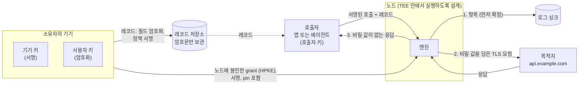
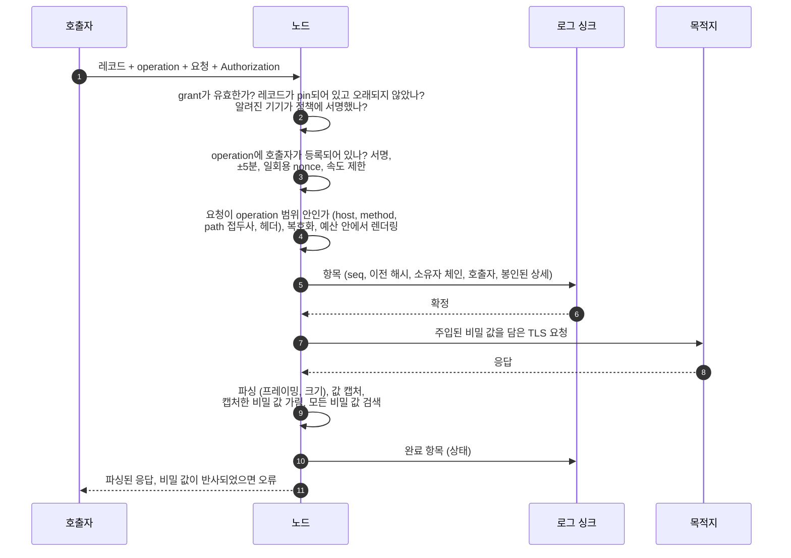
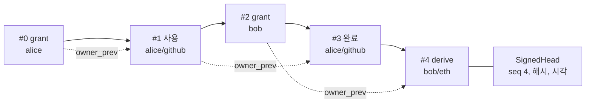

# credentials

[](https://github.com/BloubHQ/credentials/actions/workflows/ci.yml)
[](../../LICENSE)

[English](../../README.md) | **한국어** | [简体中文](README.zh-CN.md) | [日本語](README.ja.md)

애플리케이션과 AI 에이전트가 자격 증명(credential)을 **보지** 않고도 **사용**할 수 있게 해 주는
볼트 엔진입니다. 비밀 값이 정확히 어디로, 어떤 형태로 갈 수 있는지는 소유자의 기기가 서명한 정책으로
정합니다. 노드는 소유자가 허용하는 동안에만 비밀 값을 보관하고, 사용할 때마다 **그 전에**
변조 탐지가 가능한(tamper-evident) 로그 항목을 기록하며, 비밀 값이 들어 있는지 검사를 거친 응답을
호출자에게 돌려줍니다.

```text
caller:  "GET https://api.github.com/user"            (no token)
node:    log entry confirmed  ->  adds "Authorization: Bearer ghp_..."  ->  TLS  ->  GitHub
caller:  200 OK {"login": "octo"}                     (token removed or response dropped)
```

엔진은 자격 증명의 종류를 전혀 알지 못합니다. API 키, OAuth 갱신(refresh), AWS SigV4, HTTP Digest,
JWT 서명, TOTP, IMAP 로그인, 상호 TLS(mutual TLS), Ethereum 서명은 모두 코드가 아니라 정책 데이터입니다.

> **상태: 0.x, 감사받지 않음.** 엔진은 테스트를 거쳤고 내부 검토도 받았지만, 외부 보안 감사는
> 받지 않았으며 형식이 바뀔 수 있습니다. 프로덕션 비밀 값을 맡기기 전에
> [위협 모델](../threat-model.md)을 읽어 보세요.

## 목차

- [동작 방식](#동작-방식)
- [빠른 시작](#빠른-시작)
- [정책](#정책)
- [레코드, 세대, 롤백](#레코드-세대-롤백)
- [로그](#로그)
- [노드 운영](#노드-운영)
- [보장하는 것](#보장하는-것)
- [측정 결과](#측정-결과)
- [하지 않는 것](#하지-않는-것)
- [크레이트](#크레이트) · [개발](#개발) · [보안](#보안) · [라이선스](#라이선스)

## 동작 방식



참여자는 넷이고 키도 네 종류입니다.

| 참여자 | 키 | 하는 일 |
| --- | --- | --- |
| 소유자의 기기 | `DeviceKey` (Ed25519) | 정책, grant(권한 부여), pin, 폐기(revocation), 다른 기기에 서명 |
| 소유자 | `UserKey` (256-bit) | 레코드를 암호화(HKDF로 레코드마다 키 생성). 노드는 grant 기간에만 이 키를 가짐 |
| 호출자 | `CallerKey` (Ed25519) | 호출마다 서명. 어느 호출자가 어느 operation을 실행할 수 있는지는 정책에 명시 |
| 노드 | `NodeKey` (Ed25519) | 로그에 서명. 여기서 파생한 X25519 키로 봉인된 grant를 엶 |

호출 하나가 처리되는 순서입니다. 로그 항목 전의 검사는 아무 흔적도 남기지 않으며, 확정된 항목 없이는
어떤 것도 노드를 떠나지 않습니다.



## 빠른 시작

```sh
git clone https://github.com/BloubHQ/credentials && cd credentials
cargo test --workspace
GITHUB_TOKEN=ghp_... cargo run -p transport --example github_user
```

[`github_user`](../../crates/transport/examples/github_user.rs) 예제는 모든 구성 요소를 한 프로세스에서
실행합니다. 기기가 토큰을 레코드에 봉인하고, `GET https://api.github.com/user`만 허용하는 정책에
서명한 뒤 노드에 grant를 줍니다. 애플리케이션이 호출에 서명하면, 노드는 로그를 남기고 토큰을 주입해
TLS로 요청을 보낸 뒤 응답을 돌려줍니다. 코드로 보면 다음과 같습니다.

```rust
// 소유자의 기기에서.
let policy = device.sign_policy(policy)?;
let record = Record::seal(&user_key, "github", "me", policy, &values)?;
let terms = GrantTerms::new("me", Duration::from_secs(600)).pin(&record);
let grant = device.grant(&user_key, &node.identity(), terms)?;

// 노드에서.
node.grant(&grant)?;

// 애플리케이션에서: 레코드(암호문)와 자신의 호출자 키만 가지며, 토큰은 절대 갖지 않는다.
let body = Body::http(request);
let call = app.sign_call("example", &node.public_key(), record, "github", body)?;

// 노드에서: 로그를 쓰고, 토큰을 넣어 TLS로 보내고, 응답에 토큰이 없는지 검사한다.
let outcome = node.run(&call, &mut TlsTransport::new());
```

## 정책

정책은 레코드의 **필드(fields)**, 그 레코드를 쓸 수 있는 **호출자(callers)**, 그리고 호출자가 실행할 수
있는 **operation(operations)** 을 정의합니다. 정책은 기기가 서명하며, 서명과 레코드 암호화가 모두
정책에 묶여 있으므로 소유자 없이는 누구도 값이 가는 곳을 바꿀 수 없습니다. 전체 레퍼런스는
[docs/policy.md](../policy.md)에 있습니다.

```json
{
  "fields": [
    {"name": "client_id", "secret": false},
    {"name": "client_secret", "secret": true},
    {"name": "refresh_token", "secret": true},
    {"name": "access_token", "secret": true, "optional": true}
  ],
  "callers": [
    {"name": "billing-agent", "key": "<caller public key>",
     "operations": ["refresh", "call"], "limit": {"count": 100, "window_ms": 60000}}
  ],
  "operations": [
    {"kind": "http", "name": "refresh",
     "destinations": [{"host": "auth.example.com", "port": 443}],
     "steps": [{
       "request": {"from": "fixed", "method": "POST", "path": "/oauth/token"},
       "inject": [{"target": {"kind": "body"},
                   "template": "grant_type=refresh_token&refresh_token={{pct(refresh_token)}}&client_id={{pct(client_id)}}&client_secret={{pct(client_secret)}}"}],
       "capture": [{"source": {"from": "json", "pointer": "/access_token"},
                    "into": {"kind": "field", "name": "access_token"}}]
     }]},
    {"kind": "http", "name": "call",
     "destinations": [{"host": "*.api.example.com", "port": 443}],
     "methods": ["GET", "POST"], "paths": ["/v1/"], "caller_headers": ["Accept"],
     "steps": [{"inject": [{"target": {"kind": "header", "name": "Authorization"},
                            "template": "Bearer {{access_token}}"}]}]}
  ]
}
```

| Operation | 하는 일 |
| --- | --- |
| `http` | 1~8개의 step. 각 step은 호출자의 요청이나 정책이 고정한 요청을 보내고, 값을 주입하며, 응답에서 값을 캡처해 필드(새 레코드 세대) 또는 이후 step에서 쓸 임시 값에 넣습니다. 마지막 응답만 돌려줍니다. |
| `stream` | TLS 연결 하나 위에서 send/expect 스크립트를 실행한 뒤(IMAP, SMTP, 라인 기반 프로토콜), 인증된 연결로 호출자의 교환을 이어 갑니다. |
| `derive` | 템플릿의 출력을 호출자에게 돌려줍니다: 서명, HMAC, TOTP 코드, JWT. |

값은 **템플릿**을 통해 들어갑니다: `{{ hex(hmac_sha256(secret, $query)) }}`. 템플릿 언어에는 이름,
변수, 문자열 리터럴, 함수 호출, `+`가 있고 분기나 반복은 없습니다. 정책에 서명하기 전에 모든 템플릿을
분석합니다.

- **오염(taint).** 비밀 값을 되돌릴 수 있는 형태로 담은 값은 *오염(tainted)* 된 것입니다. 인코딩은
  오염을 유지하고, 해시, MAC, 서명, `len`은 오염을 제거합니다. 단, 비밀 값만 해시한 값은 예외입니다. 키를 먼저 해시해서 쓰는 곳(긴 HMAC 키, Ed25519 시드)에서는 키와 같기 때문입니다. 비밀 필드를 키로 한 암호화는 키만
  가립니다. 메시지, nonce, 데이터에 든 비밀 값은 오염된 채로 남습니다. 다른 operation이 같은 키로
  고른 바이트를 암호화할 수 있기 때문입니다. 출력이 오염된 derivation은 거부합니다.
- **오라클.** 비밀 값과, 호출자나 서버가 고르는 값은 결과가 비밀 값을 조금씩 드러내는 곳에서 만날 수
  없습니다: `replace`, `xor`, `json_set`의 키, 디코더, 숫자나 키 인자. `len(replace(key, $input, ""))`는
  거부합니다.
- **추측 가능한 필드.** derivation은 `guessable`로 표시한 필드(PIN, 비밀번호)에 `len`을 통해서만
  의존할 수 있습니다. 그 필드의 해시, 서명, MAC, 암호문은 모두 호출자가 추측을 대조하는 데 쓸 수
  있습니다.
- **예산(budget).** operation 하나가 렌더링할 수 있는 양은 최대 128 MiB, PBKDF2 1,000,000 라운드,
  서명 32개입니다.

| 자격 증명 | 정책 |
| --- | --- |
| Bearer 토큰, 쿠키, API 키 | 헤더 템플릿 하나 |
| Telegram 봇 | `/bot{token}/getMe`의 `path_param` `{{token}}` |
| 거래소 HMAC 서명 | 쿼리 `signature` = `{{ hex(hmac_sha256(secret, $query)) }}` |
| AWS SigV4 | 헤더 템플릿 두 개(`time`, `canonical_query`, 중첩 `hmac_sha256`). 공식 벡터를 재현하는 테스트 있음 |
| HTTP Digest | step 1에서 `header_param`으로 `realm`/`nonce`를 캡처, step 2에서 `md5`로 응답. RFC 2617 벡터 |
| OAuth 갱신 | `fixed` POST, `json` 캡처를 필드로: 노드가 새 레코드를 돌려줌 |
| 세션 로그인 | `fixed` POST /login, `cookie` 캡처를 임시 값으로, 호출자 요청에 `Cookie` |
| JWT RS256 | derive `b64urlraw(header) + "." + b64urlraw($input) + "." + b64urlraw(rsa_sign_pkcs1_sha256(pem(key), …))` |
| Ethereum | derive `{{ k256_sign_recoverable(key, keccak256($input)) }}` |
| IMAP | stream: 인사말 expect, `a1 LOGIN {{user}} {{password}}` send, expect, 중계 |
| TOTP | derive `{{ totp(b32decode(seed)) }}` |
| 상호 TLS | `"identity": {"cert": "{{cert}}", "key": "{{key}}"}` |

## 레코드, 세대, 롤백

레코드는 필드들을 사용자 키와 레코드 id에서 파생한 키로 ChaCha20-Poly1305 암호화한 것이며, id, 소유자,
**세대(generation)**, 서명된 정책을 연관 데이터(associated data)에 넣습니다. 다시 봉인할 때마다
세대가 1씩 늘어납니다.


노드는 소유자가 pin하지 않은 레코드(grant 안에서 또는 `DeviceKey::pin`으로)를 거부하고, 자신이 본
가장 새로운 세대나 소유자가 pin한 세대보다 오래된 세대도 거부합니다. grant가 pin을 담고 있으므로, 더
새로운 레코드를 본 적 없는 새 노드라도 옛 레코드를 거부합니다.

## 로그

각 항목은 노드가 서명하며 두 겹으로 체인됩니다. 바로 앞 항목에, 그리고 같은 소유자의 이전 항목에
연결됩니다. 소유자는 다른 소유자의 항목 없이 자신의 항목만 검증할 수 있고, 서명된 체크포인트
(`SignedHead`)가 head를 고정하므로 꼬리가 잘리면 드러납니다.



항목에는 누가 어떤 레코드를 언제, 어떤 호출자로, 어떤 operation에 썼는지가 나타납니다. 값이 **어디로**
갔고 무엇이 전송되었는지(host, path, body 해시)는 소유자의 사용자 키로 봉인됩니다. 로그 저장소는 이를
읽을 수 없고 소유자는 읽을 수 있습니다(`log::open_detail`, 또는
`credentials verify --owner alice --user-key key.txt`). 노드는 확정된 항목 없이는 절대 동작하지 않습니다. transport
함수들은 `Confirmed`를 인자로 받는데, 이 값은 싱크가 `Ok`를 반환한 뒤 `Log::commit`만 만들 수 있습니다.
싱크가 실패하면 로그는 조정(reconcile)될 때까지 멈춥니다.

```sh
credentials verify log.jsonl <node-public-key>                   # the whole chain
credentials verify log.jsonl <node-public-key> --head head.json  # must end at a signed checkpoint
credentials verify log.jsonl <node-public-key> --owner alice     # one owner's chain
credentials verify log.jsonl <node-public-key> --owner alice --user-key key.txt   # with the details
```

## 노드 운영

- **Transport.** `transport::TlsTransport` (ring provider를 쓰는 rustls, Mozilla 루트 인증서,
  클라이언트 인증서, connect/read/total 기한, 크기 제한). 연결을 소유자가 서명한 host에 묶는 것은
  목적지의 인증서이며, DNS는 신뢰하지 않습니다.
- **Zeroizing 할당자.** 노드를 실행하는 바이너리에 설치해서, 엔진이 손댈 수 없는 의존성의 버퍼(TLS
  레코드, 파싱된 RSA 키)가 해제될 때 지워지게 하세요.

  ```rust
  #[global_allocator]
  static ALLOCATOR: zeroizing_alloc::ZeroAlloc<std::alloc::System> =
      zeroizing_alloc::ZeroAlloc(std::alloc::System);
  ```

  측정 결과: 서명 하나당 해제된 메모리에 남는 RSA 키 사본이 1개에서 0개로 줄고, 시간은 3–12% 더
  걸립니다(아래 표).
- **증명(attestation).** 노드를 TEE(신뢰 실행 환경: SGX, TDX, SEV-SNP, Nitro) 안에서 실행하세요.
  `NodeIdentity::report_data()`(로그 키와 봉인 키에 대한 SHA-512)를 quote의 report data에 넣으면,
  소유자는 grant를 봉인하기 전에 quote와 그 값을 확인합니다. quote 검증은 플랫폼마다 다르며 이
  저장소에는 없습니다.
- **키와 재시작.** `NodeKey::to_bytes()`는 enclave에 봉인해 보관하세요. 재시작 후
  `Node::restore(key, sink, clock, entries)`가 체인을 이어 가고 레코드 하한(floor), 알려진 기기, 마지막
  grant 시각을 복원합니다. 소유자는 grant를 다시 주며, 재시작 전에 발급되거나 서명된 것은 받지
  않습니다. `Node::checkpoint()`는 운영자가 되돌릴 수 없는 곳(봉인 저장소, 단조 카운터)에 두고
  `Node::restore_anchored`로 재시작하세요. 잘린 로그를 거부합니다.
- **명령줄과 서버.** [`credentials`](../../crates/cli)로 키 생성, 정책 서명, 레코드 봉인, grant와 서명된
  호출 생성을 할 수 있고, `credentials serve`는 내구성 있는 JSONL 로그와 함께 HTTP로 노드를
  실행합니다.
- **동시성.** 모든 메서드가 `&self`를 받으므로 노드 하나를 여러 스레드가 공유하면 됩니다. Transport
  I/O는 노드의 락 밖에서 실행됩니다.

## 보장하는 것

- 비밀 값은 확정된 로그 항목이 생긴 뒤, `Transport`를 통해, 소유자가 서명한 목적지로 가는 요청 하나의
  바이트로서만 엔진을 떠납니다.
- `Secret` 값은 출력, 복제, 직렬화할 수 없고 drop될 때 지워집니다. 크레이트 밖의 코드는 이 값을 읽을
  수 없습니다(`compile_fail` doc 테스트).
- 정책에 등록된 호출자가, 바로 이 호출에 대한 새 일회용 서명을 가지고, 속도 제한 안에서만 operation을
  실행할 수 있습니다.
- grant는 봉인 대상이 된 노드에서만, 노드가 해당 소유자의 기기로 알고 있는 기기에서 온 것만 열리며(첫
  사용은 신뢰), 재전송할 수 없습니다. 폐기에는 알려진 기기가 필요합니다.
- 레코드는 pin이나 노드가 본 세대보다 이전으로 롤백될 수 없습니다.
- 템플릿은 서명 전에 분석됩니다. derivation은 비밀 값, 비밀 값에 대한 오라클, 추측 가능한 필드의
  추측을 확인하는 수단을 돌려줄 수 없습니다.
- 응답은 엄격하게 파싱되고(프레이밍, 인코딩, 크기), 캡처된 비밀 값은 가려지며, 알려진 형태의 비밀
  값이 하나라도 남아 있는 응답은 버려집니다.
- 로그는 추가 전용(append-only)이고, 서명되며, 노드별·소유자별로 체인되고, 오프라인으로 검증할 수
  있습니다.
- 엔진에는 `unsafe`도, `unwrap`/`expect`/`panic`/인덱싱도 없습니다(lint로 강제).

## 측정 결과

한 대의 머신에서 릴리스 빌드로 측정했습니다. 공격 사례는 내부 검토에서 쓴 프로브를 이전 코드
(`79a21c1`)와 현재 코드에 실행한 것이며, 메모리는 계측용 할당자로 잰 최대치입니다.

| 사례 | 이전 | 현재 |
| --- | --- | --- |
| 64 KiB 캡처 토큰 + 8 MiB 응답 (가림과 검색) | 63.88 s | 0.08–0.10 s |
| 16 KiB 토큰 + 4 MiB 응답 | 6.34 s | 0.07 s |
| 1 MiB 입력에 템플릿 연결 ×401 | 수락됨, 803 MiB | `Budget` 오류, 129 MiB |
| PBKDF2 1,000,000 라운드 ×127 | 12.70 s | 0.09 s 후 `Budget` 오류 |
| 64 MiB 응답 | 1.81 s 후 그대로 통과 | 0.02 s 후 거부 |
| pointer 캡처를 쓰는 16 MiB JSON 배열 | 400 MiB | 64 MiB |
| 16 MiB 헤더 | 192 MiB | 0 MiB (64 KiB에서 거부) |
| 16 MiB body를 임시 값 16개에 캡처 | 768 MiB | 32 MiB (64 KiB에서 거부) |
| 비밀 값이 남아 있는 해제된 블록 (json 캡처, `b64decode`, `json`, `replace`, `json_set`) | 1, 8, 1, 1, 1 | 0, 0, 0, 0, 0 |
| RSA 개인 키가 남아 있는 해제된 블록, 서명당 | 1 | 1 (zeroizing 할당자 사용 시 0) |
| P-384 개인 키가 남아 있는 해제된 블록 | 0 | 0 |

| 처리량 (계측용 할당자 사용) | 시스템 할당자 | Zeroizing 할당자 |
| --- | --- | --- |
| HMAC derivation 2,000회 | 0.29–0.30 s | 0.31 s |
| RSA-2048 서명 200회 | 0.129–0.130 s | 0.130–0.136 s |
| 64 KiB 응답의 HTTP 호출 1,000회 | 0.329 s | 0.338–0.369 s |

ring의 대안으로 RustCrypto `rsa` 0.10도 측정했습니다. 서명 하나당 소수 `p`를 담은 해제된 블록이
11개 남았으므로(키를 파싱하고 검사하는 동안 생기는 임시 값), ring을 유지합니다.

## 하지 않는 것

아래는 빠진 코드가 아니라 설계상의 한계입니다. 각 항목은 [위협 모델](../threat-model.md)에서
설명합니다.

- **이 저장소에는 TEE가 없습니다.** 여기서 노드는 평범한 프로세스이며, 증명은 플랫폼 통합의 몫입니다
  ([노드 운영](#노드-운영) 참고). TEE 없이는 노드를 실행하는 사람이 그 메모리를 읽을 수 있습니다.
- **반사 검색은 알려진 인코딩만 찾습니다**: 원본(raw), base64(두 알파벳 모두), 퍼센트, JSON, hex,
  그리고 이스케이프된 JSON 문자열. 서버가 되돌려 보내는 비밀 값을 쪼개거나, 자기 방식으로 압축하거나,
  암호화하면 잡아내지 못합니다. 4~7바이트인 비밀 필드는 원본 형태로만 검색하며, 그 바이트가 우연히
  나타나면 응답을 버립니다.
- **응답은 버퍼링됩니다**(최대 16 MiB). 검색에 응답 전체가 필요하기 때문입니다.
- **서버가 캡처용으로 보내는 값은 서버의 것입니다.** 서버가 키를 돌려주고 정책이 그것을 키로 쓰면,
  서버는 그 키를 압니다.
- **엔트로피가 낮은 비밀 값**이라도 `guessable`로 표시하지 않으면 강한 키로 취급합니다.
- **첫 사용은 신뢰합니다**: 노드에서 어떤 소유자에 대한 첫 grant가 그 소유자의 기기를 결정합니다.
  모든 기기를 잃은 소유자는 새 소유자 이름으로 시작해야 합니다.
- **Stream 세션**은 호출과 함께 끝납니다. SSH, 데이터베이스 와이어 프로토콜, gRPC, WebSocket
  프레이밍은 send/expect 스크립트로 가능한 범위까지만 동작합니다.
- **브라우저 로그인, 푸시 2FA, 하드웨어 키**는 사람이나 기기가 필요하므로 위임할 수 없습니다.

## 크레이트

| 크레이트 | |
| --- | --- |
| [`engine`](../../crates/engine) | 비밀 값, 정책, 템플릿, 레코드, grant, 호출자, 로그, 응답, 노드 |
| [`transport`](../../crates/transport) | TLS transport (rustls), 그리고 엔드투엔드 예제 |
| [`verify`](../../crates/verify) | 노드 로그 검증기, `credentials verify`로 실행 |
| [`cli`](../../crates/cli) | `credentials` 도구: 키, 정책, 레코드, grant, 호출, 노드 서버 |

## 개발

```sh
cargo fmt --all --check
cargo clippy --workspace --all-targets --locked -- -D warnings
cargo test --workspace --locked
```

최소 Rust 버전: 1.87. CI는 `cargo audit`, `cargo deny`, MSRV 테스트, 재현 가능 빌드 검사, 대상별 60초 퍼징도 실행합니다.
[CONTRIBUTING.md](../../.github/CONTRIBUTING.md)를 참고하세요.

## 보안

취약점은 [SECURITY.md](../../.github/SECURITY.md)에 설명된 대로 비공개로 제보해 주세요.

## 라이선스

[Apache License 2.0](../../LICENSE).
